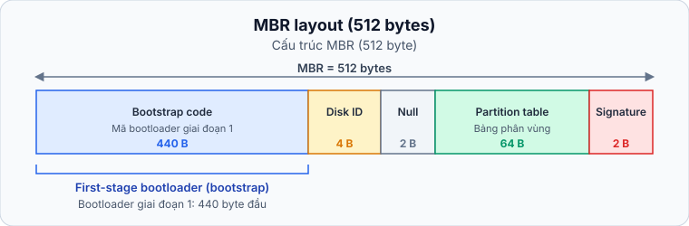
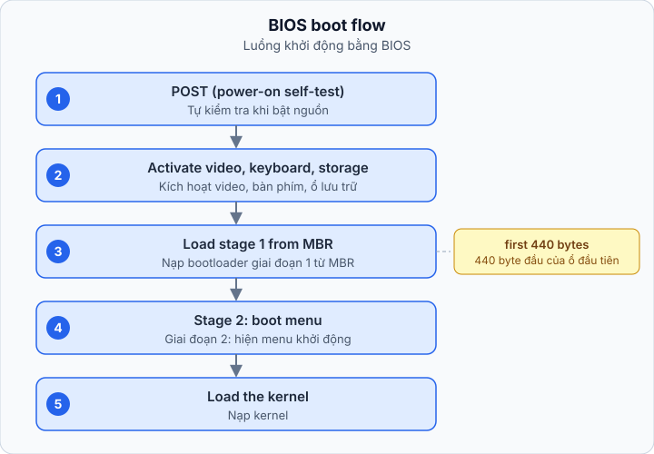
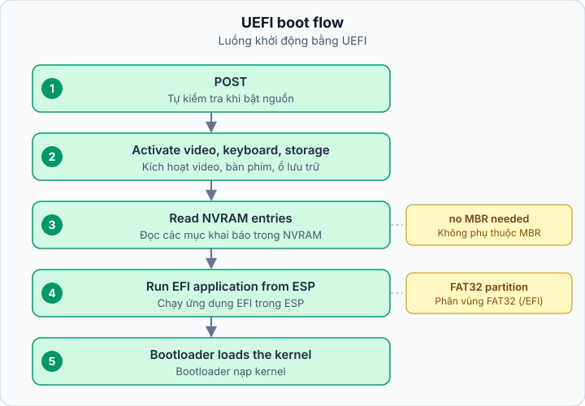
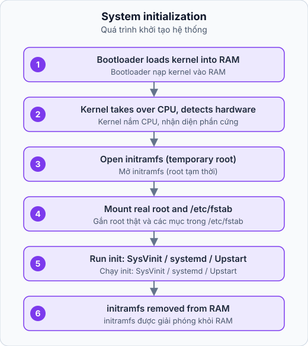

# 101.2 Boot the system

!!! abstract "Exam objective / Mục tiêu bài thi"
    EN: **LPIC-1 v5, Exam 101, Objective 101.2** (weight: 3).
    VI: **LPIC-1 v5, Exam 101, Objective 101.2** (trọng số: 3).

## Key Knowledge Areas / Kiến thức trọng tâm

- EN: Provide common commands to the boot loader and options to the kernel at boot time.
  VI: Nắm các lệnh phổ biến của bootloader và các tuỳ chọn truyền cho kernel khi khởi động.
- EN: Demonstrate knowledge of the boot sequence from BIOS/UEFI to boot completion.
  VI: Hiểu trình tự khởi động từ BIOS/UEFI cho đến khi khởi động hoàn tất.
- EN: Understanding of SysVinit and systemd.
  VI: Hiểu về SysVinit và systemd.
- EN: Awareness of Upstart.
  VI: Biết về Upstart.
- EN: Check boot events in the log files.
  VI: Kiểm tra các sự kiện khởi động trong file log.

## Files, Terms and Utilities / Tệp, thuật ngữ và tiện ích

```text
dmesg
journalctl
BIOS
UEFI
bootloader
kernel
initramfs
init
SysVinit
systemd
```

---

## Overview / Tổng quan

EN: The kernel must be loaded by a **bootloader**, which is itself loaded by firmware (**BIOS** or **UEFI**).
VI: Kernel được nạp bởi **bootloader**, còn bootloader lại được nạp bởi firmware (**BIOS** hoặc **UEFI**).

EN: The bootloader can pass parameters to the kernel, e.g. which partition holds the root filesystem or which mode to run in.
VI: Bootloader có thể truyền tham số cho kernel, ví dụ: phân vùng nào chứa root filesystem hoặc chạy ở chế độ nào.

EN: The kernel then identifies and configures hardware, and finally calls the program that starts and manages services (`init`).
VI: Sau đó kernel nhận diện và cấu hình phần cứng, cuối cùng gọi chương trình khởi chạy và quản lý dịch vụ (`init`).

!!! note "Note / Ghi chú"
    EN: Some commands may require root privileges.
    VI: Một số lệnh có thể cần quyền root.

---

## BIOS Boot / Khởi động bằng BIOS

- EN: BIOS (Basic Input/Output System) is firmware stored in a non-volatile chip on the motherboard, executed every time the machine is powered on.
  VI: BIOS (Basic Input/Output System) là firmware lưu trong chip không mất dữ liệu trên bo mạch chủ, được thực thi mỗi lần bật máy.
- EN: BIOS treats the **first 440 bytes** of the first storage device (order set in the BIOS configuration utility) as the **first stage of the bootloader** (bootstrap).
  VI: BIOS coi **440 byte đầu tiên** của thiết bị lưu trữ đầu tiên (thứ tự đặt trong chương trình cấu hình BIOS) là **giai đoạn đầu của bootloader** (bootstrap).
- EN: The first **512 bytes** of a device using the DOS partition scheme are the **MBR (Master Boot Record)**: first-stage bootloader + partition table.
  VI: **512 byte đầu tiên** của thiết bị dùng sơ đồ phân vùng DOS là **MBR (Master Boot Record)**, gồm bootloader giai đoạn 1 và bảng phân vùng.
- EN: If the MBR is incorrect, the system cannot boot (unless an alternative method is used).
  VI: Nếu MBR bị lỗi, hệ thống không thể khởi động (trừ khi dùng phương pháp khác).



### BIOS Boot Steps / Các bước khởi động BIOS

1. EN: **POST** (power-on self-test) runs to detect simple hardware failures.
   VI: **POST** (tự kiểm tra khi bật nguồn) chạy để phát hiện các lỗi phần cứng đơn giản.
2. EN: BIOS activates basic components (video output, keyboard, storage media).
   VI: BIOS kích hoạt các thành phần cơ bản (xuất hình ảnh, bàn phím, thiết bị lưu trữ).
3. EN: BIOS loads the first stage of the bootloader from the MBR (first 440 bytes of the first device).
   VI: BIOS nạp giai đoạn đầu của bootloader từ MBR (440 byte đầu của thiết bị đầu tiên).
4. EN: The first stage calls the second stage, which presents boot options and loads the kernel.
   VI: Giai đoạn 1 gọi giai đoạn 2, giai đoạn này hiển thị tuỳ chọn khởi động và nạp kernel.



---

## UEFI Boot / Khởi động bằng UEFI

- EN: UEFI (Unified Extensible Firmware Interface) is also firmware, but it can identify partitions and read many filesystems.
  VI: UEFI (Unified Extensible Firmware Interface) cũng là firmware, nhưng nhận diện được phân vùng và đọc được nhiều hệ thống tệp.
- EN: UEFI does **not** rely on the MBR; it uses settings stored in **NVRAM** on the motherboard.
  VI: UEFI **không** phụ thuộc vào MBR mà dùng các thiết lập lưu trong **NVRAM** trên bo mạch chủ.
- EN: These settings point to **EFI applications** (bootloaders, OS selectors, diagnostic/repair tools, etc.) that run automatically or from a boot menu.
  VI: Các thiết lập này trỏ tới **ứng dụng EFI** (bootloader, trình chọn hệ điều hành, công cụ chẩn đoán/sửa lỗi, v.v.), chạy tự động hoặc qua menu khởi động.
- EN: EFI applications must be on a conventional partition with a compatible filesystem: **FAT12, FAT16, FAT32** for block devices, **ISO-9660** for optical media.
  VI: Ứng dụng EFI phải nằm trên phân vùng thông thường có hệ tệp tương thích: **FAT12, FAT16, FAT32** cho block device, **ISO-9660** cho đĩa quang.
- EN: The partition holding EFI applications is the **EFI System Partition (ESP)**. It must not be shared with other system filesystems (root, user data).
  VI: Phân vùng chứa ứng dụng EFI là **EFI System Partition (ESP)**. Phân vùng này không được dùng chung với các hệ tệp khác của hệ thống (root, dữ liệu người dùng).
- EN: The `EFI` directory in the ESP contains the applications pointed to by NVRAM entries.
  VI: Thư mục `EFI` trong ESP chứa các ứng dụng mà các mục NVRAM trỏ tới.

### UEFI Boot Steps / Các bước khởi động UEFI

1. EN: **POST** runs.
   VI: **POST** chạy.
2. EN: UEFI activates basic components (video, keyboard, storage media).
   VI: UEFI kích hoạt các thành phần cơ bản (hình ảnh, bàn phím, thiết bị lưu trữ).
3. EN: Firmware reads NVRAM definitions and executes the pre-defined EFI application stored in the ESP (usually a bootloader).
   VI: Firmware đọc các khai báo trong NVRAM và chạy ứng dụng EFI đã định sẵn trong ESP (thường là bootloader).
4. EN: If it is a bootloader, it loads the kernel to start the operating system.
   VI: Nếu đó là bootloader, nó nạp kernel để khởi động hệ điều hành.



### Secure Boot / Khởi động an toàn

EN: **Secure Boot** is a UEFI feature that only allows execution of **signed** EFI applications (authorized by the hardware manufacturer).
VI: **Secure Boot** là tính năng của UEFI chỉ cho phép chạy các ứng dụng EFI **có chữ ký số** (được nhà sản xuất phần cứng uỷ quyền).

!!! warning "Watch out / Dễ nhầm"
    EN: It protects against malicious software but can make installing unsigned operating systems difficult.
    VI: Tính năng này chống phần mềm độc hại nhưng cũng gây khó khăn khi cài hệ điều hành không có chữ ký số.

---

## The Bootloader (GRUB) / Bộ nạp khởi động (GRUB)

- EN: **GRUB** (Grand Unified Bootloader) is the most popular Linux bootloader on x86.
  VI: **GRUB** (Grand Unified Bootloader) là bootloader Linux phổ biến nhất trên x86.
- EN: When called by BIOS/UEFI it displays a list of bootable operating systems.
  VI: Khi được BIOS/UEFI gọi, GRUB hiển thị danh sách các hệ điều hành có thể khởi động.
- EN: If the list does not appear, press **Shift** (BIOS) or **Esc** (UEFI) while GRUB is being called.
  VI: Nếu danh sách không xuất hiện, nhấn **Shift** (BIOS) hoặc **Esc** (UEFI) khi GRUB được gọi.
- EN: From the GRUB menu you can choose the kernel to load and pass new parameters to it. Most kernel parameters follow the pattern `option=value`.
  VI: Từ menu GRUB có thể chọn kernel để nạp và truyền tham số mới cho nó. Hầu hết tham số kernel có dạng `option=value`.

### Common Kernel Parameters / Các tham số kernel thường dùng

| Parameter | Description (EN) | Mô tả (VI) |
|---|---|---|
| `acpi` | Enables/disables ACPI support. `acpi=off` disables ACPI. | Bật/tắt hỗ trợ ACPI. `acpi=off` tắt ACPI. |
| `init` | Sets an alternative system initiator. `init=/bin/bash` starts a Bash shell right after kernel boot. | Đặt trình khởi tạo hệ thống thay thế. `init=/bin/bash` chạy shell Bash ngay sau khi kernel khởi động. |
| `systemd.unit` | Sets the systemd target to activate, e.g. `systemd.unit=graphical.target`. Also accepts SysV runlevels: add `1` or `S` (single) for runlevel 1. | Đặt target của systemd cần kích hoạt, ví dụ `systemd.unit=graphical.target`. Cũng nhận runlevel SysV: thêm `1` hoặc `S` (single) cho runlevel 1. |
| `mem` | Sets the amount of available RAM (useful for VMs). `mem=512M` limits RAM to 512 MB. | Đặt dung lượng RAM khả dụng (hữu ích cho máy ảo). `mem=512M` giới hạn RAM ở 512 MB. |
| `maxcpus` | Limits the number of CPUs/cores visible to the system (SMP). `maxcpus=2` limits to two; `0` disables multi-processor support, same as `nosmp`. | Giới hạn số CPU/nhân hiển thị với hệ thống (SMP). `maxcpus=2` giới hạn hai nhân; `0` tắt đa bộ xử lý, giống `nosmp`. |
| `quiet` | Hides most boot messages. | Ẩn phần lớn thông báo khởi động. |
| `vga` | Selects a video mode. `vga=ask` shows a list of available modes. | Chọn chế độ hiển thị video. `vga=ask` hiện danh sách các chế độ khả dụng. |
| `root` | Sets the root partition, different from the one pre-configured in the bootloader, e.g. `root=/dev/sda3`. | Đặt phân vùng root khác với phân vùng đã cấu hình sẵn trong bootloader, ví dụ `root=/dev/sda3`. |
| `rootflags` | Mount options for the root filesystem. | Các tuỳ chọn mount cho root filesystem. |
| `ro` | Makes the initial mount of the root filesystem read-only. | Gắn root filesystem ở chế độ chỉ đọc lúc đầu. |
| `rw` | Allows writing to the root filesystem during initial mount. | Cho phép ghi vào root filesystem khi gắn lúc đầu. |

!!! tip "Exam tip / Mẹo thi"
    EN: A wrong root partition is fixed at the GRUB menu by passing `root=/dev/sda3` to the kernel.
    VI: Khi chỉ định sai phân vùng root, sửa ngay tại menu GRUB bằng cách truyền `root=/dev/sda3` cho kernel.

### Making Kernel Parameters Persistent / Lưu tham số kernel lâu dài

- EN: Add parameters to the `GRUB_CMDLINE_LINUX` line in `/etc/default/grub`.
  VI: Thêm tham số vào dòng `GRUB_CMDLINE_LINUX` trong `/etc/default/grub`.

```shell title="Ví dụ /etc/default/grub trên Fedora"
$ cat /etc/default/grub
GRUB_TIMEOUT=5
GRUB_DISTRIBUTOR="$(sed 's, release .*$,,g' /etc/system-release)"
GRUB_DEFAULT=saved
GRUB_DISABLE_SUBMENU=true
GRUB_TERMINAL_OUTPUT="console"
GRUB_CMDLINE_LINUX="rhgb quiet rd.driver.blacklist=nouveau,nova_core modprobe.blacklist=nouveau,nova_core"
GRUB_DISABLE_RECOVERY="true"
GRUB_ENABLE_BLSCFG=true
```

- EN: Regenerate the bootloader configuration every time `/etc/default/grub` changes.
  VI: Tạo lại cấu hình bootloader mỗi khi `/etc/default/grub` thay đổi.

=== "Debian/Ubuntu"

    ```shell
    # grub-mkconfig -o /boot/grub/grub.cfg
    ```

=== "RHEL/Fedora"

    ```shell
    # grub2-mkconfig -o /boot/grub2/grub.cfg
    ```

- EN: Once the system is running, the parameters used for the current boot are readable in `/proc/cmdline`.
  VI: Khi hệ thống đang chạy, các tham số dùng cho lần khởi động hiện tại đọc được trong `/proc/cmdline`.

```shell
$ cat /proc/cmdline
BOOT_IMAGE=/vmlinuz-6.8.0 root=/dev/sda3 ro quiet
```

---

## System Initialization / Khởi tạo hệ thống

1. EN: The bootloader loads the **kernel** into RAM.
   VI: Bootloader nạp **kernel** vào RAM.
2. EN: The kernel takes charge of the CPU and detects/sets up fundamental aspects (basic hardware configuration, memory addressing).
   VI: Kernel nắm quyền điều khiển CPU và phát hiện/thiết lập các thành phần nền tảng (cấu hình phần cứng cơ bản, đánh địa chỉ bộ nhớ).
3. EN: The kernel opens the **initramfs** (initial RAM filesystem): an archive containing a filesystem used as a **temporary root filesystem** during boot.
   VI: Kernel mở **initramfs** (initial RAM filesystem): một tệp lưu trữ chứa hệ tệp, dùng làm **root filesystem tạm thời** trong lúc khởi động.
4. EN: The main purpose of initramfs is to provide the modules the kernel needs to access the "real" root filesystem.
   VI: Mục đích chính của initramfs là cung cấp các module mà kernel cần để truy cập root filesystem "thật".
5. EN: Once the real root filesystem is available, the kernel mounts all filesystems configured in `/etc/fstab` and executes the first program, **`init`**.
   VI: Khi root filesystem thật sẵn sàng, kernel mount mọi hệ tệp khai báo trong `/etc/fstab` và chạy chương trình đầu tiên, **`init`**.
6. EN: `init` runs all initialization scripts and system daemons. Implementations: traditional **SysVinit**, **systemd**, **Upstart**.
   VI: `init` chạy toàn bộ script khởi tạo và các daemon hệ thống. Các bản triển khai: **SysVinit** truyền thống, **systemd**, **Upstart**.
7. EN: Once `init` is loaded, the initramfs is removed from RAM.
   VI: Khi `init` đã được tải xong, initramfs bị xoá khỏi RAM.



!!! warning "Watch out / Dễ nhầm"
    EN: A custom kernel without a matching initramfs may fail to access root if its filesystem driver is built as an external module.
    VI: Kernel tự biên dịch mà thiếu initramfs phù hợp có thể không truy cập được root nếu driver hệ tệp được build thành module ngoài.

### SysVinit / Trình khởi tạo SysVinit

- EN: Service manager based on **runlevels**, numbered **0 to 6**, defined by distribution maintainers.
  VI: Trình quản lý dịch vụ dựa trên **runlevel** đánh số **0 đến 6**, do đội phát triển từng bản phân phối định nghĩa.
- EN: The only runlevels with the same meaning across all distributions are **0, 1 and 6**.
  VI: Các runlevel có ý nghĩa giống nhau trên mọi bản phân phối chỉ gồm **0, 1 và 6**.

### systemd / Trình quản lý hệ thống systemd

- EN: Modern system and service manager with a compatibility layer for SysV commands and runlevels.
  VI: Trình quản lý hệ thống và dịch vụ hiện đại, có lớp tương thích với lệnh và runlevel của SysV.
- EN: Concurrent structure; uses sockets and D-Bus for service activation, on-demand daemon execution, process monitoring with **cgroups**, snapshot support, system session recovery, mount point control, and dependency-based service control.
  VI: Kiến trúc xử lý đồng thời; dùng socket và D-Bus để kích hoạt dịch vụ, chạy daemon theo yêu cầu, giám sát tiến trình bằng **cgroups**, hỗ trợ snapshot, khôi phục phiên hệ thống, kiểm soát mount point và kiểm soát dịch vụ theo phụ thuộc.
- EN: Default system manager on most major distributions.
  VI: Là trình quản lý hệ thống mặc định của hầu hết các bản phân phối lớn.

### Upstart / Trình khởi tạo Upstart

- EN: Replacement for `init`, focused on speeding up boot by parallelizing the loading of services.
  VI: Thay thế cho `init`, tập trung tăng tốc khởi động bằng cách nạp các dịch vụ song song.
- EN: Used by Ubuntu-based distributions in past releases; replaced by systemd.
  VI: Từng được các bản phân phối dựa trên Ubuntu sử dụng ở các bản phát hành trước, nay đã bị systemd thay thế.

---

## Boot Logs / Kiểm tra log khởi động

### dmesg / Lệnh dmesg

- EN: The **kernel ring buffer** is the memory where the kernel stores its messages, including boot messages.
  VI: **Kernel ring buffer** là vùng nhớ nơi kernel lưu các thông báo, trong đó có thông báo khởi động.
- EN: Messages are kept even when not displayed during boot (e.g. splash animation), but are **lost when the system is turned off** or when `dmesg --clear` is run.
  VI: Thông báo vẫn được giữ dù không hiển thị lúc khởi động (ví dụ khi có hoạt ảnh splash), nhưng sẽ **mất khi tắt máy** hoặc khi chạy `dmesg --clear`.
- EN: `dmesg` without options displays current kernel ring buffer messages. Numbers at the beginning of each line are **seconds since kernel load began**.
  VI: `dmesg` không kèm tuỳ chọn hiển thị các thông báo hiện có. Số ở đầu mỗi dòng là **số giây tính từ lúc kernel bắt đầu được nạp**.
- EN: `dmesg -H` / `dmesg --human` enables the pager by default.
  VI: `dmesg -H` / `dmesg --human` bật pager theo mặc định.

```shell
$ dmesg
[    5.262389] EXT4-fs (sda1): mounted filesystem with ordered data mode. Opts: (null)
[    5.460286] systemd[1]: systemd 237 running in system mode.
[    5.480138] systemd[1]: Detected architecture x86-64.
```

### journalctl / Lệnh journalctl

- EN: On systemd systems, shows initialization messages with options `-b`, `--boot`, `-k` or `--dmesg`.
  VI: Trên hệ thống systemd, hiển thị thông báo khởi tạo với các tuỳ chọn `-b`, `--boot`, `-k` hoặc `--dmesg`.
- EN: `journalctl --list-boots` lists boot numbers (relative to the current boot), identification hash, and timestamps of the first and last messages.
  VI: `journalctl --list-boots` liệt kê số thứ tự lần khởi động (tương đối so với lần hiện tại), mã băm định danh và thời điểm của thông báo đầu tiên và cuối cùng.

```shell
$ journalctl --list-boots
 -1 55c0d9439bfb4e85a20a62776d0dbb4d Thu 2019-10-03 19:27:53 -03—Fri 2019-10-04 00:28:47 -03
  0 08fbbebd9f964a74b8a02bb27b200622 Fri 2019-10-04 00:31:01 -03—Fri 2019-10-04 10:17:01 -03
```

- EN: Previous boot logs are kept on systemd systems:
  VI: Log của các lần khởi động trước được giữ lại trên hệ thống systemd:
    - EN: `-b 0` / `--boot=0`: current boot
      VI: `-b 0` / `--boot=0`: lần khởi động hiện tại
    - EN: `-b -1` / `--boot=-1`: previous boot
      VI: `-b -1` / `--boot=-1`: lần khởi động trước
    - EN: `-b -2` / `--boot=-2`: the boot before that, and so on
      VI: `-b -2` / `--boot=-2`: lần trước nữa, và cứ thế tiếp tục


```shell
$ journalctl -b 0
oct 04 00:31:01 ubuntu-host kernel: EXT4-fs (sda1): mounted filesystem with ordered data mode. Opts: (null)
oct 04 00:31:01 ubuntu-host systemd[1]: systemd 237 running in system mode.
oct 04 00:31:01 ubuntu-host systemd[1]: Detected architecture x86-64.
```

### Common journalctl Options / Các tuỳ chọn journalctl hay dùng

| Option | Description (EN) | Mô tả (VI) |
|---|---|---|
| `-b`, `--boot` | Show messages from a boot: `-b` (current), `-b -1` (previous), `-b -2`, ... | Xem thông báo của một lần khởi động: `-b` (hiện tại), `-b -1` (trước đó), `-b -2`, ... |
| `--list-boots` | List recorded boots with number, ID hash and first/last timestamps. | Liệt kê các lần khởi động đã ghi, kèm số thứ tự, mã băm và thời điểm đầu/cuối. |
| `-k`, `--dmesg` | Show only kernel messages (like `dmesg`). | Chỉ hiện thông báo của kernel (giống `dmesg`). |
| `-D`, `--directory=DIR` | Read journal files from another directory instead of `/var/log/journal/`. | Đọc file journal từ thư mục khác thay vì `/var/log/journal/`. |
| `-u`, `--unit=UNIT` | Show messages of a specific unit, e.g. `-u sshd.service`. | Chỉ hiện thông báo của một unit cụ thể, ví dụ `-u sshd.service`. |
| `-p`, `--priority=LEVEL` | Filter by priority: `emerg`(0), `alert`(1), `crit`(2), `err`(3), `warning`(4), `notice`(5), `info`(6), `debug`(7). Shows that level and more severe. | Lọc theo mức ưu tiên: `emerg`(0), `alert`(1), `crit`(2), `err`(3), `warning`(4), `notice`(5), `info`(6), `debug`(7). Hiện mức đó và các mức nghiêm trọng hơn. |
| `-f`, `--follow` | Follow new messages in real time. | Theo dõi thông báo mới theo thời gian thực. |
| `-n`, `--lines=N` | Show only the last N lines (default 10). | Chỉ hiện N dòng cuối (mặc định 10). |
| `-e`, `--pager-end` | Jump to the end of the output in the pager. | Nhảy tới cuối kết quả trong pager. |
| `-r`, `--reverse` | Show newest entries first. | Hiện các mục mới nhất trước. |
| `--since`, `--until` | Limit by time, e.g. `--since "2 hours ago"` or `--since "2026-11-20 08:00"`. | Giới hạn theo thời gian, ví dụ `--since "2 hours ago"` hoặc `--since "2026-11-20 08:00"`. |
| `-x`, `--catalog` | Add explanatory help text to messages when available. | Thêm đoạn giải thích cho thông báo khi có sẵn. |
| `-o`, `--output=FORMAT` | Change output format, e.g. `short`, `verbose`, `json`, `cat`. | Đổi định dạng đầu ra, ví dụ `short`, `verbose`, `json`, `cat`. |
| `--no-pager` | Do not pipe output into a pager. | Không đưa đầu ra qua pager. |

!!! tip "Exam tip / Mẹo thi"
    EN: Remember the four options most tied to this objective: `-b`/`--boot`, `-k`/`--dmesg`, `--list-boots` and `-D`/`--directory`.
    VI: Nhớ bốn tuỳ chọn gắn chặt với mục tiêu này: `-b`/`--boot`, `-k`/`--dmesg`, `--list-boots` và `-D`/`--directory`.

```shell
$ journalctl -b -1 -p err          # lỗi (err trở lên) của lần boot trước
$ journalctl -u sshd.service -f    # theo dõi log của sshd
$ journalctl --since "1 hour ago" -k
```

### dmesg vs journalctl / So sánh dmesg và journalctl

| Criteria / Tiêu chí | `dmesg` | `journalctl` |
|---|---|---|
| Source (EN) / Nguồn (VI) | Kernel ring buffer. / Kernel ring buffer. | systemd journal (kernel + services + applications). / Journal của systemd (kernel + dịch vụ + ứng dụng). |
| Content (EN) | Kernel messages only. | Kernel messages and messages from services/applications. |
| Nội dung (VI) | Chỉ thông báo của kernel. | Thông báo của kernel và của dịch vụ/ứng dụng. |
| Requires systemd (EN) | No. | Yes (systemd-based systems only). |
| Cần systemd (VI) | Không. | Có (chỉ trên hệ thống dùng systemd). |
| Previous boots (EN) | No, only the current boot. | Yes, if the journal is stored persistently (`-b -1`, `-b -2`, ...). |
| Các lần boot trước (VI) | Không, chỉ lần boot hiện tại. | Có, nếu journal được lưu bền vững (`-b -1`, `-b -2`, ...). |
| Persistence (EN) | Lost when the system is turned off or after `dmesg --clear`. | Stored on disk (`/var/log/journal/`) when persistent. |
| Tính lưu trữ (VI) | Mất khi tắt máy hoặc sau `dmesg --clear`. | Lưu trên đĩa (`/var/log/journal/`) khi cấu hình lưu bền vững. |
| Storage format (EN) | In memory, shown as text. | Binary, so `journalctl` is required to read it. |
| Định dạng lưu (VI) | Trong bộ nhớ, hiển thị dạng văn bản. | Nhị phân, nên bắt buộc dùng `journalctl` để đọc. |
| Timestamp (EN) | Seconds since kernel load began (`-T` for date/time). | Date and time of each message. |
| Thời gian (VI) | Số giây từ lúc kernel bắt đầu nạp (`-T` để hiện ngày giờ). | Ngày giờ của từng thông báo. |
| Kernel-only view (EN) | Default behavior. | `-k` / `--dmesg`. |
| Chỉ xem kernel (VI) | Hành vi mặc định. | `-k` / `--dmesg`. |
| Human-friendly output (EN) | `-H` / `--human` (enables pager). | Pager is used by default; `--no-pager` disables it. |
| Dễ đọc (VI) | `-H` / `--human` (bật pager). | Mặc định dùng pager; `--no-pager` để tắt. |
| Read logs from another disk (EN) | Not possible. | `-D` / `--directory=DIR`. |
| Đọc log từ ổ đĩa khác (VI) | Không thực hiện được. | `-D` / `--directory=DIR`. |

!!! tip "Exam tip / Mẹo thi"
    EN: Use `dmesg` for a quick look at the current boot's kernel messages. Use `journalctl` for older boots, service logs, or a journal from another disk.
    VI: Dùng `dmesg` để xem nhanh thông báo kernel của lần boot hiện tại. Dùng `journalctl` khi cần các lần boot cũ, log dịch vụ hoặc journal từ ổ đĩa khác.

### Log Files / Các tệp log

- EN: Initialization and other OS messages are stored in files under `/var/log/`.
  VI: Thông báo khởi tạo và các thông báo khác của hệ điều hành được lưu trong các tệp dưới `/var/log/`.
- EN: If the system cannot finish booting after loading the kernel and initramfs, boot from an alternative medium, access the filesystem, and search `/var/log/` for the cause.
  VI: Nếu hệ thống không khởi động xong sau khi nạp kernel và initramfs, hãy khởi động từ thiết bị khác, truy cập hệ tệp và tìm nguyên nhân trong `/var/log/`.
- EN: systemd's default log location is `/var/log/journal/`. Use `journalctl -D` / `--directory` to read journals from another directory.
  VI: Vị trí log mặc định của systemd là `/var/log/journal/`. Dùng `journalctl -D` / `--directory` để đọc journal ở thư mục khác.
- EN: systemd logs are **not stored as raw text**, so `journalctl` is required to read them.
  VI: Log của systemd **không lưu dạng văn bản thuần**, nên cần dùng `journalctl` để đọc.

---

## Summary / Tóm tắt

- EN: BIOS vs UEFI boot methods.
  VI: Cách khởi động của BIOS so với UEFI.
- EN: Typical system initialization stages.
  VI: Các giai đoạn khởi tạo hệ thống điển hình.
- EN: Recovering boot messages.
  VI: Xem lại thông báo khởi động.
- EN: Common kernel parameters.
  VI: Các tham số kernel thường dùng.
- EN: Commands to read boot messages: `dmesg` and `journalctl`.
  VI: Các lệnh đọc thông báo khởi động: `dmesg` và `journalctl`.

---

## Guided Exercises / Bài tập hướng dẫn

1. EN: On a machine equipped with a BIOS firmware, where is the bootstrap binary located?
   VI: Trên máy dùng firmware BIOS, tệp nhị phân bootstrap nằm ở đâu?
2. EN: UEFI supports extended features provided by external programs called EFI applications. Where on the system would they be located?
   VI: UEFI hỗ trợ tính năng mở rộng qua các chương trình ngoài gọi là ứng dụng EFI. Chúng nằm ở đâu trong hệ thống?
3. EN: Suppose the system cannot boot due to a misinformed root filesystem location. How would the correct root, located at `/dev/sda3`, be given to the kernel?
   VI: Giả sử hệ thống không khởi động được do chỉ định sai vị trí root filesystem. Làm sao truyền root đúng tại `/dev/sda3` cho kernel?
4. EN: The boot ends with the message `ALERT! /dev/sda3 does not exist. Dropping to a shell!`. What is the likely cause?
   VI: Quá trình khởi động kết thúc với thông báo `ALERT! /dev/sda3 does not exist. Dropping to a shell!`. Nguyên nhân có thể là gì?

??? question "Answers / Đáp án"
    1. EN: In the MBR of the first storage device, as defined in the BIOS configuration utility.
       VI: Trong MBR của thiết bị lưu trữ đầu tiên, theo thứ tự đặt trong chương trình cấu hình BIOS.
    2. EN: In the EFI System Partition (ESP), on any storage block with a compatible filesystem (usually FAT32).
       VI: Trong EFI System Partition (ESP), nằm trên bất kỳ khối lưu trữ nào có hệ tệp tương thích (thường là FAT32).
    3. EN: Use the `root` parameter: `root=/dev/sda3`.
       VI: Dùng tham số `root`: `root=/dev/sda3`.
    4. EN: The kernel was unable to find the device `/dev/sda3`, given as the root filesystem.
       VI: Kernel không tìm thấy thiết bị `/dev/sda3` được chỉ định làm root filesystem.

---

## Explorational Exercises / Bài tập mở rộng

1. EN: A newly installed OS can overwrite the MBR and erase the first stage of the bootloader. Why would this not happen on a UEFI machine?
   VI: Hệ điều hành mới cài có thể ghi đè MBR và xoá giai đoạn đầu của bootloader. Vì sao điều này không xảy ra trên máy UEFI?
2. EN: What is a common consequence of installing a custom kernel without providing an appropriate initramfs image?
   VI: Hậu quả thường gặp khi cài kernel tự biên dịch mà không cung cấp ảnh initramfs phù hợp là gì?
3. EN: Which `dmesg` option automatically paginates its output, so no explicit pager like `less` is needed?
   VI: Tuỳ chọn nào của `dmesg` tự động phân trang, không cần pager như `less`?
4. EN: A hard drive from an offline machine is attached as a secondary drive and mounted at `/mnt/hd`. How would `journalctl` inspect the journal files in `/mnt/hd/var/log/journal/`?
   VI: Ổ cứng của một máy ngoại tuyến được gắn làm ổ phụ tại `/mnt/hd`. Dùng `journalctl` thế nào để xem journal trong `/mnt/hd/var/log/journal/`?

??? question "Answers / Đáp án"
    1. EN: UEFI machines do not use the hard disk's MBR to store the first stage of the bootloader.
       VI: Máy UEFI không dùng MBR của ổ cứng để lưu giai đoạn đầu của bootloader.
    2. EN: The root filesystem may be inaccessible if its type was compiled as an external kernel module.
       VI: Root filesystem có thể không truy cập được nếu loại hệ tệp của nó được biên dịch thành module kernel ngoài.
    3. EN: `dmesg -H` or `dmesg --human`.
       VI: `dmesg -H` hoặc `dmesg --human`.
    4. EN: `journalctl -D /mnt/hd/var/log/journal` or `journalctl --directory=/mnt/hd/var/log/journal`.
       VI: `journalctl -D /mnt/hd/var/log/journal` hoặc `journalctl --directory=/mnt/hd/var/log/journal`.
