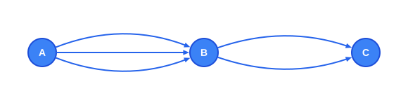
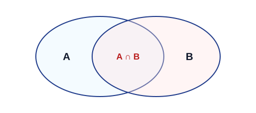
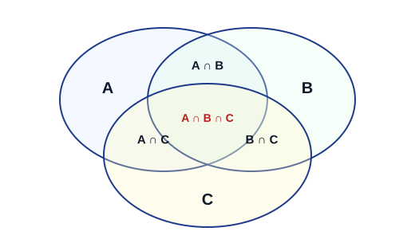
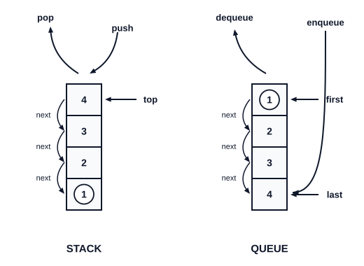
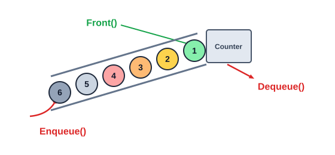
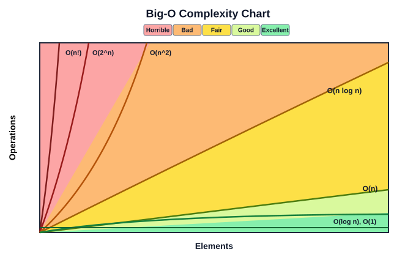
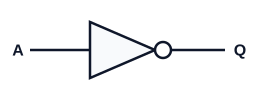
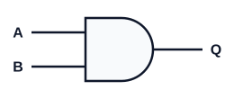
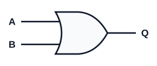
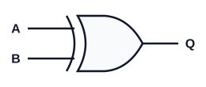

# Chương 1: Tổ hợp, Thuật toán và Cơ sở Logic

<p class="vn-lead">Các nguyên lý đếm, giải tích tổ hợp, cấu trúc dữ liệu cơ bản (Set, Stack, Queue), đánh giá độ phức tạp thuật toán và logic mệnh đề – vị từ.</p>

!!! abstract "Trọng tâm chương"
    - Phân biệt và vận dụng đúng **nguyên lý cộng, nhân, Dirichlet, bù trừ** và 5 quy tắc đếm cơ bản (**hoán vị, chỉnh hợp, tổ hợp, hoán vị lặp, tổ hợp lặp**).
    - Hiểu nguyên lý hoạt động của **Set, Stack, Queue** và tính được **độ phức tạp Big-O** của thuật toán.
    - Lập bảng chân trị, rút gọn biểu thức bằng các **luật tương đương logic**, chuyển về **dạng chuẩn tắc hội (CNF)** và dịch câu văn sang **logic vị từ – lượng từ**.

## 1. Các nguyên lý đếm

Khi giải bài toán đếm, ta luôn trả lời hai câu hỏi cốt lõi: **chọn theo bước hay chia trường hợp?** và **thứ tự có quan trọng không?**.

- **Ví dụ phân biệt thứ tự:** Lớp có 5 sinh viên $\{A, B, C, D, E\}$.
    - Chọn 2 sinh viên đi thi: $\{A, B\}$ và $\{B, A\}$ là **một cách** (không phân biệt thứ tự).
    - Chọn 1 trưởng nhóm và 1 phó nhóm: $(A\text{ trưởng}, B\text{ phó})$ khác với $(B\text{ trưởng}, A\text{ phó})$ (**có phân biệt thứ tự**).

### 1.1. Nguyên lý cộng và nguyên lý nhân

- **Nguyên lý cộng (chia trường hợp độc lập):** Nếu công việc $A$ có thể thực hiện bằng phương án 1 (có $n$ cách) **hoặc** phương án 2 (có $m$ cách), và hai phương án không trùng nhau, thì tổng số cách là:

$$N = n + m$$

- **Nguyên lý nhân (thực hiện liên tiếp theo bước):** Nếu công việc $A$ gồm 2 bước liên tiếp, bước 1 có $n$ cách **và** với mỗi cách ở bước 1 có $m$ cách ở bước 2, thì tổng số cách là:

$$N = n \times m$$



*Ví dụ:* Chọn 1 áo từ 3 áo dài tay và 5 áo ngắn tay có $3 + 5 = 8$ cách (cộng). Đi từ $A$ đến $C$ qua $B$ có 3 đường từ $A \to B$ và 2 đường từ $B \to C$ nên có $3 \times 2 = 6$ lộ trình (nhân).

**Ví dụ áp dụng:** Cho tập $X = \{0, 1, 2, 3, 4, 5\}$. Có bao nhiêu số tự nhiên có 3 chữ số khác nhau và chia hết cho 5?

**Hướng dẫn giải:** Gọi số cần tìm là $\overline{abc}$ ($a \ne 0$; $a, b, c$ đôi một khác nhau). Vì số chia hết cho 5 nên $c \in \{0, 5\}$. Khi $c = 0$, chữ số $a$ được chọn thoải mái trong 5 chữ số còn lại; nhưng khi $c = 5$, chữ số $a$ bị mất cả số $0$ lẫn số $5$ nên chỉ còn 4 cách chọn. Vì số cách chọn $a$ phụ thuộc vào $c$, ta phải **chia trường hợp**:

- **Trường hợp 1 ($c = 0$):**
    - Chọn $c$: 1 cách ($c = 0$).
    - Chọn $a \in X \setminus \{0\}$: 5 cách.
    - Chọn $b \in X \setminus \{0, a\}$: 4 cách.
    - Số lượng: $1 \times 5 \times 4 = 20$ số.
- **Trường hợp 2 ($c = 5$):**
    - Chọn $c$: 1 cách ($c = 5$).
    - Chọn $a \in X \setminus \{0, 5\}$: 4 cách.
    - Chọn $b \in X \setminus \{a, 5\}$: 4 cách (lúc này $b$ được phép bằng $0$).
    - Số lượng: $1 \times 4 \times 4 = 16$ số.

Theo nguyên lý cộng, tổng cộng có $20 + 16 = 36$ số.

### 1.2. Nguyên lý Dirichlet (Chuồng bồ câu)

- **Dạng cơ bản:** Nếu xếp $n$ đối tượng vào $k$ hộp với $n > k$, thì tồn tại ít nhất một hộp chứa từ 2 đối tượng trở lên.
- **Dạng tổng quát:** Nếu xếp $n$ đối tượng vào $k$ hộp, thì tồn tại ít nhất một hộp chứa không ít hơn $\lceil n / k \rceil$ đối tượng.

**Ví dụ:** Cho tập $X = \{1, 2, 3, 4, 5, 6, 7, 8, 9\}$. Chứng minh mọi tập con $A \subset X$ gồm 6 phần tử luôn chứa hai phần tử có tổng bằng 10.

**Chứng minh:** Chia các phần tử của $X$ thành 5 nhóm (5 "chuồng"):

$$\{1, 9\}, \quad \{2, 8\}, \quad \{3, 7\}, \quad \{4, 6\}, \quad \{5\}$$

Lấy 6 phần tử bất kỳ (6 "chim bồ câu") xếp vào 5 nhóm trên. Theo nguyên lý Dirichlet, có ít nhất 2 phần tử rơi vào cùng một nhóm. Vì nhóm $\{5\}$ chỉ có 1 phần tử nên 2 phần tử đó phải thuộc một trong bốn nhóm đầu, do đó tổng của chúng luôn bằng 10.

### 1.3. Nguyên lý bù trừ

Khi các tập hợp có phần giao nhau, ta phải trừ đi phần bị đếm lặp.

- **Với 2 tập hữu hạn $A, B$:**

$$|A \cup B| = |A| + |B| - |A \cap B|$$



- **Với 3 tập hữu hạn $A, B, C$:**

$$|A \cup B \cup C| = |A| + |B| + |C| - (|A \cap B| + |A \cap C| + |B \cap C|) + |A \cap B \cap C|$$



**Ví dụ:** Một lớp có 24 học sinh học tiếng Pháp, 26 học sinh học tiếng Anh và 15 học sinh học cả hai thứ tiếng. Biết mỗi học sinh học ít nhất một thứ tiếng, hỏi lớp có bao nhiêu học sinh?

**Giải:** Gọi $A$ là tập học sinh học tiếng Pháp ($|A| = 24$), $B$ là tập học sinh học tiếng Anh ($|B| = 26$), ta có $|A \cap B| = 15$. Số học sinh của lớp là:

$$|A \cup B| = 24 + 26 - 15 = 35 \text{ học sinh}$$

## 2. Giải tích tổ hợp

### 2.1. Hoán vị, Chỉnh hợp và Tổ hợp

Cho tập $A$ gồm $n$ phần tử phân biệt:

1. **Hoán vị ($P_n$):** Mỗi cách sắp xếp **có thứ tự tất cả $n$ phần tử** của $A$. (Quy ước $0! = 1$, và $P_n$ cũng là số song ánh từ $A$ vào chính nó).

$$P_n = n! = n(n-1)(n-2)\dots 1$$

2. **Chỉnh hợp chập $k$ ($A_n^k$):** Mỗi bộ gồm $k$ phần tử ($1 \le k \le n$) lấy từ $A$ và **có sắp thứ tự**.

$$A_n^k = \frac{n!}{(n - k)!} = n(n - 1)\dots(n - k + 1)$$

3. **Tổ hợp chập $k$ ($C_n^k$):** Mỗi tập con gồm $k$ phần tử ($0 \le k \le n$) lấy từ $A$, **không phân biệt thứ tự**.

$$C_n^k = \frac{n!}{k!(n - k)!} = \frac{A_n^k}{k!}$$

Hai tính chất thường dùng của tổ hợp: $C_n^k = C_n^{n - k}$ và $C_n^k = C_{n-1}^k + C_{n-1}^{k-1}$.

**Ví dụ minh hoạ:**

- *Hoán vị:* Từ $X = \{1, 2, 3, 4, 5\}$ lập được $P_5 = 5! = 120$ số tự nhiên có 5 chữ số khác nhau.
- *Chỉnh hợp:* Lớp có 40 sinh viên, số cách bầu 1 lớp trưởng, 1 lớp phó và 1 bí thư (3 chức danh khác nhau, có thứ tự) là $A_{40}^3 = 40 \times 39 \times 38 = 59\,280$ cách.
- *Tổ hợp:* Từ 10 người, số cách chọn ra 3 người đi công tác (vai trò như nhau, không phân biệt thứ tự) là $C_{10}^3 = \frac{10 \times 9 \times 8}{3 \times 2 \times 1} = 120$ cách.

### 2.2. Hoán vị lặp và Tổ hợp lặp

**Hoán vị lặp:** Cho $n$ đối tượng thuộc $k$ loại khác nhau, trong đó loại $i$ có $n_i$ đối tượng giống nhau ($n_1 + n_2 + \dots + n_k = n$). Số cách sắp xếp có thứ tự toàn bộ $n$ đối tượng là:

$$P(n_1, n_2, \dots, n_k) = \frac{n!}{n_1! n_2! \dots n_k!}$$

*Ví dụ:* Từ **SUCCESS** có 7 chữ cái gồm 3 chữ `S`, 2 chữ `C`, 1 chữ `U` và 1 chữ `E`. Số chuỗi khác nhau tạo được từ các chữ cái này là:

$$\frac{7!}{3! \cdot 2! \cdot 1! \cdot 1!} = \frac{5040}{6 \times 2} = 420 \text{ chuỗi}$$

**Tổ hợp lặp:** Số cách chọn $k$ phần tử từ $n$ loại đối tượng phân biệt, **không phân biệt thứ tự** và **mỗi loại có thể chọn nhiều lần**, ký hiệu $K_n^k$ (hoặc $\overline{C}_n^k$):

$$K_n^k = C_{n + k - 1}^k = \frac{(n + k - 1)!}{k!(n - 1)!}$$

*Ví dụ:* Có 3 loại bánh (bánh rán, bánh bao, bánh mì). Số cách mua 4 cái bánh (có thể mua trùng loại) là $K_3^4 = C_{3 + 4 - 1}^4 = C_6^4 = 15$ cách. Tương tự, mua 2 cái nón từ 3 loại $A, B, C$ có $K_3^2 = C_4^2 = 6$ cách (`AA, AB, AC, BB, BC, CC`).

!!! note "Hệ quả quan trọng (Bài toán chia kẹo Euler)"
    Số nghiệm nguyên không âm $(x_1, x_2, \dots, x_n)$ của phương trình $x_1 + x_2 + \dots + x_n = k$ (cũng là số cách chia $k$ vật giống nhau vào $n$ hộp phân biệt) bằng đúng:

    $$K_n^k = C_{n + k - 1}^k$$

**Ví dụ giải bài toán đếm nghiệm có ràng buộc:** Tìm số nghiệm nguyên không âm của phương trình:

$$x_1 + x_2 + x_3 + x_4 = 20 \quad (1)$$

thoả mãn điều kiện $(*)$: $x_1 \le 3$, $x_2 \ge 2$, $x_3 > 4$.

**Hướng dẫn giải (3 bước chuẩn):**

1. **Chuẩn hoá điều kiện về dạng $\ge$:** Với biến nguyên, $x_3 > 4 \iff x_3 \ge 5$. Điều kiện $(*)$ viết lại là $x_1 \le 3,\; x_2 \ge 2,\; x_3 \ge 5$.
2. **Dùng nguyên lý phần bù để xử lý cận trên $x_1 \le 3$:**
    - Gọi $p$ là số nghiệm thoả $(*)$: $x_1 \le 3,\; x_2 \ge 2,\; x_3 \ge 5$.
    - Gọi $q$ là số nghiệm bỏ qua ràng buộc $x_1$: $x_1 \ge 0,\; x_2 \ge 2,\; x_3 \ge 5$.
    - Gọi $r$ là số nghiệm vi phạm $x_1 \le 3$: $x_1 \ge 4,\; x_2 \ge 2,\; x_3 \ge 5$.
    - Ta có $p = q - r$.
3. **Đổi biến đưa về nghiệm nguyên không âm ($\ge 0$):**
    - Tính $q$: Đặt $x_1' = x_1,\; x_2' = x_2 - 2,\; x_3' = x_3 - 5,\; x_4' = x_4$ (mọi $x_i' \ge 0$). Phương trình $(1)$ thành $x_1' + x_2' + x_3' + x_4' = 20 - 2 - 5 = 13$. Suy ra:
      $$q = K_4^{13} = C_{4 + 13 - 1}^{13} = C_{16}^{13} = 560$$
    - Tính $r$: Đặt $x_1'' = x_1 - 4,\; x_2'' = x_2 - 2,\; x_3'' = x_3 - 5,\; x_4'' = x_4$ (mọi $x_i'' \ge 0$). Phương trình $(1)$ thành $x_1'' + x_2'' + x_3'' + x_4'' = 20 - 4 - 2 - 5 = 9$. Suy ra:
      $$r = K_4^9 = C_{4 + 9 - 1}^9 = C_{12}^9 = 220$$

Vậy số nghiệm cần tìm là $p = 560 - 220 = 340$.

### 2.3. Bảng tổng kết phân biệt các quy tắc tổ hợp

| Quy tắc | Có thứ tự? | Cho phép lặp? | Công thức | Dấu hiệu nhận biết |
|---|:---:|:---:|---|---|
| **Hoán vị** | Có | Không | $P_n = n!$ | Sắp xếp toàn bộ $n$ phần tử khác nhau |
| **Chỉnh hợp** | Có | Không | $A_n^k = \frac{n!}{(n-k)!}$ | Chọn $k$ phần tử xếp vào $k$ vị trí/vai trò khác nhau |
| **Tổ hợp** | Không | Không | $C_n^k = \frac{n!}{k!(n-k)!}$ | Chọn một nhóm $k$ phần tử không phân biệt vai trò |
| **Hoán vị lặp** | Có | Có (cố định số lượng) | $\frac{n!}{n_1!n_2!\dots n_k!}$ | Đảo vị trí chuỗi có ký tự giống nhau |
| **Tổ hợp lặp** | Không | Có (không giới hạn) | $K_n^k = C_{n+k-1}^k$ | Mua $k$ món từ $n$ loại; tìm nghiệm nguyên không âm |

!!! warning "Dễ nhầm"
    Trong công thức tổ hợp lặp $K_n^k = C_{n+k-1}^k$, **$n$ là số loại (số biến / số hộp)** còn **$k$ là số lần chọn (vế phải của phương trình)**. Đừng nhầm vai trò giữa $n$ và $k$ khi $k > n$.

## 3. Cấu trúc dữ liệu cơ bản và Độ phức tạp thuật toán

### 3.1. Tập hợp (Set), Ngăn xếp (Stack) và Hàng đợi (Queue)

#### Tập hợp (Set)

Trong toán học, **tập hợp** là nhóm các đối tượng xác định, phân biệt (gọi là phần tử), thường biểu diễn bằng cách liệt kê ($A = \{1, 2, 3, 4, 5\}$) hoặc nêu tính chất ($A = \{x \mid x \in \mathbb{N},\; x < 6\}$).

Trong lập trình, cấu trúc dữ liệu `Set` lưu trữ các phần tử **không trùng lặp**: khi chèn $x$, nếu $x$ đã tồn tại thì bỏ qua.

- **Cài đặt phổ biến:** C++ có `set` (cây nhị phân cân bằng, tìm kiếm $O(\log n)$) và `unordered_set` (bảng băm, tìm kiếm trung bình $O(1)$); Java có `TreeSet`, `HashSet`, `LinkedHashSet`.
- **Ứng dụng đếm phần tử phân biệt:** Khi miền giá trị lớn (ví dụ $1 \dots 10^9$) không thể dùng mảng đánh dấu, ta đưa tất cả phần tử vào `set` rồi lấy kích thước.

```cpp title="Đếm số phần tử khác nhau và số nhân viên đi làm trước 9h"
// Bài toán 1: Đếm số giá trị khác nhau trong mảng a có n phần tử
int countDistinct(int a[], int n) {
    set<int> s;
    for (int i = 0; i < n; i++) {
        s.insert(a[i]);
    }
    return s.size();
}

// Bài toán 2: Đếm số nhân viên khác nhau quẹt thẻ trước hoặc đúng 9h
int countEarlyEmployees(Record a[], int n) {
    set<string> s;
    for (int i = 0; i < n; i++) {
        if (a[i].time.hours <= 9) {
            s.insert(a[i].name);
        }
    }
    return s.size();
}
```

#### Ngăn xếp (Stack) và Hàng đợi (Queue)



| Đặc điểm | Ngăn xếp (Stack) | Hàng đợi (Queue) |
|---|---|---|
| **Nguyên lý** | **LIFO** (*Last In, First Out* – vào sau ra trước) | **FIFO** (*First In, First Out* – vào trước ra trước) |
| **Ví dụ trực quan** | Chồng đĩa: thêm và lấy đều ở đỉnh (`top`) | Hàng chờ: vào ở cuối (`rear`), ra ở đầu (`front`) |
| **Thao tác thêm** | `push(x)` (vào đỉnh) | `enqueue(x)` (vào cuối) |
| **Thao tác lấy** | `pop()` (lấy ở đỉnh) | `dequeue()` (lấy ở đầu) |
| **Xem phần tử** | `top()` / `peek()` | `front()` / `peek()` |
| **Kiểm tra & khởi tạo** | `init()`, `isEmpty()`, `isFull()` | `init()`, `isEmpty()`, `isFull()` |




### 3.2. Độ phức tạp thuật toán (Big-O)

**Độ phức tạp thuật toán** (ký hiệu Big-O: $O(f(n))$) mô tả tốc độ tăng của thời gian chạy hoặc bộ nhớ khi kích thước dữ liệu đầu vào $n$ tăng lên.



**Thứ tự tăng dần độ phức tạp** (các hàm trên cùng một mức có tốc độ tăng tương đương; thuật toán bên phải chạy chậm hơn rất nhanh khi $n$ lớn):

$$O(1) \sim O(2^{100}) < O(\log n) < O(n) < O(n \log n) \sim O(\log(n!)) < O(n^2) < O((\log n)^{\log n}) \sim O(n^{\log \log n}) < O(2^n) < O(3^n) < O(n!)$$

#### Bốn quy tắc tính độ phức tạp

1. **Bỏ hằng số:** $O(c \cdot f(n)) = O(f(n))$ với hằng số $c > 0$.
2. **Quy tắc lấy max:** $O(f(n) + g(n)) = O(\max(f(n), g(n)))$.
3. **Quy tắc cộng (các khối lệnh nối tiếp):** $T_1(n) = O(f(n))$, $T_2(n) = O(g(n)) \Rightarrow T_1(n) + T_2(n) = O(f(n) + g(n)) = O(\max(f(n), g(n)))$.
4. **Quy tắc nhân (các vòng lặp lồng nhau):** Thực hiện $k(n) = O(g(n))$ lần một khối lệnh có độ phức tạp $O(f(n))$ thì tổng độ phức tạp là $O(g(n) \cdot f(n))$.

Để tính nhanh, ta đếm số lần thực hiện của **phép toán tích cực** (phép toán nằm sâu nhất hoặc được lặp nhiều nhất).

#### Các ví dụ xác định độ phức tạp

**Nhóm 1: Không phụ thuộc $n$ và vòng lặp đơn ($O(1), O(n)$)**

```cpp title="Ví dụ O(1) và O(n)"
// 1. Không phụ thuộc n -> O(1)
s = n * (n - 1) / 2;

// 2. Vòng lặp đơn chạy n lần -> O(n)
s = 1; p = 1;
for (int i = 1; i <= n; i++) {
    p = p * x / i;
    s = s + p;
}
```

**Nhóm 2: Vòng lặp phụ thuộc biến ngoài ($O(n^2)$)**

```cpp title="Ví dụ vòng lặp tam giác"
s = 0;
for (int i = 0; i <= n; i++) {
    p = 1;
    for (int j = 1; j <= i; j++)
        p = p * x / j;
    s = s + p;
}
```

Số lần thực hiện phép toán tích cực `p = p * x / j` là:

$$0 + 1 + 2 + \dots + n = \frac{n(n + 1)}{2} = \frac{n^2}{2} + \frac{n}{2}$$

Áp dụng quy tắc lấy max (giữ bậc cao nhất $n^2/2$) và bỏ hằng số $1/2$, ta được độ phức tạp **$O(n^2)$**.

**Nhóm 3: Vòng lặp nhiều biến (phân biệt lồng nhau vs nối tiếp)**

| Cấu trúc vòng lặp | Độ phức tạp | Lý do |
|---|---|---|
| `for i = 1..n` lồng `for j = 1..m` | $O(n \cdot m)$ | Quy tắc nhân |
| `for i = 1..n` nối tiếp `for j = 1..m` | $O(\max(n, m))$ | Quy tắc cộng và lấy max |
| `for i = 1..n { (for u=1..m; for v=1..n) ; (for j=1..x; for k=1..z) }` | $O(n \cdot \max(m \cdot n,\; x \cdot z))$ | Trong khối ngoài có 2 cụm nối tiếp |
| `for i = 1..n { for j = 1..m { (for k=1..x) ; (for h=1..y) } }` | $O(n \cdot m \cdot \max(x, y))$ | Nhân hai vòng ngoài với max hai vòng trong |
| `(for i=1..n; for u=1..m; for v=1..n)` nối tiếp `(for j=1..x; for k=1..z)` | $O(\max(m \cdot n^2,\; x \cdot z))$ | Hai khối độc lập đặt nối tiếp nhau |

**Nhóm 4: Cộng và nhân hai đa thức**

Cho $P(x) = a_m x^m + a_{m-1} x^{m-1} + \dots + a_1 x + a_0$ và $Q(x) = b_n x^n + b_{n-1} x^{n-1} + \dots + b_1 x + b_0$:

```cpp title="Cộng hai đa thức: O(max(m, n))"
int p = (m < n) ? m : n;
for (int i = 0; i <= p; i++)
    c[i] = a[i] + b[i];
if (p < m)
    for (int i = p + 1; i <= m; i++) c[i] = a[i];
else
    for (int i = p + 1; i <= n; i++) c[i] = b[i];
while (p > 0 && c[p] == 0) p--;
```

```cpp title="Nhân hai đa thức: O(m * n)"
int p = m + n;
for (int i = 0; i <= p; i++) c[i] = 0;
for (int i = 0; i <= m; i++)
    for (int j = 0; j <= n; j++)
        c[i + j] = c[i + j] + a[i] * b[j];
```

## 4. Logic mệnh đề

### 4.1. Khái niệm và phân loại mệnh đề

**Mệnh đề** là một câu khẳng định có giá trị chân lý xác định: hoặc **Đúng** (`True`, `T`, `1`), hoặc **Sai** (`False`, `F`, `0`), không thể vừa đúng vừa sai.

- **Mệnh đề sơ cấp:** Khẳng định đơn, không chứa phép nối logic (ví dụ: *"2 là số nguyên tố"*).
- **Mệnh đề phức hợp:** Tạo từ các mệnh đề sơ cấp qua các liên từ (*và, hay, nếu... thì..., khi và chỉ khi*) hoặc trạng từ *"không"*.

??? question "Bài tập nhanh: Câu nào là mệnh đề?"
    1. Paris là thành phố của Mỹ.
    2. $n$ là số tự nhiên.
    3. Con nhà ai mà xinh thế!
    4. 3 là số nguyên tố.
    5. Bạn có khỏe không?
    6. $x^2 + 1$ luôn dương (với $x \in \mathbb{R}$).

    **Đáp án:**
    - (1) Là mệnh đề (giá trị **Sai**).
    - (2) **Không** là mệnh đề (là vị từ vì chứa biến $n$ chưa biết giá trị).
    - (3) **Không** là mệnh đề (câu cảm thán).
    - (4) Là mệnh đề (giá trị **Đúng**).
    - (5) **Không** là mệnh đề (câu nghi vấn).
    - (6) Là mệnh đề (giá trị **Đúng** với mọi $x \in \mathbb{R}$).

### 4.2. Các phép toán mệnh đề và ứng dụng cổng logic

| Phép toán | Ký hiệu | Cách đọc | Điều kiện Đúng / Sai |
|---|---|---|---|
| **Phủ định** | $\neg P$ hay $\overline{P}$ | Không $P$ | Đúng khi $P$ sai; sai khi $P$ đúng |
| **Hội (Giao)** | $P \land Q$ | $P$ và $Q$ | Chỉ **đúng** khi cả $P, Q$ cùng đúng |
| **Tuyển (Hợp)** | $P \lor Q$ | $P$ hay $Q$ | Chỉ **sai** khi cả $P, Q$ cùng sai |
| **Tuyển loại (XOR)** | $P \oplus Q$ | Hoặc $P$ hoặc $Q$ | Đúng khi $P, Q$ **khác** giá trị chân lý |
| **Kéo theo** | $P \to Q$ | Nếu $P$ thì $Q$ | Chỉ **sai** khi $P$ đúng và $Q$ sai |
| **Tương đương** | $P \leftrightarrow Q$ | $P$ khi và chỉ khi $Q$ | Đúng khi $P, Q$ **cùng** giá trị chân lý |

**Bảng chân trị tổng hợp 6 phép toán:**

| $p$ | $q$ | $\neg p$ | $p \land q$ | $p \lor q$ | $p \oplus q$ | $p \to q$ | $p \leftrightarrow q$ |
|:---:|:---:|:---:|:---:|:---:|:---:|:---:|:---:|
| 1 | 1 | 0 | 1 | 1 | 0 | 1 | 1 |
| 1 | 0 | 0 | 0 | 1 | 1 | 0 | 0 |
| 0 | 1 | 1 | 0 | 1 | 1 | 1 | 0 |
| 0 | 0 | 1 | 0 | 0 | 0 | 1 | 1 |

!!! warning "Dễ nhầm về phép kéo theo ($P \to Q$)"
    Trong logic toán, khi giả thiết $P$ **sai**, mệnh đề $P \to Q$ **luôn đúng** bất kể $Q$ đúng hay sai. Ví dụ: *"Nếu $1 = 2$ thì $5 > 6$"* có giá trị chân lý là **Đúng** (`1`).

**Thứ tự ưu tiên phép toán** (từ cao xuống thấp): Ngoặc `()` $\rightarrow$ $\neg$ $\rightarrow$ $\land$ $\rightarrow$ $\lor$ $\rightarrow$ $\to$ $\rightarrow$ $\leftrightarrow$.

- Ví dụ: $p \lor q \to r$ hiểu là $(p \lor q) \to r$; còn $p \land (q \lor r) \leftrightarrow \neg q$ hiểu là $(p \land (q \lor r)) \leftrightarrow (\neg q)$.

**Ứng dụng trong mạch điện logic và phép toán bit:**

- Mạch logic tương ứng với các phép toán: cổng **NOT** ($\neg A$), cổng **AND** ($A \land B$), cổng **OR** ($A \lor B$), cổng **XOR** ($A \oplus B$).









- **Phép toán trên từng bit (bitwise):** Với $A = 13_{10} = 1101_2$ và $B = 8_{10} = 1000_2$:
    - `A AND B` = `1000` ($8$)
    - `A OR B` = `1101` ($13$)
    - `A XOR B` = `0101` ($5$)

### 4.3. Dạng mệnh đề, Hằng đúng, Mâu thuẫn và Tương đương logic

**Dạng mệnh đề** $E(p, q, r, \dots)$ là biểu thức logic cấu tạo từ các biến mệnh đề, hằng mệnh đề và các phép toán logic. Nếu có $n$ biến, bảng chân trị có $2^n$ dòng.

- **Hằng đúng (Tautology):** Luôn nhận giá trị `1` (`T`) với mọi bộ giá trị của các biến (ví dụ: $p \lor \neg p$).
- **Mâu thuẫn / Hằng sai (Contradiction):** Luôn nhận giá trị `0` (`F`) với mọi bộ giá trị của các biến (ví dụ: $p \land \neg p$).

*Ví dụ bảng chân trị cho $E(p, q, r) = (p \lor q) \to r$:*

| $p$ | $q$ | $r$ | $p \lor q$ | $(p \lor q) \to r$ |
|:---:|:---:|:---:|:---:|:---:|
| 0 | 0 | 0 | 0 | 1 |
| 0 | 0 | 1 | 0 | 1 |
| 0 | 1 | 0 | 1 | 0 |
| 0 | 1 | 1 | 1 | 1 |
| 1 | 0 | 0 | 1 | 0 |
| 1 | 0 | 1 | 1 | 1 |
| 1 | 1 | 0 | 1 | 0 |
| 1 | 1 | 1 | 1 | 1 |

**Tương đương logic ($A \equiv B$ hoặc $A \iff B$):** Hai dạng mệnh đề có cột giá trị chân lý trùng nhau hoàn toàn. Ví dụ kiểm chứng luật De Morgan $\overline{p \lor q} \equiv \overline{p} \land \overline{q}$ bằng bảng chân trị:

| $p$ | $q$ | $p \lor q$ | $\overline{p \lor q}$ | $\overline{p}$ | $\overline{q}$ | $\overline{p} \land \overline{q}$ |
|:---:|:---:|:---:|:---:|:---:|:---:|:---:|
| T | T | T | **F** | F | F | **F** |
| T | F | T | **F** | F | T | **F** |
| F | T | T | **F** | T | F | **F** |
| F | F | F | **T** | T | T | **T** |

**Bảng 11 luật tương đương logic cơ bản:**

| STT | Tên luật | Công thức tương đương |
|:---:|---|---|
| 1 | Phủ định kép | $\neg(\neg p) \iff p$ |
| 2 | De Morgan | $\neg(p \land q) \iff \neg p \lor \neg q$ <br> $\neg(p \lor q) \iff \neg p \land \neg q$ |
| 3 | Giao hoán | $p \lor q \iff q \lor p$ <br> $p \land q \iff q \land p$ |
| 4 | Kết hợp | $(p \lor q) \lor r \iff p \lor (q \lor r)$ <br> $(p \land q) \land r \iff p \land (q \land r)$ |
| 5 | Phân phối | $p \lor (q \land r) \iff (p \lor q) \land (p \lor r)$ <br> $p \land (q \lor r) \iff (p \land q) \lor (p \land r)$ |
| 6 | Luỹ đẳng | $p \lor p \iff p$ <br> $p \land p \iff p$ |
| 7 | Trung hoà | $p \lor F \iff p$ <br> $p \land T \iff p$ |
| 8 | Phần tử bù | $p \lor \neg p \iff T$ <br> $p \land \neg p \iff F$ |
| 9 | Thống trị | $p \lor T \iff T$ <br> $p \land F \iff F$ |
| 10 | Hấp thụ | $p \lor (p \land q) \iff p$ <br> $p \land (p \lor q) \iff p$ |
| 11 | Phép kéo theo | $p \to q \iff \neg p \lor q \iff \neg q \to \neg p$ <br> $p \leftrightarrow q \iff (p \to q) \land (q \to p)$ |

### 4.4. Dạng chuẩn tắc hội (CNF)

Một **mệnh đề tuyển sơ cấp** là phép tuyển ($\lor$) của các biến mệnh đề hoặc phủ định của chúng. Một công thức ở **dạng chuẩn tắc hội (CNF)** nếu nó là **hội ($\land$)** của các mệnh đề tuyển sơ cấp.

**Quy trình 5 bước chuyển một công thức bất kỳ về CNF:**

1. Khử phép tương đương: $a \leftrightarrow b \equiv (a \to b) \land (b \to a)$.
2. Khử phép kéo theo: $a \to b \equiv \neg a \lor b$.
3. Đẩy dấu $\neg$ vào sát biến bằng luật De Morgan.
4. Khử phủ định kép: $\neg(\neg a) \equiv a$.
5. Áp dụng luật phân phối $a \lor (b \land c) \equiv (a \lor b) \land (a \lor c)$ để đưa dấu $\land$ ra ngoài.

**Ví dụ:** Chuẩn hoá $(p \to q) \lor \neg(r \lor \neg s)$ về dạng chuẩn tắc hội:

$$
\begin{aligned}
(p \to q) \lor \overline{r \lor \overline{s}}
&\iff (\overline{p} \lor q) \lor \overline{r \lor \overline{s}} && \text{(khử kéo theo)} \\
&\iff (\overline{p} \lor q) \lor (\overline{r} \land \overline{\overline{s}}) && \text{(De Morgan)} \\
&\iff (\overline{p} \lor q) \lor (\overline{r} \land s) && \text{(phủ định kép)} \\
&\iff (\overline{p} \lor q \lor \overline{r}) \land (\overline{p} \lor q \lor s) && \text{(phân phối)}
\end{aligned}
$$

### 4.5. Các ví dụ chứng minh bằng biến đổi tương đương

Khi chứng minh tương đương hoặc hằng đúng/hằng sai không dùng bảng chân trị, chiến lược chung là: **(1) khử $\to, \leftrightarrow$**, **(2) đẩy $\neg$ vào trong bằng De Morgan**, **(3) dùng hấp thụ, phân phối và phần tử bù để rút gọn**.

**Ví dụ 1:** Chứng minh $\overline{p \lor (\overline{p} \land q)} \iff \overline{p} \land \overline{q}$.

$$
\begin{aligned}
\overline{p \lor (\overline{p} \land q)}
&\iff \overline{p} \land \overline{(\overline{p} \land q)} && \text{(De Morgan)} \\
&\iff \overline{p} \land (\overline{\overline{p}} \lor \overline{q}) && \text{(De Morgan)} \\
&\iff \overline{p} \land (p \lor \overline{q}) && \text{(phủ định kép)} \\
&\iff (\overline{p} \land p) \lor (\overline{p} \land \overline{q}) && \text{(phân phối)} \\
&\iff F \lor (\overline{p} \land \overline{q}) \iff \overline{p} \land \overline{q} && \text{(phần tử bù, trung hoà)}
\end{aligned}
$$

**Ví dụ 2:** Chứng minh $(\neg p \to r) \land (q \to r) \iff (p \to q) \to r$.

$$
\begin{aligned}
(\neg p \to r) \land (q \to r)
&\iff (p \lor r) \land (\neg q \lor r) && \text{(luật kéo theo)} \\
&\iff (p \land \neg q) \lor r && \text{(phân phối ngược)} \\
&\iff \neg(\neg p \lor q) \lor r && \text{(De Morgan ngược)} \\
&\iff \neg(p \to q) \lor r && \text{(luật kéo theo)} \\
&\iff (p \to q) \to r && \text{(luật kéo theo)}
\end{aligned}
$$

**Ví dụ 3 (Chứng minh hằng đúng):** Chứng minh $(p \land q) \to q$ và $p \to (q \to (p \land q))$ là hằng đúng.

- Biểu thức 1: $(p \land q) \to q \equiv \overline{p \land q} \lor q \equiv (\overline{p} \lor \overline{q}) \lor q \equiv \overline{p} \lor (\overline{q} \lor q) \equiv \overline{p} \lor T \equiv T$.
- Biểu thức 2:

$$
\begin{aligned}
p \to (q \to (p \land q))
&\equiv p \to (\neg q \lor (p \land q)) \\
&\equiv p \to ((\neg q \lor p) \land (\neg q \lor q)) && \text{(phân phối)} \\
&\equiv p \to ((\neg q \lor p) \land T) \equiv p \to (\neg q \lor p) \\
&\equiv \neg p \lor \neg q \lor p \equiv (\neg p \lor p) \lor \neg q \equiv T \lor \neg q \equiv T
\end{aligned}
$$

**Ví dụ 4 (Chứng minh hằng sai):** Chứng minh $(\neg((r \lor q) \land q) \lor \neg p) \land ((\neg p \lor \neg q) \to (p \land q \land r))$ là hằng sai.

- Vế 1: $\neg((r \lor q) \land q) \lor \neg p \equiv \neg q \lor \neg p \equiv \neg(p \land q)$ (dùng luật hấp thụ $(r \lor q) \land q \equiv q$).
- Vế 2: $(\neg p \lor \neg q) \to (p \land q \land r) \equiv \neg(\neg p \lor \neg q) \lor (p \land q \land r) \equiv (p \land q) \lor (p \land q \land r) \equiv p \land q$ (hấp thụ).
- Kết hợp hai vế: $\neg(p \land q) \land (p \land q) \equiv F$.

**Ví dụ 5 (Chứng minh tương đương hai vế phức tạp):** Chứng minh:

$$(\neg(p \lor q) \lor (\neg p \land q)) \land \neg q \equiv (p \to q) \land (\neg q \land (r \lor \neg q))$$

- Vế trái:
  $$(\neg p \land \neg q \lor (\neg p \land q)) \land \neg q \equiv (\neg p \land (\neg q \lor q)) \land \neg q \equiv (\neg p \land T) \land \neg q \equiv \neg p \land \neg q$$
- Vế phải (chú ý hấp thụ $\neg q \land (r \lor \neg q) \equiv \neg q$):
  $$(\neg p \lor q) \land \neg q \equiv (\neg p \land \neg q) \lor (q \land \neg q) \equiv (\neg p \land \neg q) \lor F \equiv \neg p \land \neg q$$
- Hai vế cùng tương đương $\neg p \land \neg q$, suy ra điều phải chứng minh.

#### Bài tập tự luyện Logic mệnh đề

1. **Lập bảng chân trị** cho các dạng mệnh đề:
    - $A(p, q) = \neg(p \land q) \land p$
    - $B(p, q, r) = p \land (q \lor r) \leftrightarrow \neg q$
    - $\neg p \to (p \lor q)$
    - $(p \lor \neg q) \land (\neg p \lor q)$
    - $(p \to q) \lor (q \to p)$
2. **Chứng minh các mệnh đề sau là hằng đúng:**
    - a) $(p \land q) \to p$ $\qquad$ f) $\neg(p \to q) \to \neg q$
    - b) $p \to (p \lor q)$ $\qquad$ g) $\neg p \land (p \lor q) \to q$
    - c) $\neg p \to (p \to q)$ $\qquad$ h) $(p \to q) \land (q \to r) \to (p \to r)$
    - d) $(p \land q) \to (p \to q)$ $\qquad$ i) $(p \land (p \to q)) \to q$
    - e) $\neg(p \to q) \to p$ $\qquad$ j) $((p \lor q) \land (p \to r) \land (q \to r)) \to r$
3. **Chứng minh các tương đương logic sau:**
    - $(p \leftrightarrow q) \equiv (p \land q) \lor (\neg p \land \neg q)$
    - $\neg p \leftrightarrow q \equiv p \leftrightarrow \neg q$
    - $\neg(p \leftrightarrow q) \equiv \neg p \leftrightarrow q$

??? tip "Gợi ý giải nhanh bài tập 2 và 3"
    - **Ý 2g ($\neg p \land (p \lor q) \to q$):** Rút gọn vế trái: $\neg p \land (p \lor q) \equiv (\neg p \land p) \lor (\neg p \land q) \equiv \neg p \land q$. Khi đó $(\neg p \land q) \to q \equiv \neg(\neg p \land q) \lor q \equiv p \lor \neg q \lor q \equiv T$.
    - **Ý 2i (Quy tắc Modus Ponens):** $(p \land (p \to q)) \to q \equiv \neg(p \land (\neg p \lor q)) \lor q \equiv \neg(p \land q) \lor q \equiv \neg p \lor \neg q \lor q \equiv T$.
    - **Ý 3.1:** $(p \leftrightarrow q) \equiv (p \to q) \land (q \to p) \equiv (\neg p \lor q) \land (\neg q \lor p)$. Khai triển bằng luật phân phối 2 lần rồi khử các cặp mâu thuẫn $p \land \neg p \equiv F$ và $q \land \neg q \equiv F$ sẽ thu được $(p \land q) \lor (\neg p \land \neg q)$.

## 5. Logic vị từ và Lượng từ

### 5.1. Vị từ và các phép toán trên vị từ

**Vị từ** (hàm mệnh đề) là một khẳng định $P(x, y, \dots)$ chứa các biến tự do $x, y, \dots$ thuộc tập không gian $A, B, \dots$:

- Bản thân $P(x, y, \dots)$ **chưa phải là mệnh đề** vì chưa có giá trị đúng/sai.
- Khi thay các biến bằng giá trị cụ thể, $P(a, b, \dots)$ trở thành một **mệnh đề**.
- **Không gian của vị từ:** Tập $E$ mà biến nhận giá trị. **Trọng lượng của vị từ:** Số biến của vị từ.

*Ví dụ:*

- $P(n)$: *"$n$ là số chẵn"* $\Rightarrow P(2)$ đúng, $P(5)$ sai.
- $Q(x, y)$: *"$x = y + 3$"* $\Rightarrow Q(1, 2)$ sai ($1 \ne 2 + 3$), $Q(3, 0)$ đúng ($3 = 0 + 3$).
- $R(a, b)$: *"$a + b = 5$"* với $a, b \in \mathbb{Z}$ có không gian là $\mathbb{Z} \times \mathbb{Z}$ và trọng lượng bằng 2.

Các phép toán mệnh đề ($\neg, \land, \lor, \oplus, \to, \leftrightarrow$) áp dụng hoàn toàn tương tự trên các vị từ cùng biến.

### 5.2. Lượng từ phổ dụng ($\forall$) và Lượng từ tồn tại ($\exists$)

Lượng từ dùng để biến vị từ thành mệnh đề bằng cách ràng buộc biến trên toàn bộ không gian xét:

| Biểu thức | Tên gọi và cách đọc | Đúng khi | Sai khi |
|:---:|---|---|---|
| $\forall x \in A, P(x)$ | **Lượng từ phổ dụng:** *"Với mọi $x \in A$, $P(x)$"* | $P(a)$ đúng với **tất cả** $a \in A$ | Tồn tại **ít nhất một** $a \in A$ để $P(a)$ sai |
| $\exists x \in A, P(x)$ | **Lượng từ tồn tại:** *"Tồn tại $x \in A$, $P(x)$"* | Tồn tại **ít nhất một** $a \in A$ để $P(a)$ đúng | $P(a)$ sai với **tất cả** $a \in A$ |

*Ví dụ 1 biến (trên $\mathbb{R}$):*

- $\forall x \in \mathbb{R},\; x^2 + 3x + 1 \le 0$ là **Sai** (thử $x = 0 \Rightarrow 1 > 0$).
- $\exists x \in \mathbb{R},\; x^2 + 3x + 1 \le 0$ là **Đúng** (thử $x = -1 \Rightarrow 1 - 3 + 1 = -1 \le 0$).
- $\forall x \in \mathbb{R},\; x^2 + 1 \ge 2x$ là **Đúng** (vì $(x-1)^2 \ge 0$).
- $\exists x \in \mathbb{R},\; x^2 + 1 < 0$ là **Sai** (vì $x^2 + 1 \ge 1 > 0$ với mọi $x \in \mathbb{R}$).

#### Mệnh đề lượng từ 2 biến và thứ tự lượng từ

Với vị từ $p(x, y)$ trên $A \times B$, thứ tự lượng từ $\forall$ và $\exists$ làm thay đổi hoàn toàn ý nghĩa:

1. $\forall x \in \mathbb{R},\; \forall y \in \mathbb{R},\; x + 2y < 1$: **Sai**, vì chọn $x_0 = 0, y_0 = 1$ thì $0 + 2(1) = 2 \ge 1$.
2. $\forall x \in \mathbb{R},\; \exists y \in \mathbb{R},\; x + 2y < 1$: **Đúng**, vì với mỗi $x = a$ cho trước, ta chọn $y_a = -a/2$ (phụ thuộc vào $a$) thì $a + 2(-a/2) = 0 < 1$.
3. $\exists x \in \mathbb{R},\; \forall y \in \mathbb{R},\; x + 2y < 1$: **Sai**, vì không có số $x = a$ cố định nào thoả $a + 2y < 1$ với mọi $y$ (chỉ cần chọn $y = -a/2 + 2 \Rightarrow a + 2y = 4 \ge 1$).
4. $\exists x \in \mathbb{R},\; \exists y \in \mathbb{R},\; x + 2y < 1$: **Đúng**, vì có cặp $x_0 = 0, y_0 = 0$ thoả $0 < 1$.

**Định lý về thứ tự lượng từ:**

- $\forall x \in A,\; \forall y \in B,\; p(x, y) \iff \forall y \in B,\; \forall x \in A,\; p(x, y)$ (cùng $\forall$ đổi chỗ được).
- $\exists x \in A,\; \exists y \in B,\; p(x, y) \iff \exists y \in B,\; \exists x \in A,\; p(x, y)$ (cùng $\exists$ đổi chỗ được).
- $\exists x \in A,\; \forall y \in B,\; p(x, y) \implies \forall y \in B,\; \exists x \in A,\; p(x, y)$ (chiều ngược lại **không đúng**).

**Quy tắc đặc biệt hoá phổ dụng:** Nếu $\forall x \in A,\; p(x)$ đúng và $a \in A$, thì $p(a)$ đúng.

$$\frac{\forall x \in A,\; p(x) \quad \text{và} \quad a \in A}{\therefore \; p(a)}$$

*Ví dụ:* *"Mọi người đều chết"* và *"Socrate là người"* $\Rightarrow$ *"Socrate cũng chết"*.

### 5.3. Phủ định mệnh đề lượng từ

**Quy tắc phủ định:** Đổi $\forall \leftrightarrow \exists$, giữ nguyên miền xác định của biến và phủ định vị từ phía sau:

- **1 biến:**

$$\overline{\forall x \in A,\; p(x)} \iff \exists x \in A,\; \overline{p(x)}$$

$$\overline{\exists x \in A,\; p(x)} \iff \forall x \in A,\; \overline{p(x)}$$

- **2 biến:**

$$\overline{\forall x \in A,\; \forall y \in B,\; p(x, y)} \iff \exists x \in A,\; \exists y \in B,\; \overline{p(x, y)}$$

$$\overline{\forall x \in A,\; \exists y \in B,\; p(x, y)} \iff \exists x \in A,\; \forall y \in B,\; \overline{p(x, y)}$$

$$\overline{\exists x \in A,\; \forall y \in B,\; p(x, y)} \iff \forall x \in A,\; \exists y \in B,\; \overline{p(x, y)}$$

$$\overline{\exists x \in A,\; \exists y \in B,\; p(x, y)} \iff \forall x \in A,\; \forall y \in B,\; \overline{p(x, y)}$$

**Ví dụ phủ định:**

1. Phủ định của *"$\forall x \in A,\; 2x + 1 \le 0$"* là:
   $$\exists x \in A,\; 2x + 1 > 0$$
2. Phủ định của *"$\forall \varepsilon > 0,\; \exists \delta > 0,\; \forall x \in \mathbb{R},\; |x - a| < \delta \to |f(x) - f(a)| < \varepsilon$"* là (nhớ $\neg(A \to B) \equiv A \land \neg B$):
   $$\exists \varepsilon > 0,\; \forall \delta > 0,\; \exists x \in \mathbb{R},\; |x - a| < \delta \land |f(x) - f(a)| \ge \varepsilon$$

### 5.4. Dịch ngôn ngữ tự nhiên sang biểu thức logic

**Ví dụ 1:** *"Bạn không được lái xe máy nếu bạn cao dưới $1.5\text{ m}$ trừ khi bạn trên 18 tuổi."*

- Đặt $p$: "Bạn được lái xe máy"; $q$: "Bạn cao dưới $1.5\text{ m}$"; $r$: "Bạn trên 18 tuổi".
- Phân tích: Điều kiện bị cấm lái xe xảy ra khi vừa cao dưới $1.5\text{ m}$ ($q$) vừa **không** trên 18 tuổi ($\neg r$).
- Biểu thức logic: $(q \land \neg r) \to \neg p$.

**Ví dụ 2:** *"Mọi người đều có đúng một người bạn thân."*

- Đặt $B(x, y)$: "$y$ là bạn thân của $x$".
- Phân tích: Với mọi người $x$, tồn tại người $y$ là bạn thân của $x$, **và** mọi người $z$ là bạn thân của $x$ đều phải trùng với $y$ (để đảm bảo tính duy nhất).
- Biểu thức logic:
  $$\forall x\, \exists y\, \big(B(x, y) \land \forall z\, (B(x, z) \to z = y)\big)$$

**Ví dụ 3:** *"Có một sinh viên ở lớp này ít nhất đã ở tất cả các phòng của ít nhất một nhà trong ký túc xá."*

- Đặt $P(z, y)$: "phòng $z$ thuộc nhà $y$"; $Q(x, z)$: "sinh viên $x$ đã ở phòng $z$".
- Biểu thức logic:
  $$\exists x\, \exists y\, \forall z\, \big(P(z, y) \to Q(x, z)\big)$$

**Ví dụ 4:** *"Không có ai ở lớp này đã ở tất cả các phòng của một nhà nào đó trong ký túc xá."*

- Đây chính là **phủ định** của Ví dụ 3:

$$
\begin{aligned}
\neg\big[\exists x\, \exists y\, \forall z\, (P(z, y) \to Q(x, z))\big]
&\iff \forall x\, \forall y\, \exists z\, \neg(P(z, y) \to Q(x, z)) \\
&\iff \forall x\, \forall y\, \exists z\, \big(P(z, y) \land \neg Q(x, z)\big)
\end{aligned}
$$

- Ý nghĩa: Với mọi sinh viên $x$ và mọi nhà $y$, luôn tồn tại một phòng $z$ thuộc nhà $y$ mà sinh viên $x$ chưa từng ở.

## 6. Tổng kết Chương 1

- **Đếm:** Chia trường hợp rời nhau dùng **cộng**; làm liên tiếp qua nhiều bước dùng **nhân**. Khi có điều kiện cận trên/dưới ở bài toán nghiệm nguyên, luôn **đổi biến khử cận dưới ($\ge$)** trước rồi dùng **phần bù** để khử cận trên ($\le$).
- **Big-O:** Giữ số hạng bậc cao nhất, bỏ hằng số nhân; các khối nối tiếp lấy **max**, các vòng lồng nhau lấy **tích**.
- **Logic:** Phép kéo theo $p \to q$ tương đương $\neg p \lor q$ và $\neg(p \to q) \equiv p \land \neg q$. Khi phủ định mệnh đề có lượng từ, đảo $\forall \leftrightarrow \exists$ và phủ định vị từ phía sau.
