# Chương 2: Khái niệm và Biểu diễn Đồ thị

<p class="vn-lead">Phân loại đồ thị, các thuật ngữ cơ bản (bậc, đường đi, chu trình, tính liên thông), các dạng đồ thị đặc biệt, đồ thị phẳng, sự đẳng cấu và 4 phương pháp biểu diễn đồ thị trong máy tính.</p>

!!! abstract "Trọng tâm chương"
    - Phân biệt 5 loại đồ thị (đơn, đa, giả; vô hướng và có hướng) và nắm vững **Định lý bắt tay**.
    - Xác định đường đi, chu trình, thành phần liên thông, **đỉnh trụ**, **cạnh cầu** và tính **liên thông mạnh/yếu**.
    - Ghi nhớ công thức số đỉnh, số cạnh của các đồ thị đặc biệt ($K_n, C_n, W_n, Q_n, K_{m,n}$), dấu hiệu **đồ thị hai phía**, **đồ thị phẳng** (Euler & Kuratowski) và **đẳng cấu**.
    - Cài đặt và so sánh 4 cách biểu diễn đồ thị: **ma trận kề**, **danh sách cạnh**, **danh sách kề**, **ma trận liên thuộc**.

## 1. Khái niệm, ứng dụng và phân loại đồ thị

**Đồ thị** $G = (V, E)$ gồm tập đỉnh $V$ (khác rỗng) và tập cạnh (hoặc cung) $E$ nối các cặp đỉnh. Đồ thị dùng để mô hình hoá nhiều hệ thống thực tế:

- **Mạng máy tính và mạng Web:** Đỉnh là thiết bị hoặc trang web; cạnh/cung là liên kết kết nối hoặc siêu liên kết.
- **Mạng truyền thông, giao thông và giải đấu:** Đỉnh là trạm thu phát, giao lộ hoặc đội thi đấu; cung có hướng biểu diễn cuộc gọi, đường một chiều hoặc kết quả thắng – thua trong giải đấu vòng tròn.

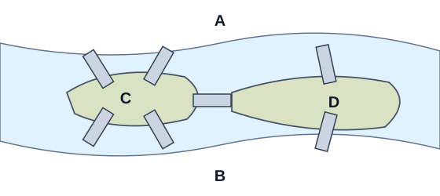

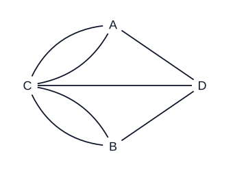

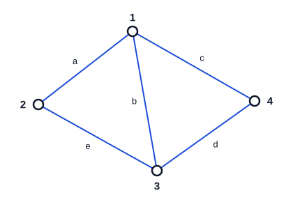

### 1.1. Phân loại 5 dạng đồ thị

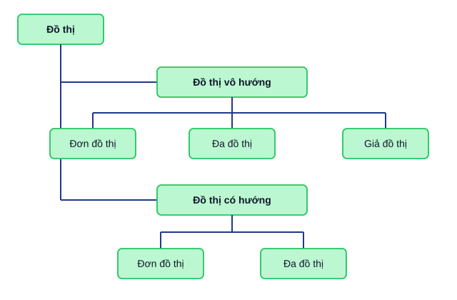

1. **Đơn đồ thị vô hướng (Simple Graph):** Cạnh là cặp **không có thứ tự** gồm 2 đỉnh phân biệt; giữa 2 đỉnh có tối đa 1 cạnh và **không có khuyên** (cạnh nối một đỉnh với chính nó).
2. **Đa đồ thị vô hướng (Multigraph):** Cho phép có **cạnh song song** (nhiều cạnh nối cùng một cặp đỉnh), không có khuyên.
3. **Giả đồ thị vô hướng (Pseudograph):** Cho phép cả **cạnh song song** và **khuyên** (loop).
4. **Đơn đồ thị có hướng (Directed Graph):** Cung là cặp **có thứ tự** $(u, v)$ đi từ $u$ đến $v$ ($u \ne v$); giữa hai đỉnh theo một chiều có tối đa 1 cung, không có khuyên.
5. **Đa đồ thị có hướng (Directed Multigraph):** Cho phép có nhiều **cung song song** cùng hướng (và khuyên).

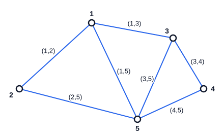

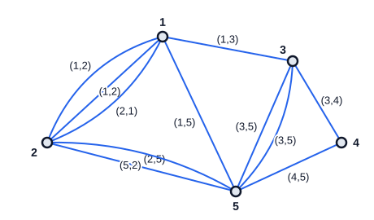

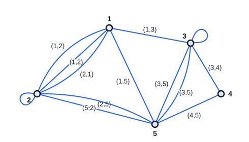

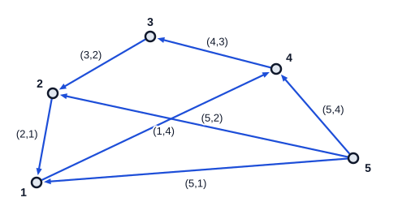

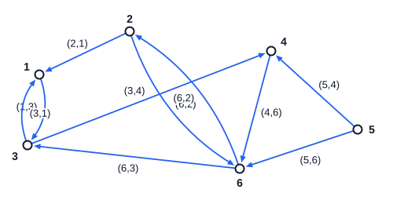

| Loại đồ thị | Cạnh / Cung | Cạnh bội (song song)? | Khuyên (loop)? |
|---|---|:---:|:---:|
| **Đơn đồ thị vô hướng** | Không có thứ tự | Không | Không |
| **Đa đồ thị vô hướng** | Không có thứ tự | Có | Không |
| **Giả đồ thị vô hướng** | Không có thứ tự | Có | Có |
| **Đơn đồ thị có hướng** | Có thứ tự | Không | Không |
| **Đa đồ thị có hướng** | Có thứ tự | Có | Có |

## 2. Các thuật ngữ cơ bản

### 2.1. Đỉnh kề, liên thuộc và bậc của đỉnh (Đồ thị vô hướng)

Trong đồ thị vô hướng $G = (V, E)$, nếu $e = (u, v) \in E$ thì $u$ và $v$ gọi là **kề nhau**, cạnh $e$ **liên thuộc** với $u$ và $v$.

- **Bậc của đỉnh $v$** ($\deg(v)$): Số cạnh liên thuộc với $v$ (trong giả đồ thị, mỗi khuyên tại $v$ tính thêm 2 bậc).
- **Đỉnh cô lập:** Đỉnh có $\deg(v) = 0$.
- **Đỉnh treo:** Đỉnh có $\deg(v) = 1$; cạnh nối với đỉnh treo gọi là **cạnh treo**.

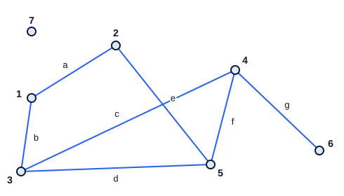

*Ví dụ trên hình:* $\deg(1) = 2,\; \deg(2) = 2,\; \deg(3) = 3,\; \deg(4) = 3,\; \deg(5) = 3,\; \deg(6) = 1$ (đỉnh treo), $\deg(7) = 0$ (đỉnh cô lập).

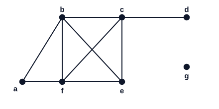

**Ví dụ:** Xác định bậc các đỉnh, đỉnh treo, đỉnh cô lập và cạnh treo của đồ thị $P$ dưới đây:

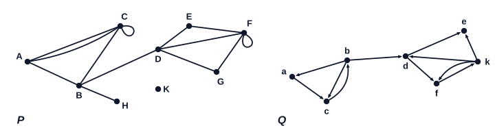

| Đỉnh | $A$ | $B$ | $C$ | $D$ | $E$ | $F$ | $G$ | $H$ | $K$ |
|:---:|:---:|:---:|:---:|:---:|:---:|:---:|:---:|:---:|:---:|
| **Bậc** | 3 | 4 | 5 | 4 | 2 | 5 | 2 | 1 | 0 |

Trong đồ thị $P$: $K$ là đỉnh cô lập ($\deg(K)=0$), $H$ là đỉnh treo ($\deg(H)=1$) và $(B, H)$ là cạnh treo.

### 2.2. Định lý bắt tay và hệ quả

!!! note "Định lý bắt tay (Handshaking Lemma)"
    Với mọi đồ thị vô hướng $G = (V, E)$ có $m$ cạnh, tổng bậc của tất cả các đỉnh luôn bằng hai lần số cạnh:

    $$\sum_{v \in V} \deg(v) = 2m$$

*Giải thích:* Mỗi cạnh nối hai đầu mút nên đóng góp đúng 2 đơn vị vào tổng bậc (kể cả khuyên đóng góp 2 đơn vị vào chính đỉnh đó).

- **Hệ quả:** Trong mọi đồ thị vô hướng, **số đỉnh bậc lẻ luôn là một số chẵn**.
- *Chứng minh:* Gọi $L$ và $C$ lần lượt là tập đỉnh bậc lẻ và bậc chẵn. Ta có:
  $$2m = \sum_{v \in V} \deg(v) = \sum_{v \in L} \deg(v) + \sum_{v \in C} \deg(v)$$
  Vì $2m$ chẵn và $\sum_{v \in C} \deg(v)$ chẵn nên $\sum_{v \in L} \deg(v)$ phải là số chẵn. Một tổng các số lẻ là số chẵn khi và chỉ khi số lượng số hạng $|L|$ là **chẵn**.

### 2.3. Bán bậc vào và bán bậc ra (Đồ thị có hướng)

Nếu $e = (u, v)$ là một **cung** có hướng từ $u$ đến $v$, thì $u$ là đỉnh đầu, $v$ là đỉnh cuối.

- **Bán bậc ra** $\deg^+(v)$: Số cung đi ra khỏi $v$.
- **Bán bậc vào** $\deg^-(v)$: Số cung đi vào $v$.

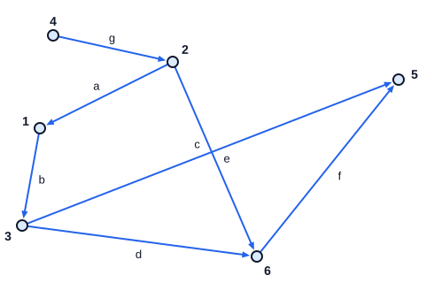

**Định lý:** Với mọi đồ thị có hướng $G = (V, E)$ có $m$ cung:

$$\sum_{v \in V} \deg^+(v) = \sum_{v \in V} \deg^-(v) = m$$

**Ví dụ:** Bảng bán bậc của đồ thị có hướng $Q$ và đồ thị 5 đỉnh $\{a, b, c, d, e\}$:

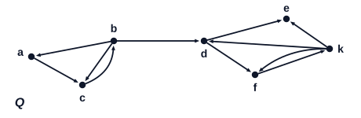

| Đỉnh $x$ trong $Q$ | $a$ | $b$ | $c$ | $d$ | $e$ | $f$ | $k$ |
|:---:|:---:|:---:|:---:|:---:|:---:|:---:|:---:|
| $\deg^-(x)$ | 1 | 1 | 2 | 2 | 2 | 2 | 1 |
| $\deg^+(x)$ | 1 | 3 | 1 | 2 | 0 | 1 | 3 |

Đồ thị $Q$ có tổng $\deg^- = \sum \deg^+ = 11$ cung, không có đỉnh cô lập hay đỉnh treo.

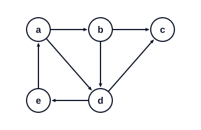

- Đỉnh $a$: $\deg^- = 2, \deg^+ = 1$; đỉnh $b$: $\deg^- = 2, \deg^+ = 1$; đỉnh $c$: $\deg^- = 0, \deg^+ = 2$; đỉnh $d$: $\deg^- = 2, \deg^+ = 2$; đỉnh $e$: $\deg^- = 1, \deg^+ = 1$.

#### Bài tập tự luyện phần Bậc của đỉnh

1. Một đồ thị vô hướng có 10 đỉnh, mỗi đỉnh đều có bậc bằng 6. Đồ thị có bao nhiêu cạnh? *(A. 20 / B. 30 / C. 40 / D. 50)*
2. Một đồ thị vô hướng có bậc các đỉnh là `4, 3, 3, 2, 2`. Số cạnh của đồ thị là bao nhiêu? *(A. 5 / B. 6 / C. 7 / D. 8)*
3. Dãy bậc nào sau đây **không thể** là dãy bậc của một đồ thị vô hướng?
    - a) `3, 3, 3, 3, 2` $\qquad$ b) `1, 2, 3, 4, 5` $\qquad$ c) `0, 1, 2, 2, 3` $\qquad$ d) `1, 1, 1, 1`
4. Có tồn tại đơn đồ thị 15 đỉnh mà mỗi đỉnh đều có bậc bằng 5 không?
5. Trong một giải đấu có $n$ đội, đã thi đấu tổng cộng $n + 1$ trận (hai đội bất kỳ gặp nhau tối đa một lần). Chứng minh có ít nhất một đội đã thi đấu từ 3 trận trở lên.

??? tip "Hướng dẫn giải bài tập 1 – 5"
    - **Câu 1 (B. 30):** Theo định lý bắt tay: $2m = 10 \times 6 = 60 \Rightarrow m = 30$.
    - **Câu 2 (C. 7):** $2m = 4 + 3 + 3 + 2 + 2 = 14 \Rightarrow m = 7$.
    - **Câu 3 (b):** Dãy `1, 2, 3, 4, 5` có tổng bậc bằng $15$ (số lẻ, có 3 đỉnh bậc lẻ), trái với hệ quả định lý bắt tay. Các dãy còn lại đều có tổng bậc chẵn và dựng được đơn đồ thị.
    - **Câu 4:** **Không**, vì tổng bậc là $15 \times 5 = 75$ là số lẻ (vô lý).
    - **Câu 5:** Coi mỗi đội là 1 đỉnh, mỗi trận là 1 cạnh. Tổng bậc các đỉnh là $2m = 2(n + 1) = 2n + 2$. Vì có $n$ đội, theo nguyên lý Dirichlet tồn tại ít nhất một đội có bậc $\ge \lceil (2n + 2) / n \rceil \ge 3$.

## 3. Đường đi, chu trình và tính liên thông

### 3.1. Đường đi và chu trình

- **Đường đi độ dài $n$** từ $u$ đến $v$ là dãy đỉnh $x_0, x_1, \dots, x_n$ sao cho $u = x_0$, $v = x_n$ và mỗi $(x_i, x_{i+1})$ là một cạnh (hoặc cung có hướng từ $x_i$ tới $x_{i+1}$).
- **Chu trình:** Đường đi khép kín có đỉnh đầu trùng đỉnh cuối ($x_0 = x_n$).
- **Đường đi đơn / Chu trình đơn:** Không đi qua một cạnh (cung) nào quá một lần.

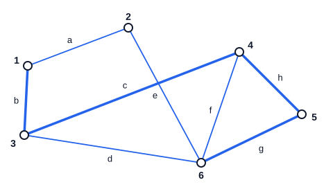

*Ví dụ vô hướng:* $(1, 3, 4, 5, 6)$ là đường đi; $(1, 2, 6, 3, 1)$ là chu trình đơn; $(2, 6, 4, 3, 6, 2)$ là chu trình không đơn (lặp đỉnh 6, nếu qua lại cùng cạnh thì không đơn).

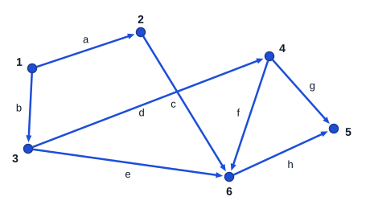

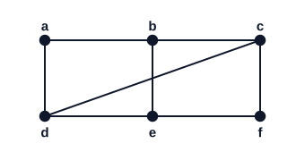

*Ví dụ trên hình cuối:*
- `a, d, c, f, e`: đường đi đơn độ dài 4.
- `d, e, c, a`: **không** phải đường đi vì không có cạnh `(e, c)`.
- `b, c, f, e, b`: chu trình độ dài 4.
- `a, b, e, d, a, b`: đường đi độ dài 5 nhưng **không đơn** vì lặp lại cạnh `(a, b)`.

### 3.2. Đồ thị con, đồ thị riêng và thành phần liên thông

Cho đồ thị $G = (V, E)$:

- **Đồ thị con (Subgraph):** $H = (W, F)$ với $W \subseteq V$ và $F \subseteq E$ (các cạnh trong $F$ chỉ được nối các đỉnh thuộc $W$). Nếu giữ lại toàn bộ cạnh của $G$ nối giữa các đỉnh trong $W$ thì gọi là *đồ thị con cảm sinh* bởi $W$.
- **Đồ thị riêng (Spanning Subgraph):** $G'' = (V, E'')$ giữ nguyên tập đỉnh $V$ và bỏ bớt một số cạnh ($E'' \subseteq E$).
- **Đồ thị liên thông (vô hướng):** Giữa hai đỉnh bất kỳ luôn có đường đi nối chúng. Một đồ thị không liên thông sẽ phân rã thành các **thành phần liên thông** (các đồ thị con liên thông cực đại).

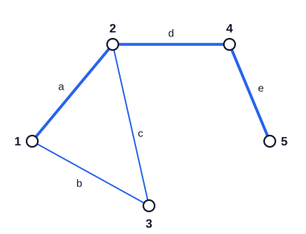

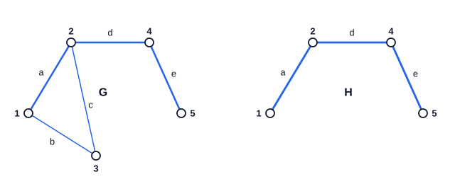

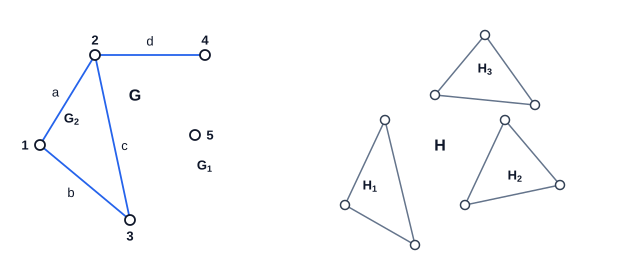

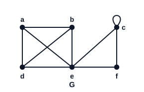

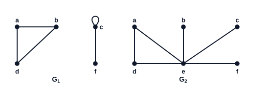

**Ví dụ đếm số đồ thị con:** Đồ thị đầy đủ $K_3$ (3 đỉnh, 3 cạnh) có bao nhiêu đồ thị con có ít nhất 1 đỉnh?

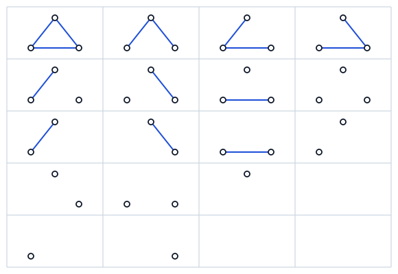

**Cách đếm tổ hợp:** Xét theo số đỉnh của tập con $V' \subseteq V$:
- Chọn 1 đỉnh ($C_3^1 = 3$ cách): 0 cạnh $\Rightarrow 3 \times 2^0 = 3$ đồ thị con.
- Chọn 2 đỉnh ($C_3^2 = 3$ cách): tối đa 1 cạnh $\Rightarrow 3 \times 2^1 = 6$ đồ thị con.
- Chọn 3 đỉnh ($C_3^3 = 1$ cách): tối đa 3 cạnh $\Rightarrow 1 \times 2^3 = 8$ đồ thị con.
- Tổng cộng: $3 + 6 + 8 = 17$ đồ thị con (nếu tính cả đồ thị rỗng là 18).

### 3.3. Đỉnh trụ, cạnh cầu và liên thông trên đồ thị có hướng

- **Đỉnh trụ (đỉnh rẽ nhánh):** Đỉnh $v$ mà khi xoá $v$ cùng các cạnh liên thuộc với nó sẽ làm **tăng số thành phần liên thông** của đồ thị.
- **Cạnh cầu:** Cạnh $e$ mà khi xoá $e$ sẽ làm **tăng số thành phần liên thông** của đồ thị.

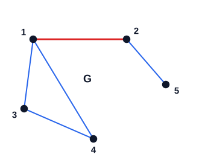

Trên đồ thị có hướng $G = (V, E)$, có hai mức độ liên thông:

- **Liên thông mạnh (Strongly Connected):** Giữa hai đỉnh bất kỳ $u, v$ luôn có đường đi có hướng từ $u \to v$ và từ $v \to u$.
- **Liên thông yếu (Weakly Connected):** Đồ thị vô hướng tương ứng (bỏ mũi tên) là liên thông.

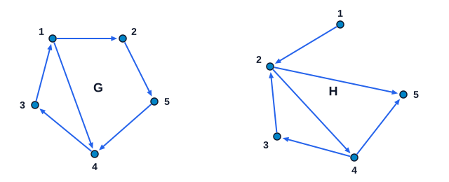

??? question "Bài tập chứng minh: Hai đỉnh bậc lẻ và đường đi nối chúng"
    Trong một đồ thị $G$ có đúng 2 đỉnh bậc lẻ (các đỉnh còn lại đều bậc chẵn). Chứng minh tồn tại một đường đi nối 2 đỉnh bậc lẻ đó với nhau.

    ??? tip "Hướng dẫn giải"
        Giả sử hai đỉnh bậc lẻ $u, v$ nằm ở hai thành phần liên thông khác nhau là $G_1$ và $G_2$. Khi đó $G_1$ là một đồ thị con độc lập chỉ chứa **đúng 1 đỉnh bậc lẻ** ($u$), mâu thuẫn với Hệ quả Định lý bắt tay (số đỉnh bậc lẻ phải chẵn). Do đó $u$ và $v$ bắt buộc phải thuộc cùng một thành phần liên thông, tức là luôn có đường đi nối chúng.

## 4. Một số dạng đồ thị đặc biệt

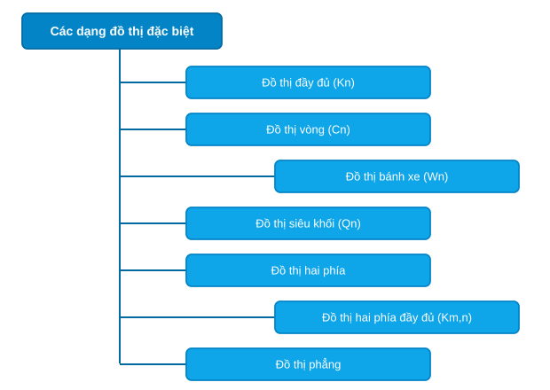

- **Đồ thị đầy đủ ($K_n$):** Đơn đồ thị vô hướng $n$ đỉnh mà hai đỉnh bất kỳ đều kề nhau. Số cạnh: $m = C_n^2 = \frac{n(n - 1)}{2}$.
- **Đồ thị vòng ($C_n$, $n \ge 3$):** Có đúng $n$ đỉnh, $n$ cạnh tạo thành một chu trình đơn duy nhất.
- **Đồ thị bánh xe ($W_n$, $n \ge 3$):** Thêm 1 đỉnh tâm nối với tất cả $n$ đỉnh của $C_n$. Có $n + 1$ đỉnh và $2n$ cạnh.
- **Đồ thị siêu khối ($Q_n$):** Có $2^n$ đỉnh đánh số bằng chuỗi nhị phân độ dài $n$; hai đỉnh kề nhau khi chuỗi nhị phân khác nhau đúng 1 bit. Mỗi đỉnh có bậc $n$, tổng số cạnh là $n \cdot 2^{n-1}$.

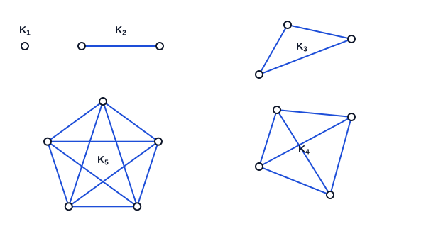

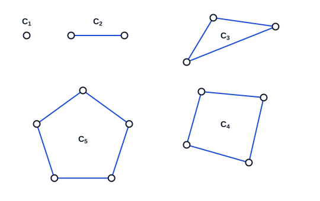

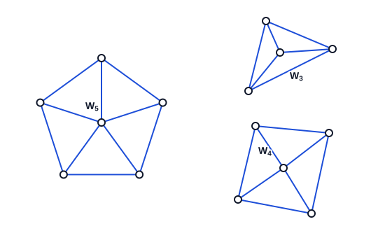

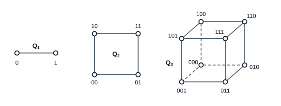

- **Đồ thị hai phía (Bipartite Graph):** Tập đỉnh chia được thành $V = X \cup Y$ ($X \cap Y = \emptyset$, $X, Y \ne \emptyset$) sao cho mọi cạnh đều nối một đỉnh thuộc $X$ với một đỉnh thuộc $Y$.
- **Đồ thị hai phía đầy đủ ($K_{m,n}$):** $|X| = m$, $|Y| = n$ và mọi đỉnh thuộc $X$ đều nối với mọi đỉnh thuộc $Y$. Có $m + n$ đỉnh và $m \cdot n$ cạnh.

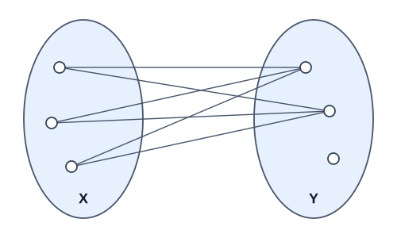

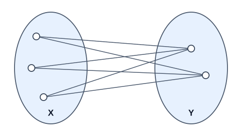

| Ký hiệu | Tên đồ thị | Số đỉnh | Số cạnh | Bậc mỗi đỉnh |
|:---:|---|:---:|:---:|:---:|
| $K_n$ | Đầy đủ | $n$ | $\frac{n(n-1)}{2}$ | $n - 1$ |
| $C_n$ | Vòng ($n \ge 3$) | $n$ | $n$ | $2$ |
| $W_n$ | Bánh xe ($n \ge 3$) | $n + 1$ | $2n$ | Tâm: $n$; vành: $3$ |
| $Q_n$ | Siêu khối | $2^n$ | $n \cdot 2^{n-1}$ | $n$ |
| $K_{m,n}$ | Hai phía đầy đủ | $m + n$ | $m \cdot n$ | Bên $X$: $n$; bên $Y$: $m$ |

!!! note "Định lý nhận biết đồ thị hai phía"
    Đơn đồ thị $G$ là **đồ thị hai phía** khi và chỉ khi $G$ **không chứa chu trình độ dài lẻ**.

**Thuật toán kiểm tra đồ thị hai phía (tô 2 màu theo từng lớp BFS):**

1. Chọn đỉnh $v$ chưa xét, đặt vào tập $X = \{v\}$.
2. Tìm $Y = \{u \mid u \text{ kề với một đỉnh trong } X\}$ (loại các đỉnh đã thuộc tập $Y$ ở các vòng trước nếu cài đặt bằng mảng đánh dấu màu).
3. Nếu một đỉnh kề vừa xuất hiện ở hai tập $X \cap Y \ne \emptyset$ (tức có cạnh nối hai đỉnh cùng phía) $\Rightarrow$ **không phải** đồ thị hai phía.
4. Tiếp tục mở rộng xen kẽ hai tập cho tới khi xét hết mọi thành phần liên thông.

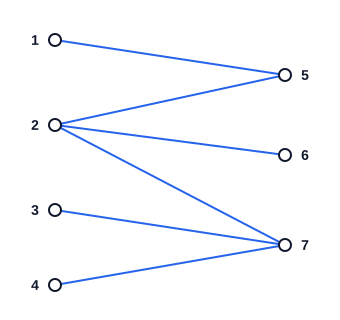

*Ví dụ minh hoạ trên hình:* Xuất phát từ $X = \{1\} \to Y = \{5\} \to \{1, 2\} \to \{5, 6, 7\} \to \{1, 2, 3, 4\}$. Không có cạnh nối nội bộ trong $X = \{1, 2, 3, 4\}$ hay $Y = \{5, 6, 7\}$, vậy đồ thị là hai phía.

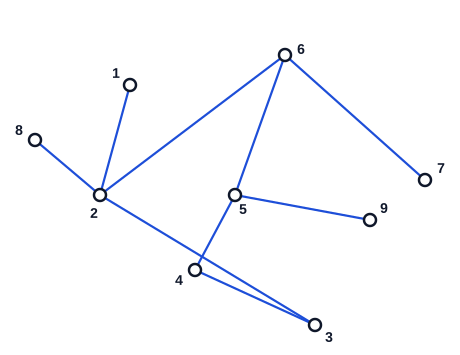

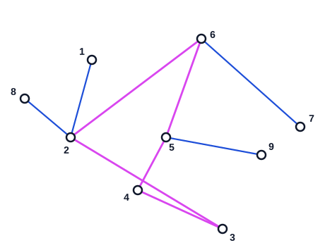

## 5. Đồ thị phẳng (Planar Graph)

**Định nghĩa:** Đồ thị được gọi là **đồ thị phẳng** nếu có thể vẽ nó trên mặt phẳng sao cho không có hai cạnh nào cắt nhau (ngoài các đỉnh mút chung).

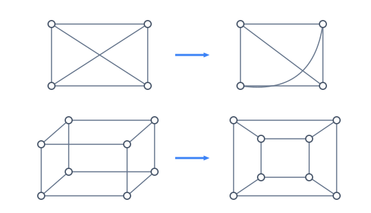

### 5.1. Công thức Euler

Cho $G = (V, E)$ là đồ thị phẳng, liên thông gồm $v$ đỉnh (hoặc $n$), $e$ cạnh (hoặc $m$) và chia mặt phẳng thành $f$ miền/mặt (hoặc $r$, tính cả miền vô hạn bên ngoài). Khi đó:

$$f = e - v + 2 \qquad (\text{hay } r = m - n + 2)$$

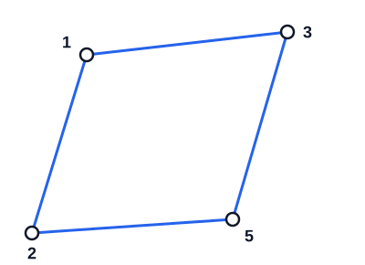

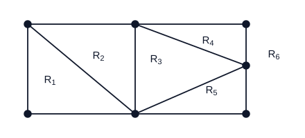

**Chứng minh quy nạp theo số cạnh $n$ của đồ thị phẳng $G_n$:**

- **Bước cơ sở:** Với $e_1 = 1,\; v_1 = 2$ (1 cạnh nối 2 đỉnh), mặt phẳng chưa bị chia kín nên $f_1 = 1 = 1 - 2 + 2$ (đúng).
- **Bước quy nạp:** Giả sử công thức đúng với $G_n$ ($f_n = e_n - v_n + 2$). Thêm 1 cạnh mới $(a_{n+1}, b_{n+1})$ để được $G_{n+1}$, có 2 trường hợp:
    1. **Cả hai đỉnh $a_{n+1}, b_{n+1}$ đều đã thuộc $G_n$:** Cạnh mới chia một mặt cũ thành 2 mặt nên $f_{n+1} = f_n + 1$, $e_{n+1} = e_n + 1$, $v_{n+1} = v_n \implies f_{n+1} = e_{n+1} - v_{n+1} + 2$.
    2. **Chỉ một đỉnh thuộc $G_n$, đỉnh còn lại là đỉnh mới:** Cạnh mới treo vào đỉnh cũ nên không tạo thêm mặt kín nào; ta có $f_{n+1} = f_n$, $e_{n+1} = e_n + 1$, $v_{n+1} = v_n + 1 \implies f_{n+1} = e_{n+1} - v_{n+1} + 2$.

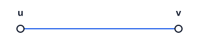

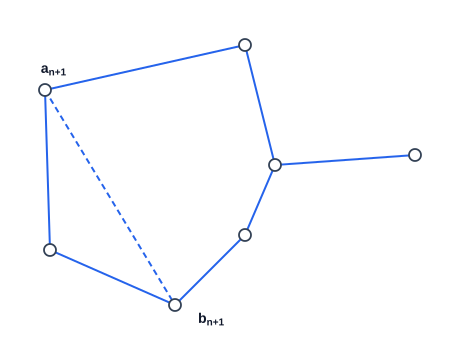

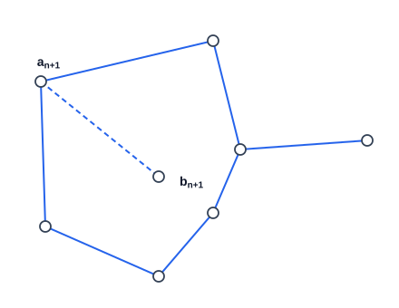

### 5.2. Hệ quả và Định lý Kuratowski

Từ công thức Euler, với đơn đồ thị phẳng liên thông $G$ có $n$ đỉnh ($n \ge 3$) và $m$ cạnh:

- **Hệ quả 1:** $m \le 3n - 6$.
- **Hệ quả 2:** Nếu $G$ **không có chu trình độ dài 3**, thì $m \le 2n - 4$.
- **Hệ quả 3:** Trong đơn đồ thị phẳng liên thông, luôn tồn tại ít nhất một đỉnh có bậc **$\le 5$**.

**Áp dụng chứng minh $K_5$ và $K_{3,3}$ không phẳng:**

- **$K_5$** có $n = 5, m = 10$, vi phạm Hệ quả 1 vì $10 > 3(5) - 6 = 9 \Rightarrow$ không phẳng. ($K_5$ là đồ thị không phẳng ít đỉnh nhất).
- **$K_{3,3}$** có $n = 6, m = 9$ và là đồ thị hai phía nên không có chu trình độ dài 3; vi phạm Hệ quả 2 vì $9 > 2(6) - 4 = 8 \Rightarrow$ không phẳng. ($K_{3,3}$ là đồ thị không phẳng ít cạnh nhất).

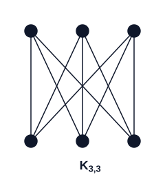

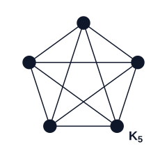

**Phép chia cạnh và đồng phôi (Homeomorphic):** Phép chia cạnh $(u, v)$ là việc xoá cạnh $(u, v)$, thêm đỉnh bậc 2 mới $w$ và hai cạnh $(u, w), (w, v)$. Hai đồ thị gọi là **đồng phôi** (đồng cấu) nếu chúng cùng sinh ra từ một đồ thị gốc qua dãy các phép chia cạnh.

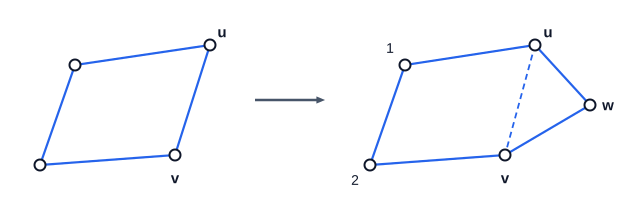

!!! note "Định lý Kuratowski (Điều kiện cần và đủ)"
    Một đồ thị là **phẳng** khi và chỉ khi nó **không chứa** bất kỳ đồ thị con nào đồng phôi với $K_5$ hoặc $K_{3,3}$.

**Ví dụ:** Kiểm tra tính phẳng của đồ thị $G$ bên dưới bằng Định lý Kuratowski:

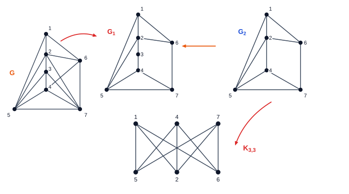

- Xoá đỉnh 4 và các cạnh liên thuộc để thu được đồ thị con $G_1$ (lưu ý nhãn đỉnh trên hình vẽ lại $G_2$).
- Gộp cạnh qua đỉnh bậc 2 (phép chia cạnh ngược), đồ thị thu được đồng phôi với $K_{3,3}$ gồm hai phía $\{1, 4, 7\}$ và $\{5, 2, 6\}$ (trên hình minh hoạ phép chia cạnh $(2, 4)$ qua đỉnh $3$). Do đó $G$ **không phẳng**.

## 6. Sự đẳng cấu của các đồ thị (Graph Isomorphism)

Hai đơn đồ thị $G_1 = (V_1, E_1)$ và $G_2 = (V_2, E_2)$ gọi là **đẳng cấu** (đẳng hình) nếu tồn tại một **song ánh** $f : V_1 \to V_2$ bảo toàn quan hệ kề:

$$\forall x, y \in V_1:\; (x, y) \in E_1 \iff (f(x), f(y)) \in E_2$$

Nói cách khác, hai đồ thị đẳng cấu có cùng cấu trúc liên kết, chỉ khác tên đỉnh và cách vẽ hình.

- **Tính bất biến đẳng cấu (điều kiện cần):** Hai đồ thị đẳng cấu bắt buộc phải có **cùng số đỉnh, cùng số cạnh, cùng dãy bậc sắp xếp, cùng số thành phần liên thông và cùng số chu trình độ dài $k$**. Nếu chỉ cần sai khác một bất biến thì hai đồ thị chắc chắn **không** đẳng cấu.

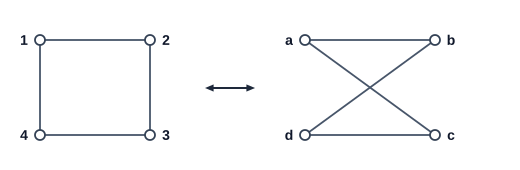

*Ví dụ 1:* $G_1$ ($V_1 = \{1, 2, 3, 4\}$) và $G_2$ ($V_2 = \{a, b, c, d\}$) đẳng cấu qua song ánh $f(1) = a,\; f(2) = b,\; f(3) = d,\; f(4) = c$.

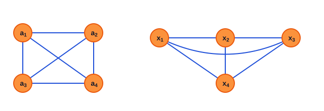

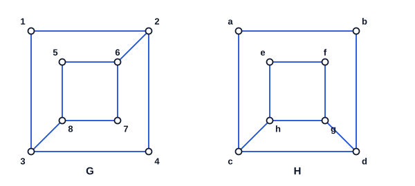

## 7. Các phương pháp biểu diễn đồ thị

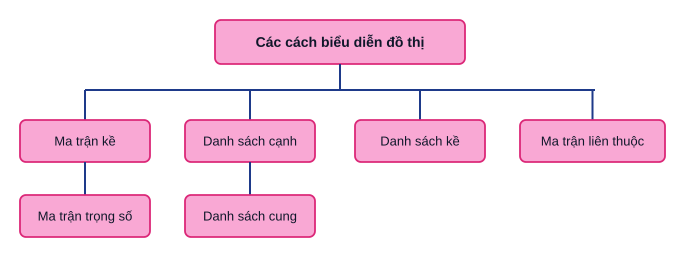

### 7.1. Ma trận kề (Adjacency Matrix)

Cho đồ thị $G = (V, E)$ có $n$ đỉnh $V = \{0, 1, \dots, n-1\}$. Ma trận kề $A = (a_{i,j})$ kích thước $n \times n$ được định nghĩa:

- **Đơn đồ thị (vô hướng / có hướng):** $a_{i,j} = 1$ nếu $(i, j) \in E$, ngược lại $a_{i,j} = 0$.
- **Đa đồ thị:** $a_{i,j}$ bằng số cạnh (hoặc cung) nối từ $i$ tới $j$.
- **Đồ thị có trọng số:** $a_{i,j} = c_{i,j}$ (trọng số cạnh) nếu $(i, j) \in E$, ngược lại $a_{i,j} = b$ (giá trị quy ước: $0, -1, \infty, \dots$).


*Bảng ma trận kề trọng số cho đồ thị 6 đỉnh trên hình (quy ước $b = 0$ khi không có cạnh):*

| Đỉnh | 0 | 1 | 2 | 3 | 4 | 5 |
|:---:|:---:|:---:|:---:|:---:|:---:|:---:|
| **0** | 0 | 4 | 3 | 0 | 7 | 0 |
| **1** | 4 | 0 | 5 | 0 | 3 | 0 |
| **2** | 3 | 5 | 0 | 2 | 0 | 0 |
| **3** | 0 | 0 | 2 | 0 | 5 | 2 |
| **4** | 7 | 3 | 0 | 5 | 0 | 3 |
| **5** | 0 | 0 | 0 | 2 | 3 | 0 |

**Tính chất của ma trận kề:**

- Ma trận kề của đồ thị vô hướng luôn **đối xứng** ($a_{i,j} = a_{j,i}$); với đơn đồ thị vô hướng, đường chéo chính bằng $0$.
- Với đồ thị vô hướng không khuyên: **Tổng hàng $i$ = Tổng cột $i$ = $\deg(i)$**.
- Với đồ thị có hướng: **Tổng hàng $i$ = $\deg^+(i)$**, **Tổng cột $i$ = $\deg^-(i)$**.

### 7.2. Danh sách cạnh và danh sách cung (Edge List)

Thường dùng cho **đồ thị thưa** ($m < 6n$) để tiết kiệm bộ nhớ: chỉ lưu danh sách $m$ cặp đỉnh $(u, v)$ của mỗi cạnh/cung.


| Cạnh | 0 | 1 | 2 | 3 | 4 | 5 | 6 | 7 | 8 |
|:---:|:---:|:---:|:---:|:---:|:---:|:---:|:---:|:---:|:---:|
| **Đầu 1** | 0 | 0 | 0 | 1 | 1 | 2 | 3 | 3 | 4 |
| **Đầu 2** | 1 | 2 | 4 | 2 | 4 | 3 | 4 | 5 | 5 |

- **Cài đặt bằng mảng hoặc cấu trúc danh sách liên kết:**

```cpp title="Cấu trúc cạnh trong C/C++"
typedef struct Edge {
    int u, v;
} Edge;
```


- **Danh sách cung (đồ thị có hướng):** Lưu thứ tự $(u, v)$ với $u$ là đỉnh đầu, $v$ là đỉnh cuối: `(1,2), (4,1), (1,3), (2,4), (3,4)`.


### 7.3. Danh sách kề (Adjacency List)

Với mỗi đỉnh $v$, lưu một danh sách các đỉnh kề với nó. Đây là cách biểu diễn **phổ biến nhất trong lập trình thuật toán**.


| Đỉnh $v$ | Danh sách đỉnh kề `Ke(v)` |
|:---:|---|
| 0 | `1, 2, 4` |
| 1 | `0, 2, 4` |
| 2 | `0, 1, 3` |
| 3 | `2, 4, 5` |
| 4 | `0, 1, 3, 5` |
| 5 | `3, 4` |

- **Cài đặt bằng mảng nén (CSR):** `Ke[] = {1, 2, 4, 0, 2, 4, 0, 1, 3, 2, 4, 5, 0, 1, 3, 5, 3, 4}` và mảng chỉ mục bắt đầu `ViTri[] = {0, 3, 6, 9, 12, 16, 18}`.
- **Cài đặt bằng danh sách liên kết trong C/C++:**


```cpp title="Xây dựng danh sách kề bằng con trỏ C/C++"
#include <iostream>
#include <cstdlib>
using namespace std;

const int MAXV = 99;
struct Node {
    int v;
    Node *next;
};

Node *ke[MAXV];

int main() {
    int n, m, x, y;
    cout << "Nhap so dinh va so canh: ";
    cin >> n >> m;
    for (int j = 0; j < n; j++) ke[j] = NULL;

    for (int j = 1; j <= m; j++) {
        cout << "Nhap dinh dau, dinh cuoi canh " << j << ": ";
        cin >> x >> y;
        Node *p = (Node*)malloc(sizeof(Node));
        p->v = y; p->next = ke[x]; ke[x] = p;

        p = (Node*)malloc(sizeof(Node));
        p->v = x; p->next = ke[y]; ke[y] = p;
    }
    return 0;
}
```

### 7.4. Ma trận liên thuộc (Incidence Matrix)

Biểu diễn quan hệ giữa $n$ đỉnh (hàng) và $m$ cạnh/cung (cột), ma trận $B = (b_{i,j})$ kích thước $n \times m$:

- **Đồ thị vô hướng:** $b_{i,j} = 1$ nếu đỉnh $i$ liên thuộc cạnh $j$, ngược lại $b_{i,j} = 0$.
    - Mỗi cột chứa đúng hai số `1` (hoặc một số `1` nếu cạnh $j$ là khuyên).
    - Hai cột ứng với hai cạnh song song thì giống hệt nhau.
    - Nếu không có khuyên, tổng hàng $i$ chính là $\deg(i)$.


| Đỉnh \ Cạnh | $e_0$ | $e_1$ | $e_2$ | $e_3$ | $e_4$ | $e_5$ | $e_6$ | $e_7$ | $e_8$ |
|:---:|:---:|:---:|:---:|:---:|:---:|:---:|:---:|:---:|:---:|
| **0** | 1 | 0 | 0 | 0 | 0 | 1 | 1 | 0 | 0 |
| **1** | 0 | 0 | 0 | 0 | 1 | 1 | 0 | 1 | 0 |
| **2** | 1 | 1 | 0 | 1 | 0 | 0 | 0 | 1 | 0 |
| **3** | 0 | 1 | 1 | 0 | 0 | 0 | 0 | 0 | 1 |
| **4** | 0 | 0 | 1 | 0 | 1 | 0 | 1 | 0 | 1 |

- **Đồ thị có hướng (không khuyên):** $b_{i,j} = 1$ nếu $i$ là đỉnh **đầu** của cung $j$; $b_{i,j} = -1$ nếu $i$ là đỉnh **cuối**; $b_{i,j} = 0$ nếu không liên thuộc. Ví dụ với 5 cung `(1,2), (4,1), (1,3), (3,4), (2,4)`:

| Đỉnh \ Cung | `(1,2)` | `(4,1)` | `(1,3)` | `(3,4)` | `(2,4)` |
|:---:|:---:|:---:|:---:|:---:|:---:|
| **1** | 1 | -1 | 1 | 0 | 0 |
| **2** | -1 | 0 | 0 | 0 | 1 |
| **3** | 0 | 0 | -1 | 1 | 0 |
| **4** | 0 | 1 | 0 | -1 | -1 |

### 7.5. Bảng so sánh 4 phương pháp biểu diễn đồ thị

| Phương pháp | Bộ nhớ | Kiểm tra cạnh $(u, v)$ | Ưu điểm chính | Hạn chế / Khi nên dùng |
|---|:---:|:---:|---|---|
| **Ma trận kề** | $O(n^2)$ | $O(1)$ | Kiểm tra kề cực nhanh, tính bậc dễ | Tốn bộ nhớ nếu đồ thị thưa; hợp đồ thị dày ($n$ nhỏ) |
| **Danh sách cạnh** | $O(m)$ | $O(m)$ | Rất gọn cho đồ thị thưa, dễ cài đặt (Kruskal) | Duyệt kề của một đỉnh chậm ($O(m)$) |
| **Danh sách kề** | $O(n + m)$ | $O(\deg(u))$ | Tiết kiệm bộ nhớ, duyệt BFS/DFS tối ưu | Phức tạp hơn một chút khi xoá cạnh |
| **Ma trận liên thuộc** | $O(n \cdot m)$ | $O(m)$ | Thể hiện rõ quan hệ đỉnh – cạnh, biểu diễn được cạnh bội | Tốn nhiều bộ nhớ nhất ($n \times m$) |

## 8. Bài tập tổng hợp Chương 2

1. Tính số cạnh của $K_8$, $C_{2007}$ và $W_{100}$.
2. Cho đồ thị phẳng, liên thông $G$ có 20 đỉnh, mỗi đỉnh đều có bậc bằng 3. Đồ thị biểu diễn phẳng của $G$ có bao nhiêu mặt?
3. Cho đồ thị hai phía có $p$ đỉnh và $q$ cạnh. Chứng minh $q \le \frac{p^2}{4}$. Dấu bằng xảy ra khi nào?
4. Cho đồ thị đơn $G$ có $n$ đỉnh, $m$ cạnh với $m \ge n$. Chứng minh $G$ chứa ít nhất một chu trình.
5. Có bao nhiêu đồ thị đơn (gắn nhãn) gồm 5 đỉnh và có 4 hoặc 6 cạnh?
6. Vẽ đồ thị vô hướng $G = (V, E)$ với $V = \{a, b, c, d, e, f, g\}$ và $E = \{(e, g), (b, f), (d, c), (d, f), (c, f), (a, f), (e, d)\}$.
7. Xác định bậc, tính liên thông, đường đi, chu trình, cạnh cầu và đỉnh trụ cho các đồ thị vô hướng và có hướng dưới đây:


8. Kiểm tra tính đẳng cấu của hai cặp đồ thị dưới đây (cặp 1 cho sẵn song ánh $f(A)=1, f(B)=2, f(C)=3, f(D)=4, f(E)=5, f(F)=6$):


9. Cho biết hai đồ thị dưới đây có phẳng không? Nếu có, hãy vẽ lại sao cho các cạnh không cắt nhau:


10. Thực hành tổng hợp trên các đồ thị kiểm tra cuối chương: xác định tính liên thông, đỉnh trụ, cạnh cầu, bậc/bán bậc và biểu diễn bằng ma trận kề:


??? tip "Hướng dẫn giải bài tập 1 – 5"
    - **Bài 1:** $K_8$ có $\frac{8 \times 7}{2} = 28$ cạnh; $C_{2007}$ có $2007$ cạnh; $W_{100}$ có $2 \times 100 = 200$ cạnh.
    - **Bài 2:** Tổng bậc $= 20 \times 3 = 60 \Rightarrow m = 30$ cạnh. Theo công thức Euler: $f = m - n + 2 = 30 - 20 + 2 = 12$ mặt.
    - **Bài 3:** Giả sử hai phía có $x$ và $y$ đỉnh ($x + y = p$). Số cạnh tối đa khi là đồ thị hai phía đầy đủ: $q \le x \cdot y \le \left(\frac{x + y}{2}\right)^2 = \frac{p^2}{4}$ (BĐT Cauchy). Dấu `=` xảy ra khi đồ thị là $K_{p/2,\, p/2}$ ($p$ chẵn).
    - **Bài 4:** Nếu $G$ không có chu trình thì $G$ là một rừng gồm $k \ge 1$ cây, khi đó số cạnh chỉ là $m = n - k \le n - 1$, mâu thuẫn với $m \ge n$. Vậy $G$ bắt buộc phải có ít nhất một chu trình.
    - **Bài 5:** Đơn đồ thị 5 đỉnh có tối đa $C_5^2 = 10$ cặp đỉnh (vị trí đặt cạnh).
      - Số đồ thị 4 cạnh: $C_{10}^4 = 210$.
      - Số đồ thị 6 cạnh: $C_{10}^6 = 210$.
      - Tổng cộng: $210 + 210 = 420$ đồ thị gắn nhãn.
