# Chương 3: Đồ thị Euler và Đồ thị Hamilton

<p class="vn-lead">Khái niệm, tiêu chuẩn nhận biết, thuật toán tìm chu trình – đường đi Euler (Fleury, Stack) và Hamilton (quy tắc loại cạnh, cây liệt kê, quay lui), cùng các bài toán ứng dụng kinh điển.</p>

!!! abstract "Trọng tâm chương"
    - Nắm vững điều kiện cần và đủ để đồ thị vô hướng/có hướng là **Euler** hoặc **nửa Euler**.
    - Cài đặt và chạy tay được thuật toán **Fleury** và thuật toán **ngăn xếp (Stack)** tìm chu trình Euler, cũng như giải **Bài toán người đưa thư (CPP)**.
    - Phân biệt đúng **điều kiện đủ** (Dirac, Ore) và **điều kiện cần** (xoá $k$ đỉnh) khi nhận biết **đồ thị Hamilton**.
    - Vẽ **cây liệt kê**, sửa và cài đặt **thuật toán quay lui Hamilton** cho **Bài toán người du lịch (TSP)**.

## 1. Đồ thị Euler

### 1.1. Bài toán 7 cây cầu Königsberg và các khái niệm

Bài toán lịch sử của Leonhard Euler (1736) đặt ra câu hỏi: liệu có thể đi dạo qua **tất cả 7 cây cầu** ở thành phố Königsberg, **mỗi cây cầu đúng một lần**, rồi quay về điểm xuất phát hay không?

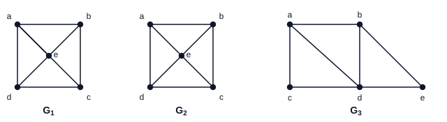

- **Đường đi Euler:** Đường đi đơn đi qua **tất cả các cạnh (cung)** của đồ thị, mỗi cạnh đúng một lần.
- **Chu trình Euler:** Chu trình đơn đi qua **tất cả các cạnh (cung)** của đồ thị, mỗi cạnh đúng một lần (điểm đầu trùng điểm cuối).
- **Đồ thị Euler:** Đồ thị có chu trình Euler.
- **Đồ thị nửa Euler (Semi-Euler):** Đồ thị có đường đi Euler (nhưng không có chu trình Euler).

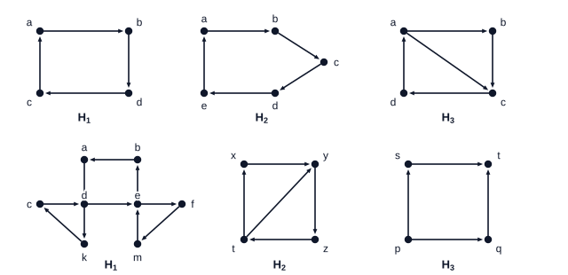

*Ví dụ trên hình:*
- **Đồ thị vô hướng:** $H_1$ là đồ thị Euler (mọi đỉnh bậc chẵn); $H_2$ là đồ thị nửa Euler (có đúng 2 đỉnh bậc lẻ là $b, d$); $H_3$ không phải Euler cũng không phải nửa Euler (có 4 đỉnh bậc lẻ).
- **Đồ thị có hướng:** $H_1$ có chu trình Euler $\langle a, d, k, c, d, e, f, m, e, b, a \rangle$; $H_2$ có đường đi Euler $\langle t, x, y, z, t, y \rangle$; $H_3$ không có cả hai.

### 1.2. Định lý nhận biết đồ thị Euler và nửa Euler

Điều kiện **cần và đủ** để đồ thị (không có đỉnh cô lập) là Euler hoặc nửa Euler:

| Loại đồ thị | Điều kiện là **Đồ thị Euler** | Điều kiện là **Đồ thị nửa Euler** |
|---|---|---|
| **Vô hướng** | 1. **Liên thông**<br>2. **Mọi đỉnh** đều có bậc chẵn | 1. **Liên thông**<br>2. Có đúng **0 hoặc 2 đỉnh bậc lẻ** (nếu có 2 đỉnh bậc lẻ, đường đi bắt đầu ở đỉnh lẻ này và kết thúc ở đỉnh lẻ kia) |
| **Có hướng** | 1. **Liên thông yếu** (khi đó cân bằng bậc sẽ tự kéo theo liên thông mạnh)<br>2. **Mọi đỉnh** cân bằng: $\deg^+(v) = \deg^-(v)$ | 1. **Liên thông yếu**<br>2. Tồn tại đúng 2 đỉnh $u, v$ thoả mãn $\deg^+(u) - \deg^-(u) = 1$ (đỉnh xuất phát) và $\deg^-(v) - \deg^+(v) = 1$ (đỉnh kết thúc); mọi đỉnh còn lại có $\deg^+(s) = \deg^-(s)$ |

**Quy trình 2 bước chứng minh bằng ma trận kề:**

1. **Kiểm tra tính liên thông:** Dùng `BFS(1)` hoặc `DFS(1)` (với đồ thị có hướng, xét trên đồ thị vô hướng tương ứng để kiểm tra liên thông yếu). Nếu tập đỉnh duyệt được bằng $V$ thì liên thông.
2. **Kiểm tra bậc từ ma trận kề $A$:**
    - Vô hướng: Tổng hàng $u$ (hoặc cột $u$) bằng $\deg(u)$.
    - Có hướng: Tổng hàng $u$ bằng $\deg^+(u)$, tổng cột $u$ bằng $\deg^-(u)$.

**Ví dụ 1 (Ma trận kề đồ thị vô hướng Euler):** Chứng minh đồ thị vô hướng 13 đỉnh cho bởi ma trận kề $A$ là đồ thị Euler:

$$
A = \begin{pmatrix}
0 & 1 & 0 & 0 & 0 & 1 & 0 & 0 & 0 & 0 & 0 & 0 & 0 \\
1 & 0 & 1 & 0 & 1 & 1 & 0 & 0 & 0 & 0 & 0 & 0 & 0 \\
0 & 1 & 0 & 1 & 1 & 0 & 0 & 0 & 0 & 0 & 1 & 0 & 0 \\
0 & 0 & 1 & 0 & 0 & 0 & 1 & 1 & 0 & 0 & 1 & 0 & 0 \\
0 & 1 & 1 & 0 & 0 & 1 & 1 & 0 & 0 & 0 & 0 & 0 & 0 \\
1 & 1 & 0 & 0 & 1 & 0 & 1 & 0 & 0 & 0 & 0 & 0 & 0 \\
0 & 0 & 0 & 1 & 1 & 1 & 0 & 1 & 0 & 0 & 0 & 0 & 0 \\
0 & 0 & 0 & 1 & 0 & 0 & 1 & 0 & 1 & 1 & 0 & 0 & 0 \\
0 & 0 & 0 & 0 & 0 & 0 & 0 & 1 & 0 & 1 & 0 & 1 & 1 \\
0 & 0 & 0 & 0 & 0 & 0 & 0 & 1 & 1 & 0 & 1 & 1 & 0 \\
0 & 0 & 1 & 1 & 0 & 0 & 0 & 0 & 0 & 1 & 0 & 1 & 0 \\
0 & 0 & 0 & 0 & 0 & 0 & 0 & 0 & 1 & 1 & 1 & 0 & 1 \\
0 & 0 & 0 & 0 & 0 & 0 & 0 & 0 & 1 & 0 & 0 & 1 & 0
\end{pmatrix}
$$

- **Liên thông:** $\text{BFS}(1) = \{1, 2, 6, 3, 5, 7, 4, 11, 8, 10, 12, 9, 13\} = V \implies G$ liên thông.
- **Bậc các đỉnh:** $\deg(1) = \deg(13) = 2$; các đỉnh từ $2$ đến $12$ đều có bậc $4$. Tất cả các đỉnh đều bậc chẵn $\implies G$ là **đồ thị Euler**.

**Ví dụ 2 (Ma trận kề đồ thị có hướng Euler):** Xét ma trận kề $A$ của đồ thị có hướng 13 đỉnh:

$$
A = \begin{pmatrix}
0 & 1 & 0 & 0 & 0 & 0 & 0 & 0 & 0 & 0 & 0 & 0 & 0 \\
0 & 0 & 1 & 0 & 1 & 0 & 0 & 0 & 0 & 0 & 0 & 0 & 0 \\
0 & 0 & 0 & 1 & 0 & 0 & 0 & 0 & 0 & 0 & 1 & 0 & 0 \\
0 & 0 & 0 & 0 & 0 & 0 & 1 & 0 & 0 & 0 & 1 & 0 & 0 \\
0 & 0 & 1 & 0 & 0 & 1 & 0 & 0 & 0 & 0 & 0 & 0 & 0 \\
1 & 1 & 0 & 0 & 0 & 0 & 0 & 0 & 0 & 0 & 0 & 0 & 0 \\
0 & 0 & 0 & 0 & 1 & 1 & 0 & 0 & 0 & 0 & 0 & 0 & 0 \\
0 & 0 & 0 & 1 & 0 & 0 & 1 & 0 & 0 & 0 & 0 & 0 & 0 \\
0 & 0 & 0 & 0 & 0 & 0 & 0 & 1 & 0 & 1 & 0 & 0 & 0 \\
0 & 0 & 0 & 0 & 0 & 0 & 0 & 1 & 0 & 0 & 0 & 1 & 0 \\
0 & 0 & 0 & 0 & 0 & 0 & 0 & 0 & 0 & 1 & 0 & 1 & 0 \\
0 & 0 & 0 & 0 & 0 & 0 & 0 & 0 & 0 & 1 & 0 & 0 & 1 \\
0 & 0 & 0 & 0 & 0 & 0 & 0 & 0 & 1 & 0 & 0 & 0 & 0
\end{pmatrix}
$$

- **Liên thông yếu:** $\text{BFS}(1) = \{1, 2, 3, 5, 4, 11, 6, 7, 10, 12, 8, 9, 13\} = V \implies G$ liên thông yếu.
- **Bán bậc:** $\deg^+(1) = \deg^-(1) = \deg^+(13) = \deg^-(13) = 1$; mọi đỉnh còn lại ($2 \dots 12$) đều có $\deg^+(v) = \deg^-(v) = 2$. Vậy $G$ là **đồ thị Euler**.

**Ví dụ 3 (Đồ thị vô hướng nửa Euler):** Ma trận kề $A$ dưới đây có bậc các đỉnh: $\deg(1) = \deg(13) = 3$, $\deg(2) = \deg(3) = \deg(6) = \deg(7) = \deg(8) = \deg(9) = \deg(11) = \deg(12) = 4$, $\deg(4) = \deg(5) = \deg(10) = 6$. Vì $G$ liên thông và có đúng 2 đỉnh bậc lẻ ($1$ và $13$) nên $G$ là **đồ thị nửa Euler**.

$$
A = \begin{pmatrix}
0 & 1 & 0 & 0 & 1 & 1 & 0 & 0 & 0 & 0 & 0 & 0 & 0 \\
1 & 0 & 1 & 0 & 1 & 1 & 0 & 0 & 0 & 0 & 0 & 0 & 0 \\
0 & 1 & 0 & 1 & 1 & 0 & 0 & 0 & 0 & 0 & 1 & 0 & 0 \\
0 & 0 & 1 & 0 & 1 & 0 & 1 & 1 & 0 & 1 & 1 & 0 & 0 \\
1 & 1 & 1 & 1 & 0 & 1 & 1 & 0 & 0 & 0 & 0 & 0 & 0 \\
1 & 1 & 0 & 0 & 1 & 0 & 1 & 0 & 0 & 0 & 0 & 0 & 0 \\
0 & 0 & 0 & 1 & 1 & 1 & 0 & 1 & 0 & 0 & 0 & 0 & 0 \\
0 & 0 & 0 & 1 & 0 & 0 & 1 & 0 & 1 & 1 & 0 & 0 & 0 \\
0 & 0 & 0 & 0 & 0 & 0 & 0 & 1 & 0 & 1 & 0 & 1 & 1 \\
0 & 0 & 0 & 1 & 0 & 0 & 0 & 1 & 1 & 0 & 1 & 1 & 1 \\
0 & 0 & 1 & 1 & 0 & 0 & 0 & 0 & 0 & 1 & 0 & 1 & 0 \\
0 & 0 & 0 & 0 & 0 & 0 & 0 & 0 & 1 & 1 & 1 & 0 & 1 \\
0 & 0 & 0 & 0 & 0 & 0 & 0 & 0 & 1 & 1 & 0 & 1 & 0
\end{pmatrix}
$$

**Ví dụ 4 (Đồ thị có hướng nửa Euler):** Ma trận kề $A$ dưới đây có tính liên thông yếu; các đỉnh $2, 3, 6, 7, 8, 9, 11, 12$ có $\deg^+ = \deg^- = 2$; các đỉnh $4, 5, 10$ có $\deg^+ = \deg^- = 3$; riêng đỉnh 1 có $\deg^+(1) - \deg^-(1) = 1$ và đỉnh 13 có $\deg^-(13) - \deg^+(13) = 1$. Do đó $G$ là **đồ thị nửa Euler** (đường đi Euler xuất phát tại $1$, kết thúc tại $13$).

$$
A = \begin{pmatrix}
0 & 1 & 0 & 0 & 1 & 0 & 0 & 0 & 0 & 0 & 0 & 0 & 0 \\
0 & 0 & 1 & 0 & 1 & 0 & 0 & 0 & 0 & 0 & 0 & 0 & 0 \\
0 & 0 & 0 & 1 & 0 & 0 & 0 & 0 & 0 & 0 & 1 & 0 & 0 \\
0 & 0 & 0 & 0 & 0 & 0 & 1 & 0 & 0 & 1 & 1 & 0 & 0 \\
0 & 0 & 1 & 1 & 0 & 1 & 0 & 0 & 0 & 0 & 0 & 0 & 0 \\
1 & 1 & 0 & 0 & 0 & 0 & 0 & 0 & 0 & 0 & 0 & 0 & 0 \\
0 & 0 & 0 & 0 & 1 & 1 & 0 & 0 & 0 & 0 & 0 & 0 & 0 \\
0 & 0 & 0 & 1 & 0 & 0 & 1 & 0 & 0 & 0 & 0 & 0 & 0 \\
0 & 0 & 0 & 0 & 0 & 0 & 0 & 1 & 0 & 1 & 0 & 0 & 0 \\
0 & 0 & 0 & 0 & 0 & 0 & 0 & 1 & 0 & 0 & 0 & 1 & 1 \\
0 & 0 & 0 & 0 & 0 & 0 & 0 & 0 & 0 & 1 & 0 & 1 & 0 \\
0 & 0 & 0 & 0 & 0 & 0 & 0 & 0 & 0 & 1 & 0 & 0 & 1 \\
0 & 0 & 0 & 0 & 0 & 0 & 0 & 0 & 1 & 0 & 0 & 0 & 0
\end{pmatrix}
$$

### 1.3. Thuật toán tìm chu trình và đường đi Euler

#### Cách 1: Thuật toán Fleury (làm bằng tay)

1. Kiểm tra tính liên thông và bậc đỉnh để chọn điểm xuất phát:
    - Tìm **chu trình Euler**: xuất phát từ đỉnh bất kỳ.
    - Tìm **đường đi Euler**: ở đồ thị vô hướng phải xuất phát từ một trong 2 đỉnh bậc lẻ; ở đồ thị có hướng phải xuất phát từ đỉnh có $\deg^+(u) = \deg^-(u) + 1$ (và sẽ kết thúc ở đỉnh có $\deg^-(v) = \deg^+(v) + 1$).
2. Tại đỉnh hiện tại, chọn đi qua một cạnh (cung) kề rồi **xoá bỏ cạnh đó** khỏi đồ thị. **Nguyên tắc vàng:** không đi qua **cạnh cầu** (cạnh mà nếu xoá đi sẽ tách phần đồ thị còn cạnh thành phần rời nhau), trừ khi không còn lựa chọn nào khác.
3. Lặp lại bước 2 cho đến khi không còn cạnh nào.

#### Cách 2: Thuật toán dùng Ngăn xếp (Hierholzer / Stack)

Thuật toán dưới đây rất dễ cài đặt bằng code và không cần kiểm tra cạnh cầu:

```text title="Thuật toán Euler-Cycle(u) dùng Stack"
Bước 1 (Khởi tạo):
    stack = ∅;
    CE = ∅;                 // Mảng lưu kết quả chu trình/đường đi Euler
    Push(stack, u);         // Đưa đỉnh xuất phát u vào ngăn xếp

Bước 2 (Lặp cho đến khi stack rỗng):
    while (stack ≠ ∅) do {
        s = top(stack);     // Xem đỉnh ở đầu ngăn xếp
        if (Ke(s) ≠ ∅) then {
            t = <Đỉnh đầu tiên trong Ke(s)>;
            Push(stack, t);
            E = E \ {(s, t)};   // Xoá cạnh (s, t) (nếu vô hướng xoá cả hai chiều)
        } else {
            s = Pop(stack);     // s đã hết cạnh kề -> lấy ra đưa vào kết quả
            append(CE, s);
        }
    }

Bước 3 (Trả kết quả):
    Đảo ngược thứ tự các đỉnh trong mảng CE -> thu được chu trình (đường đi) Euler.
```

#### Ví dụ minh hoạ tìm chu trình / đường đi Euler

**Ví dụ 1 (Đồ thị vô hướng $G$ và $H$):**

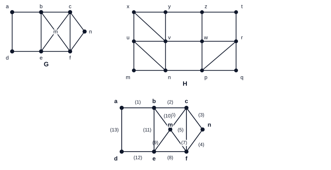

- **Đồ thị $G$:** Bảng bậc:

| Đỉnh | $a$ | $b$ | $c$ | $d$ | $e$ | $f$ | $m$ | $n$ |
|:---:|:---:|:---:|:---:|:---:|:---:|:---:|:---:|:---:|
| **Bậc** | 2 | 4 | 4 | 2 | 4 | 4 | 4 | 2 |

Mọi đỉnh đều bậc chẵn $\Rightarrow G$ là đồ thị Euler. Một chu trình Euler tìm được là:

$$\langle a, b, c, n, f, c, m, f, e, m, b, e, d, a \rangle$$

*(Lưu ý theo thuật toán Fleury: sau khi chọn cạnh `(1)` thì cạnh `(12)` và `(13)` trở thành cầu nên phải tránh đi sớm).*

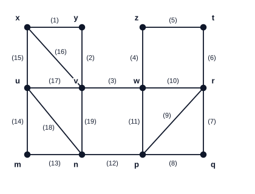

- **Đồ thị $H$:** Bảng bậc:

| Đỉnh | $x$ | $y$ | $z$ | $t$ | $u$ | $v$ | $w$ | $r$ | $m$ | $n$ | $p$ | $q$ |
|:---:|:---:|:---:|:---:|:---:|:---:|:---:|:---:|:---:|:---:|:---:|:---:|:---:|
| **Bậc** | 3 | 2 | 2 | 2 | 4 | 5 | 4 | 4 | 2 | 4 | 4 | 2 |

Số cạnh $m = \frac{1}{2}\sum \deg = \frac{38}{2} = 19$ cạnh. Có đúng 2 đỉnh bậc lẻ là $x$ (bậc 3) và $v$ (bậc 5) $\Rightarrow H$ là đồ thị nửa Euler. Đường đi Euler đi từ $x$ tới $v$:

$$\langle x, y, v, w, z, t, r, q, p, r, w, p, n, m, u, x, v, u, n, v \rangle$$

**Ví dụ 2 (Đồ thị có hướng $G_1, G_2, G_3$):**

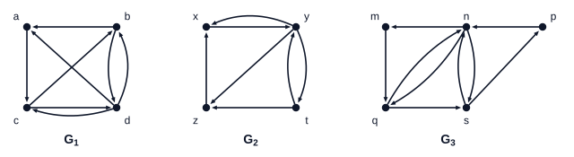

1. **Xét $G_1$:** $\deg^+(d) - \deg^-(d) = 3 - 2 = 1$ (xuất phát tại $d$); $\deg^-(a) - \deg^+(a) = 2 - 1 = 1$ (kết thúc tại $a$); $b, c$ cân bằng ($\deg^+ = \deg^- = 2$). Tổng số cung $m = 8$. $G_1$ là **nửa Euler**, đường đi Euler: $\langle d, b, a, c, d, c, b, d, a \rangle$.

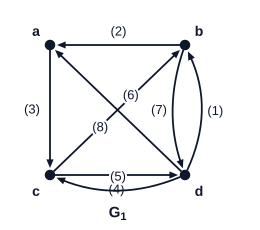

2. **Xét $G_2$:** Có tới 2 đỉnh thừa bậc ra ($y$: $3 - 2 = 1$; $t$: $2 - 1 = 1$) và 2 đỉnh thừa bậc vào ($x, z$), nên $G_2$ **không** phải Euler cũng không phải nửa Euler.
3. **Xét $G_3$:** Mọi đỉnh đều cân bằng ($\deg^+ = \deg^-$): $m, p$ bậc $1$; $q, s$ bậc $2$; $n$ bậc $3$. Tổng số cung $m = 9$. $G_3$ là **đồ thị Euler**, chu trình Euler: $\langle m, q, s, p, n, s, n, q, n, m \rangle$.

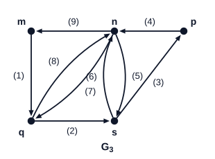

**Ví dụ 3 (Bài toán vẽ hình bằng một nét bút):**

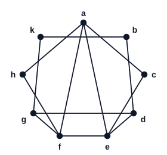

Đồ thị Hình 3.7 có đúng 2 đỉnh bậc lẻ là $g$ và $d$, các đỉnh còn lại đều bậc chẵn. Vậy **vẽ được** bằng một nét liền không nhấc bút và không vẽ lặp lại nét nào, theo đường đi Euler xuất phát từ $g$ và kết thúc tại $d$:

$$\langle g, k, b, d, g, f, a, e, f, h, a, c, e, d \rangle$$

### 1.4. Ứng dụng: Bài toán người đưa thư (Chinese Postman Problem)

**Bài toán:** Một bưu tá xuất phát từ bưu điện phải đi qua **tất cả các con phố** (mỗi phố coi như có độ dài 1 đơn vị) rồi quay về bưu điện sao cho **tổng quãng đường ngắn nhất**.

- **Trường hợp 1:** Nếu đồ thị $G$ là đồ thị Euler, hành trình tối ưu chính là chu trình Euler có độ dài bằng số cạnh $N(U)$.
- **Trường hợp 2:** Nếu $G$ có các đỉnh bậc lẻ, bắt buộc phải đi lặp lại một số cạnh. Để tối ưu, mỗi cạnh đi lặp tối đa 2 lần; ta **nhân đôi (thêm cạnh song song)** trên các đường đi ngắn nhất nối từng cặp đỉnh bậc lẻ sao cho tổng số cạnh thêm vào $m(G)$ là nhỏ nhất, biến $G$ thành đồ thị Euler $G_E$.

**Thuật toán tìm tổng độ dài tối ưu $N(U) + m(G)$:**

1. Liệt kê tập đỉnh bậc lẻ $X_0(G)$ gồm $2k$ đỉnh.
2. Xét tất cả các cách ghép $2k$ đỉnh thành $k$ cặp (phân hoạch $P_i$). Với mỗi cách ghép, tính tổng độ dài đường đi ngắn nhất giữa các cặp:
   $$d(P_i) = \sum_{(x, y) \in P_i} d(x, y)$$
3. Chọn $m(G) = \min_{P_i} d(P_i)$. Nhân đôi các cạnh trên những đường đi ngắn nhất của phân hoạch tối ưu để được $G_E$, rồi tìm chu trình Euler trên $G_E$.

**Ví dụ:** Tìm hành trình ngắn nhất cho bưu tá trên đồ thị $G$ dưới đây:

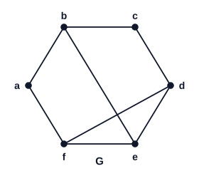

- **Bảng bậc:** $a: 2,\; b: 3,\; c: 2,\; d: 3,\; e: 3,\; f: 3$. Số cạnh ban đầu $m = \frac{16}{2} = 8$.
- **Tập đỉnh bậc lẻ:** $X_0 = \{b, d, e, f\}$ (4 đỉnh $\Rightarrow$ ghép thành 2 cặp, có 3 cách ghép):
    - $P_1 = \{(b, d), (e, f)\} \implies d(P_1) = d(b, d) + d(e, f) = 2 + 1 = 3$.
    - $P_2 = \{(b, e), (d, f)\} \implies d(P_2) = d(b, e) + d(d, f) = 1 + 1 = 2$ **(nhỏ nhất)**.
    - $P_3 = \{(b, f), (d, e)\} \implies d(P_3) = d(b, f) + d(d, e) = 2 + 1 = 3$.
- **Kết luận:** $m(G) = 2$, độ dài chu trình ngắn nhất là $8 + 2 = 10$ cạnh. Nhân đôi hai cạnh $(b, e)$ và $(d, f)$ để thu được $G_E$, ta có hành trình tối ưu:

$$\langle a, b, c, d, e, b, e, f, d, f, a \rangle$$

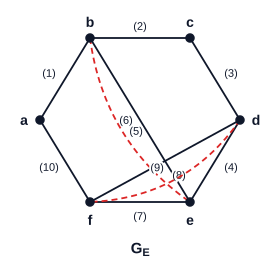

## 2. Đồ thị Hamilton

### 2.1. Khái niệm đồ thị Hamilton và nửa Hamilton

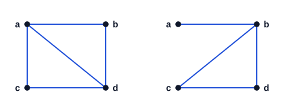

- **Đường đi Hamilton:** Đường đi đơn qua **tất cả các đỉnh** của đồ thị, mỗi đỉnh **đúng một lần**.
- **Chu trình Hamilton:** Chu trình đơn qua **tất cả các đỉnh** của đồ thị, mỗi đỉnh đúng một lần (trừ đỉnh đầu trùng đỉnh cuối).
- **Đồ thị Hamilton:** Có chu trình Hamilton.
- **Đồ thị nửa Hamilton:** Có đường đi Hamilton (nhưng không có chu trình Hamilton).

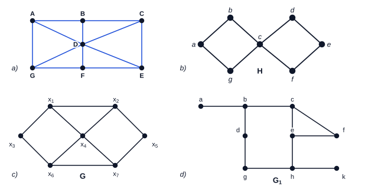

*Ví dụ trên Hình 3.9:*
- **3.9a & 3.9b:** Là đồ thị Hamilton với chu trình $\langle G, A, B, D, C, E, F, G \rangle$ và $\langle x_3, x_6, x_7, x_5, x_2, x_4, x_1, x_3 \rangle$.
- **3.9c:** Đồ thị nửa Hamilton với đường đi $\langle g, a, b, c, d, e, f \rangle$ (không có chu trình Hamilton).
- **3.9d:** Không phải Hamilton và cũng không phải nửa Hamilton.

### 2.2. Điều kiện nhận biết và các quy tắc tìm

Khác với đồ thị Euler, **chưa có tiêu chuẩn đơn giản nào vừa là điều kiện cần vừa là điều kiện đủ** để nhận biết đồ thị Hamilton. Ta sử dụng các **điều kiện đủ** để khẳng định có chu trình Hamilton, và dùng **điều kiện cần** để bác bỏ.

#### Các điều kiện đủ (nếu thoả mãn thì chắc chắn có)

Cho đơn đồ thị vô hướng liên thông $G = (V, E)$ có $n \ge 3$ đỉnh:

- **Định lý Ore:** Nếu với mọi cặp đỉnh **không kề nhau** $x, y$ đều có $\deg(x) + \deg(y) \ge n$ thì $G$ là **đồ thị Hamilton**.
- **Định lý Dirac:** Nếu mọi đỉnh $x \in V$ đều có $\deg(x) \ge \frac{n}{2}$ thì $G$ là **đồ thị Hamilton**.
- **Hệ quả nửa Hamilton:** Nếu mọi đỉnh $x \in V$ đều có $\deg(x) \ge \frac{n - 1}{2}$ thì $G$ là **đồ thị nửa Hamilton**.
- **Đồ thị có hướng:** Nếu đơn đồ thị có hướng $G$ liên thông mạnh và mọi đỉnh đều có $\deg^+(x) \ge \frac{n}{2},\; \deg^-(x) \ge \frac{n}{2}$ thì $G$ là **đồ thị Hamilton**.
- **Định lý đấu loại (Tournament):** Đồ thị đấu loại (đồ thị có hướng mà hai đỉnh bất kỳ nối với nhau bởi đúng 1 cung) luôn là **đồ thị nửa Hamilton**; nếu nó liên thông mạnh thì là **đồ thị Hamilton** (ví dụ $D_5, D_6$ dưới đây).

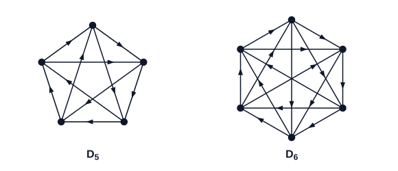

!!! warning "Dễ nhầm"
    Các định lý Dirac, Ore chỉ là **điều kiện đủ**, không phải điều kiện cần (tức *"nếu ... thì ..."*, **không** phải *"khi và chỉ khi"*). Một đồ thị không thoả Dirac/Ore (như đồ thị vòng $C_6$ có $\deg = 2 < 3$) vẫn có thể là đồ thị Hamilton.

#### Điều kiện cần để bác bỏ đồ thị Hamilton

- **Định lý tách thành phần liên thông:** Nếu xoá đi $k$ đỉnh (cùng các cạnh liên thuộc) của đồ thị $G$ mà thu được đồ thị con có **nhiều hơn $k$ thành phần liên thông** thì $G$ **không phải** là đồ thị Hamilton.

#### Bốn quy tắc tìm chu trình Hamilton bằng tay

1. Nếu $G$ có đỉnh bậc $< 2$ (đỉnh treo hoặc cô lập) $\Rightarrow G$ **không** phải Hamilton.
2. Nếu một đỉnh $x$ có **bậc bằng 2**, cả 2 cạnh kề với $x$ **bắt buộc phải chọn** vào chu trình (hoặc đường đi nếu $x$ không là đầu/cuối).
3. Trong quá trình xây dựng chu trình, một đỉnh đã chọn đủ **2 cạnh** thì phải **xoá bỏ tất cả các cạnh kề còn lại** của đỉnh đó. (Hệ quả: đỉnh nào kề với từ 3 đỉnh bậc 2 trở lên thì đồ thị không thể là Hamilton).
4. Chu trình Hamilton **không được tạo thành chu trình con** đóng kín trước khi đi qua đủ $n$ đỉnh.

#### Các ví dụ nhận biết và tìm Hamilton

**Ví dụ 1 (Đồ thị $G_2$ 13 đỉnh):** Chứng minh $G_2$ không phải Hamilton nhưng là nửa Hamilton.

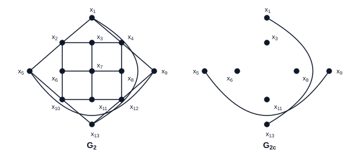

- Tổng số cạnh $m = \frac{1}{2}\sum \deg = 22$.
- **Chứng minh không là Hamilton:** Xoá $k = 5$ đỉnh $\{x_2, x_4, x_7, x_{10}, x_{12}\}$ thu được $6 > 5$ thành phần liên thông ($G_{2c}$) $\Rightarrow$ theo điều kiện cần, $G_2$ **không** là đồ thị Hamilton.
- **Tìm đường đi Hamilton:** Thử chọn cạnh từ $x_1$:
- *Nhánh thử thất bại ($G_{2a}$):* Chọn $(x_1, x_2), (x_1, x_4)$ $\rightarrow$ tạo ép bậc 2 cho $x_{13}, x_3, x_6$ $\rightarrow$ chỉ nối được 11 cạnh qua 12 đỉnh (bỏ sót $x_{11}$).

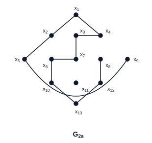

| Bước | Cạnh chọn | Cạnh xoá | Đỉnh thăm | Cạnh – Đỉnh |
|:---:|---|---|---|:---:|
| 1 | $(x_1, x_2), (x_1, x_4)$ | $(x_1, x_{13})$ | $x_1, x_2, x_4$ | 2 – 3 |
| 2 | $(x_{13}, x_{10}), (x_{13}, x_{12}), (x_2, x_5)$ | $(x_2, x_3), (x_2, x_6)$ | $x_{13}, x_{10}, x_{12}, x_5$ | 5 – 7 |
| 3 | $(x_3, x_4), (x_3, x_7), (x_6, x_7), (x_6, x_{10})$ | $(x_4, x_8), (x_4, x_9), (x_7, x_8), (x_7, x_{11}), (x_{10}, x_{11}), (x_{10}, x_5)$ | $x_3, x_7, x_6$ | 9 – 10 |
| 4 | $(x_5, x_9), (x_8, x_{12})$ | $(x_{12}, x_9), (x_{12}, x_{11})$ | $x_9, x_8$ | 11 – 12 |

- *Nhánh chọn thành công ($G_{2b}$):* Chọn $(x_1, x_4), (x_1, x_{13})$ giúp nối qua đủ 12 cạnh, 13 đỉnh, thu được đường đi Hamilton:

$$\langle x_6, x_2, x_3, x_4, x_1, x_{13}, x_{10}, x_{11}, x_7, x_8, x_{12}, x_9, x_5 \rangle$$

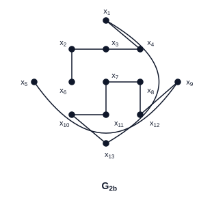

| Bước | Cạnh chọn | Cạnh xoá | Đỉnh thăm | Cạnh – Đỉnh |
|:---:|---|---|---|:---:|
| 1 | $(x_1, x_4), (x_1, x_{13})$ | $(x_1, x_2)$ | $x_1, x_4, x_{13}$ | 2 – 3 |
| 2 | $(x_{13}, x_{10}), (x_4, x_3)$ | $(x_{13}, x_{12}), (x_4, x_8), (x_4, x_9)$ | $x_{10}, x_3$ | 4 – 5 |
| 3 | $(x_3, x_7), (x_8, x_{12}), (x_9, x_5), (x_9, x_{12})$ | $(x_{12}, x_{11})$ | $x_9, x_7, x_{12}, x_8, x_5$ | 8 – 10 |
| 4 | $(x_{11}, x_7), (x_{11}, x_{10})$ | $(x_7, x_3), (x_7, x_6), (x_{10}, x_6), (x_{10}, x_5)$ | $x_{11}$ | 10 – 11 |
| 5 | $(x_3, x_2), (x_6, x_2)$ | $(x_2, x_5)$ | $x_2, x_6$ | 12 – 13 |

**Ví dụ 2 (Đồ thị lưới $G_1$ 9 đỉnh):**

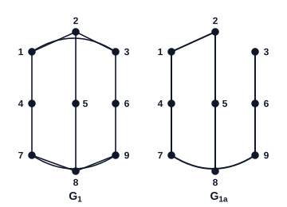

- Các đỉnh $4, 5, 6$ có bậc 2; các đỉnh $1, 2, 3, 7, 8, 9$ có bậc 3. Tổng số cạnh $m = \frac{1}{2}(6\times 3 + 3\times 2) = 12$ cạnh.
- Chọn đủ 8 cạnh qua 9 đỉnh theo các bước ép bậc 2, ta tìm được đường đi Hamilton: $\langle 3, 6, 9, 7, 4, 1, 2, 5, 8 \rangle$ ($G_{1a}$). (Lưu ý: đồ thị không có chu trình Hamilton vì thử mọi cách nối hai cạnh ở các đỉnh bậc 2 sẽ ép tạo chu trình con hoặc thừa đỉnh).

**Ví dụ 3 (Đồ thị 17 đỉnh không phải Hamilton và không phải nửa Hamilton):**

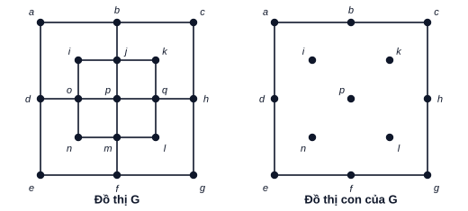

- Tổng số cạnh $m = 24$. Xoá 4 đỉnh bậc 4 là $\{o, j, q, m\}$ thu được $6 > 4$ thành phần liên thông $\implies G$ **không** là Hamilton.
- Thử lấy các cạnh bắt buộc tại các đỉnh bậc 2 ($a, c, e, g, i, k, n, t$) sẽ ép sinh ra hai chu trình con rời nhau $C_1 = \langle a, b, c, h, g, f, e, d, a \rangle$ (8 đỉnh) và $C_2 = \langle o, i, j, k, q, t, m, n, o \rangle$ (8 đỉnh) cùng đỉnh cô lập $p$. Không thể ghép $C_1, C_2$ và $p$ thành một đường đi qua 17 đỉnh $\implies G$ **không** là nửa Hamilton.

**Ví dụ 4 (Trò chơi "Vòng quanh thế giới" trên khối 12 mặt đều):**

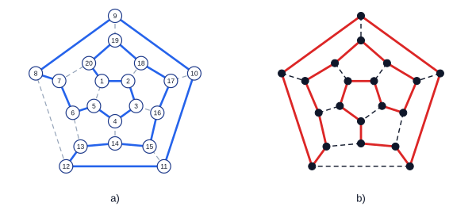

Đồ thị có 20 đỉnh đều bậc 3 ($m = 30$ cạnh), là đồ thị Hamilton. Hai chu trình Hamilton hợp lệ:
- $\langle 1, 2, 3, 4, 5, 6, 7, 8, 9, 10, 11, 12, 13, 14, 15, 16, 17, 18, 19, 20, 1 \rangle$
- $\langle 1, 2, 3, 16, 17, 18, 19, 20, 7, 6, 13, 12, 8, 9, 10, 11, 15, 14, 4, 5, 1 \rangle$

### 2.3. Cây liệt kê và Thuật toán quay lui tìm chu trình Hamilton

#### Quy tắc vẽ cây liệt kê chu trình Hamilton

1. Chọn 1 đỉnh $v_0$ làm gốc (mức 0).
2. Nối tất cả các đỉnh kề với gốc để tạo các đỉnh mức 1.
3. Từ mỗi đỉnh mức $i$, nối tiếp các đỉnh kề chưa xuất hiện trên đường từ gốc tới đỉnh hiện tại (tránh tạo chu trình con) để tạo mức $i + 1$.
4. Lặp lại cho đến mức $n - 1$ (đã đủ $n$ đỉnh): nhánh nào từ đỉnh mức $n - 1$ có cạnh nối về lại gốc $v_0$ thì nhánh đó là một **chu trình Hamilton** (nếu không nối về gốc được thì chỉ là **đường đi Hamilton**).

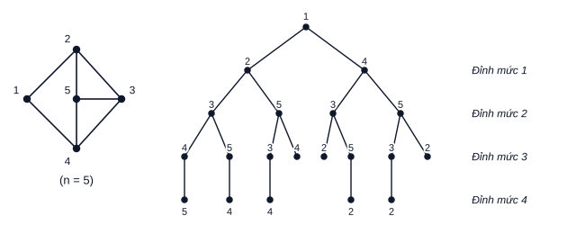

*Ví dụ trên hình (gốc là đỉnh 1):* Từ các nhánh mức 4 kết thúc ở đỉnh 4 và đỉnh 2 đều có cạnh nối về 1, ta thu được 4 chu trình (thực chất là 2 chu trình theo hai chiều ngược nhau):
- $\langle 1, 2, 3, 5, 4, 1 \rangle$ và chiều ngược $\langle 1, 4, 5, 3, 2, 1 \rangle$
- $\langle 1, 2, 5, 3, 4, 1 \rangle$ và chiều ngược $\langle 1, 4, 3, 5, 2, 1 \rangle$

#### Thuật toán quay lui (Backtracking)

```cpp title="Thuật toán quay lui liệt kê mọi chu trình Hamilton"
void Hamilton(int k) {
    // Phát triển dãy đỉnh X[1..k-1], xuất phát từ k = 2 với X[1] = v0
    for (int y : Ke[X[k - 1]]) {
        if (k == n + 1 && y == v0) {
            GhiNhan(X[1], X[2], ..., X[n], v0);
        } else if (chuaxet[y]) {
            X[k] = y;
            chuaxet[y] = false;
            Hamilton(k + 1);
            chuaxet[y] = true; // Phục hồi trạng thái sau khi quay lui
        }
    }
}

int main() {
    for (int v : V) chuaxet[v] = true;
    X[1] = v0;
    chuaxet[v0] = false;
    Hamilton(2);
}
```

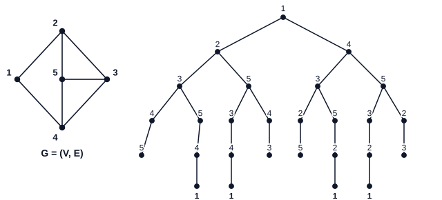

### 2.4. Ứng dụng: Bài toán sắp xếp chỗ ngồi và Bài toán người du lịch (TSP)

#### Bài toán sắp xếp chỗ ngồi quanh bàn tròn

**Đề bài:** Có $n$ đại biểu ngồi quanh bàn tròn, mỗi ngày họp một lần. Cần bố trí tối đa bao nhiêu ngày để mỗi người mỗi ngày đều có 2 người ngồi cạnh là bạn mới (tức không cặp nào ngồi cạnh nhau quá 1 lần)?

**Phân tích:** Mô hình hoá bằng đồ thị đầy đủ $K_n$. Mỗi cách xếp chỗ là một chu trình Hamilton. Hai ngày khác nhau tương ứng với hai **chu trình Hamilton phân biệt cạnh** (không dùng chung cạnh nào).

- **Định lý:** Với $n$ **lẻ** ($n \ge 3$), $K_n$ có đúng $\frac{n - 1}{2}$ chu trình Hamilton phân biệt cạnh.
    - *Chứng minh:* $K_n$ có $\frac{n(n-1)}{2}$ cạnh, mỗi chu trình Hamilton dùng $n$ cạnh nên số chu trình phân biệt tối đa là $\frac{n - 1}{2}$. Giữ đỉnh $1$ ở tâm/cố định, xếp $n - 1$ đỉnh còn lại trên đường tròn theo cấu trúc đường gấp khúc đối xứng rồi xoay dần góc $\frac{1}{n-1}$ vòng tròn sẽ tạo ra đúng $\frac{n - 1}{2}$ chu trình rời cạnh nhau hoàn toàn.
- **Chú ý với $n$ chẵn:** Mọi chu trình Hamilton phân biệt cạnh tối đa cũng chỉ là $\lfloor \frac{n-1}{2} \rfloor$ (luôn dư ra ít nhất $n/2$ cạnh không ghép tiếp được thành chu trình Hamilton).

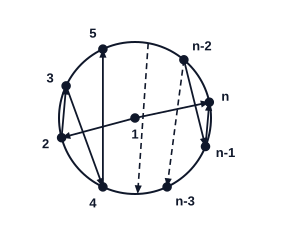

??? tip "Gợi ý giải: Liệt kê các chu trình Hamilton phân biệt cạnh trong $K_9$"
    Với $n = 9$ (lẻ), số chu trình phân biệt cạnh là $\frac{9 - 1}{2} = 4$ chu trình. Giữ đỉnh `9` (hoặc `1`) cố định làm đỉnh nối hai đầu và xoay dãy $\{1, 2, \dots, 8\}$ theo quy tắc zig-zag:
    1. $\langle 9, 1, 2, 8, 3, 7, 4, 6, 5, 9 \rangle$
    2. $\langle 9, 2, 3, 1, 4, 8, 5, 7, 6, 9 \rangle$
    3. $\langle 9, 3, 4, 2, 5, 1, 6, 8, 7, 9 \rangle$
    4. $\langle 9, 4, 5, 3, 6, 2, 7, 1, 8, 9 \rangle$

#### Bài toán Người du lịch (Travelling Salesperson Problem – TSP)

**Đề bài:** Cho đồ thị có hướng trọng số gồm $n$ thành phố với ma trận chi phí $a[i][j]$ ($a[i][j] = -1$ nếu không có đường đi trực tiếp từ $i$ đến $j$). Sử dụng thuật toán quay lui tìm chu trình Hamilton để tìm **lộ trình đi qua tất cả thành phố đúng một lần và quay về nơi xuất phát có tổng chi phí nhỏ nhất**.

**Dữ liệu mẫu ($n = 4$ thành phố):**

$$
A = \begin{pmatrix}
0 & 4 & 1 & 3 \\
1 & 0 & -1 & 2 \\
-1 & 1 & 0 & 4 \\
2 & 3 & 5 & 0
\end{pmatrix}
$$

??? tip "Lời giải mẫu bài toán TSP $4 \times 4$"
    Xuất phát từ thành phố `1`, ta liệt kê các chu trình Hamilton hợp lệ (không đi qua cạnh có chi phí `-1`):
    - $1 \to 2 \to 4 \to 3 \to 1$: không hợp lệ vì $a[3][1] = -1$.
    - $1 \to 3 \to 2 \to 4 \to 1$: chi phí $= a[1][3] + a[3][2] + a[2][4] + a[4][1] = 1 + 1 + 2 + 2 = 6$.
    - $1 \to 3 \to 4 \to 2 \to 1$: chi phí $= a[1][3] + a[3][4] + a[4][2] + a[2][1] = 1 + 4 + 3 + 1 = 9$.
    - $1 \to 4 \to 3 \to 2 \to 1$: chi phí $= a[1][4] + a[4][3] + a[3][2] + a[2][1] = 3 + 5 + 1 + 1 = 10$.

    **Kết luận:** Lộ trình tối ưu là $1 \to 3 \to 2 \to 4 \to 1$ với tổng chi phí nhỏ nhất bằng **6**.

## 3. So sánh tổng kết Euler và Hamilton

| Tiêu chí | Đồ thị **Euler** | Đồ thị **Hamilton** |
|---|---|---|
| **Mục tiêu đi qua** | Đi qua **mọi cạnh (cung)** đúng 1 lần | Đi qua **mọi đỉnh** đúng 1 lần |
| **Điều kiện cần & đủ** | **Có** (liên thông + mọi đỉnh bậc chẵn / $\deg^+ = \deg^-$) | **Chưa có** tiêu chuẩn đơn giản chung |
| **Cách bác bỏ nhanh** | Có đỉnh bậc lẻ (hoặc $> 2$ đỉnh bậc lẻ cho nửa Euler) | Xoá $k$ đỉnh tạo $> k$ TPLT; đỉnh bậc $< 2$ |
| **Thuật toán tìm** | Fleury, Hierholzer (Stack) | Quy tắc loại cạnh, Cây liệt kê, Quay lui + Nhánh cận |
| **Độ phức tạp bài toán quyết định** | Thời gian đa thức $O(V + E)$ (thuộc lớp **P**) | **NP-đầy đủ** (rất tốn thời gian khi $n$ lớn) |
| **Ứng dụng tiêu biểu** | Người đưa thư (CPP), vẽ nét liền | Người du lịch (TSP), xếp lịch/chỗ ngồi |

## 4. Bài tập Chương 3

### Bài tập thực hành trên hình vẽ

1. **Ma trận kề và đồ thị có hướng 8 đỉnh:** Cho đồ thị dưới đây, hãy lập ma trận kề và chứng minh đồ thị có phải Euler hoặc nửa Euler hay không.

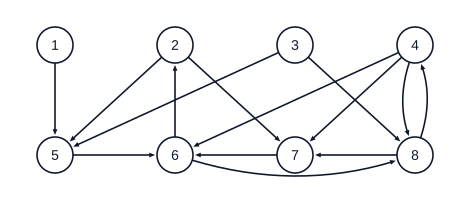

2. **Nhận biết đồ thị Hamilton dạng lưới:** Đồ thị dưới đây có phải đồ thị Hamilton hoặc nửa Hamilton không? Tìm chu trình hoặc đường đi Hamilton nếu có.

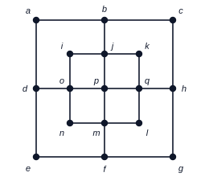

### Bài tập ma trận kề và danh sách kề (Euler)

3. Cho đồ thị vô hướng liên thông 13 đỉnh cho bởi ma trận kề $A$ dưới đây:
    - a) Chứng minh đồ thị đã cho là **Euler**.
    - b) Xây dựng thuật toán và tìm chu trình Euler xuất phát từ $u = 1$ và $u = 5$.

$$
A = \begin{pmatrix}
0 & 1 & 0 & 0 & 0 & 1 & 0 & 0 & 0 & 0 & 0 & 0 & 0 \\
1 & 0 & 1 & 0 & 1 & 1 & 0 & 0 & 0 & 0 & 0 & 0 & 0 \\
0 & 1 & 0 & 1 & 1 & 0 & 0 & 0 & 0 & 0 & 1 & 0 & 0 \\
0 & 0 & 1 & 0 & 0 & 0 & 1 & 1 & 0 & 0 & 1 & 0 & 0 \\
0 & 1 & 1 & 0 & 0 & 1 & 1 & 0 & 0 & 0 & 0 & 0 & 0 \\
1 & 1 & 0 & 0 & 1 & 0 & 1 & 0 & 0 & 0 & 0 & 0 & 0 \\
0 & 0 & 0 & 1 & 1 & 1 & 0 & 1 & 0 & 0 & 0 & 0 & 0 \\
0 & 0 & 0 & 1 & 0 & 0 & 1 & 0 & 1 & 1 & 0 & 0 & 0 \\
0 & 0 & 0 & 0 & 0 & 0 & 0 & 1 & 0 & 1 & 0 & 1 & 1 \\
0 & 0 & 0 & 0 & 0 & 0 & 0 & 1 & 1 & 0 & 1 & 1 & 0 \\
0 & 0 & 1 & 1 & 0 & 0 & 0 & 0 & 0 & 1 & 0 & 1 & 0 \\
0 & 0 & 0 & 0 & 0 & 0 & 0 & 0 & 1 & 1 & 1 & 0 & 1 \\
0 & 0 & 0 & 0 & 0 & 0 & 0 & 0 & 1 & 0 & 0 & 1 & 0
\end{pmatrix}
$$

4. Cho đồ thị vô hướng liên thông 13 đỉnh cho bởi ma trận kề $A$ dưới đây:
    - a) Chứng minh đồ thị đã cho là **nửa Euler**.
    - b) Tìm một đường đi Euler của đồ thị (chỉ rõ các bước Stack).

$$
A = \begin{pmatrix}
0 & 0 & 0 & 1 & 0 & 1 & 0 & 0 & 0 & 0 & 0 & 0 & 0 \\
0 & 0 & 1 & 0 & 0 & 0 & 0 & 1 & 0 & 1 & 1 & 0 & 0 \\
0 & 1 & 0 & 0 & 0 & 0 & 0 & 0 & 1 & 1 & 0 & 0 & 1 \\
1 & 0 & 0 & 0 & 0 & 1 & 0 & 1 & 0 & 0 & 0 & 1 & 0 \\
0 & 0 & 0 & 0 & 0 & 0 & 1 & 0 & 1 & 0 & 0 & 0 & 0 \\
1 & 0 & 0 & 1 & 0 & 0 & 0 & 0 & 0 & 1 & 0 & 1 & 0 \\
0 & 0 & 0 & 0 & 1 & 0 & 0 & 0 & 0 & 0 & 1 & 0 & 1 \\
0 & 1 & 0 & 1 & 0 & 0 & 0 & 0 & 0 & 0 & 1 & 1 & 0 \\
0 & 0 & 1 & 0 & 1 & 0 & 0 & 0 & 0 & 0 & 0 & 0 & 1 \\
0 & 1 & 1 & 0 & 0 & 1 & 0 & 0 & 0 & 0 & 0 & 1 & 0 \\
0 & 1 & 0 & 0 & 0 & 0 & 1 & 1 & 0 & 0 & 0 & 0 & 1 \\
0 & 0 & 0 & 1 & 0 & 1 & 0 & 1 & 0 & 1 & 0 & 0 & 0 \\
0 & 0 & 1 & 0 & 0 & 0 & 1 & 0 & 1 & 0 & 1 & 0 & 0
\end{pmatrix}
$$

5. Cho đồ thị có hướng liên thông yếu 13 đỉnh cho bởi ma trận kề $A$ dưới đây:
    - a) Chứng minh đồ thị đã cho là **Euler**.
    - b) Tìm một chu trình Euler xuất phát từ $u = 1$ và $u = 5$.

$$
A = \begin{pmatrix}
0 & 0 & 0 & 0 & 0 & 1 & 0 & 0 & 0 & 0 & 0 & 0 & 0 \\
0 & 0 & 1 & 0 & 0 & 0 & 0 & 1 & 0 & 0 & 0 & 0 & 0 \\
0 & 0 & 0 & 0 & 0 & 0 & 0 & 0 & 1 & 0 & 0 & 0 & 1 \\
1 & 0 & 0 & 0 & 0 & 1 & 0 & 0 & 0 & 0 & 0 & 0 & 0 \\
0 & 0 & 0 & 0 & 0 & 0 & 1 & 0 & 0 & 0 & 0 & 0 & 0 \\
0 & 0 & 0 & 0 & 0 & 0 & 0 & 0 & 0 & 1 & 0 & 1 & 0 \\
0 & 0 & 0 & 0 & 0 & 0 & 0 & 0 & 0 & 0 & 1 & 0 & 1 \\
0 & 0 & 0 & 1 & 0 & 0 & 0 & 0 & 0 & 0 & 0 & 1 & 0 \\
0 & 0 & 0 & 0 & 1 & 0 & 1 & 0 & 0 & 0 & 0 & 0 & 0 \\
0 & 1 & 1 & 0 & 0 & 0 & 0 & 0 & 0 & 0 & 0 & 0 & 0 \\
0 & 1 & 0 & 0 & 0 & 0 & 0 & 1 & 0 & 0 & 0 & 0 & 0 \\
0 & 0 & 0 & 1 & 0 & 0 & 0 & 0 & 0 & 1 & 0 & 0 & 0 \\
0 & 0 & 0 & 0 & 0 & 0 & 0 & 0 & 1 & 0 & 1 & 0 & 0
\end{pmatrix}
$$

6. **Danh sách kề (Vô hướng):** Cho đồ thị vô hướng liên thông 13 đỉnh:
    - `Ke(1) = {4, 6}`, `Ke(2) = {3, 8, 10, 11}`, `Ke(3) = {2, 9, 10, 13}`, `Ke(4) = {1, 6, 8, 12}`
    - `Ke(5) = {7, 9}`, `Ke(6) = {1, 4, 10, 12}`, `Ke(7) = {5, 9, 11, 13}`, `Ke(8) = {2, 4, 11, 12}`
    - `Ke(9) = {3, 5, 7, 13}`, `Ke(10) = {2, 3, 6, 12}`, `Ke(11) = {2, 7, 8, 13}`, `Ke(12) = {4, 6, 8, 10}`, `Ke(13) = {3, 7, 9, 11}`
    - Hãy tìm chu trình Euler bắt đầu tại $u = 1$ và $u = 5$.

7. **Danh sách kề (Có hướng):** Cho đồ thị có hướng liên thông yếu 13 đỉnh:
    - `Ke(1) = {6}`, `Ke(2) = {3, 8}`, `Ke(3) = {9, 13}`, `Ke(4) = {1, 6}`
    - `Ke(5) = {7}`, `Ke(6) = {10, 12}`, `Ke(7) = {11, 13}`, `Ke(8) = {4, 12}`
    - `Ke(9) = {5, 7}`, `Ke(10) = {2, 3}`, `Ke(11) = {2, 8}`, `Ke(12) = {4, 10}`, `Ke(13) = {9, 11}`
    - Hãy tìm chu trình Euler bắt đầu tại $u = 1$ và $u = 7$.

??? tip "Gợi ý kiểm tra nhanh cho Bài tập 3 – 7"
    - **Bài 3:** Đồ thị có 24 cạnh; $\deg(1) = \deg(13) = 2$, các đỉnh còn lại đều bậc $4$ (mọi đỉnh bậc chẵn $\Rightarrow$ Euler). Chạy `Euler-Cycle(u)` từ $u = 1$ hoặc $u = 5$ sẽ thu được chu trình dài 25 đỉnh (24 cạnh).
    - **Bài 4:** Đồ thị có 23 cạnh; tổng các hàng cho thấy $\deg(7) = 3$, $\deg(9) = 3$, các đỉnh còn lại đều bậc chẵn ($2$ hoặc $4$) $\Rightarrow$ có đúng 2 đỉnh bậc lẻ là **7** và **9** (nửa Euler). Đường đi Euler bắt buộc xuất phát tại đỉnh **7** (hoặc **9**) và kết thúc ở đỉnh lẻ còn lại.
    - **Bài 5:** Đồ thị có 24 cung; $\deg^+(1) = \deg^-(1) = \deg^+(5) = \deg^-(5) = 1$, các đỉnh còn lại đều có $\deg^+ = \deg^- = 2$ $\Rightarrow$ mọi đỉnh cân bằng (Euler).
    - **Bài 6 & 7:** Đều có 24 cạnh/cung, mọi đỉnh bậc chẵn hoặc cân bằng bán bậc ($\deg(1) = \deg(5) = 2$ ở Bài 6; $\deg^+(1) = \deg^-(1) = \deg^+(5) = \deg^-(5) = 1$ ở Bài 7). Khi chạy thuật toán Stack bằng tay, luôn ưu tiên lấy đỉnh đầu tiên (nhỏ nhất) trong `Ke(s)`, và đừng quên **đảo ngược mảng `CE`** ở bước cuối.
