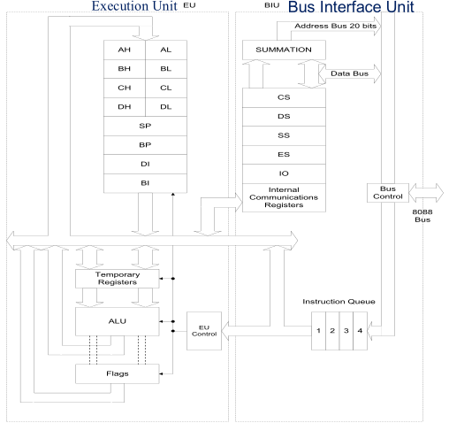
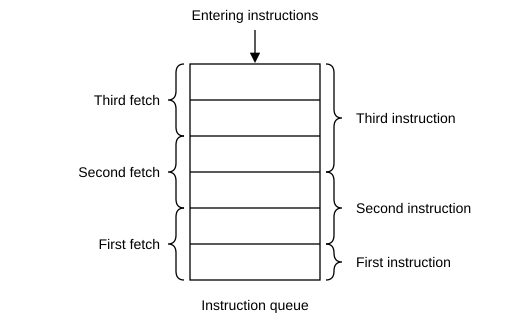
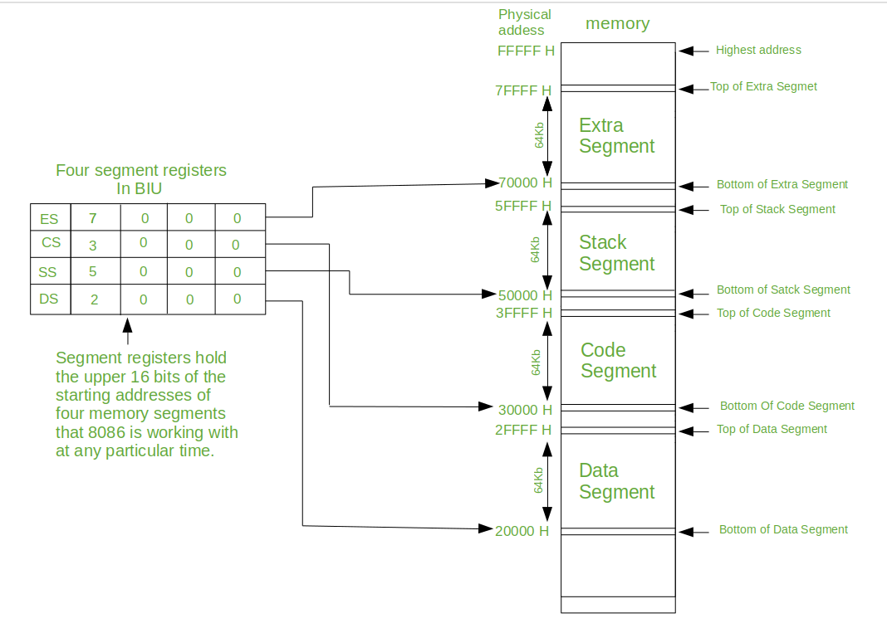
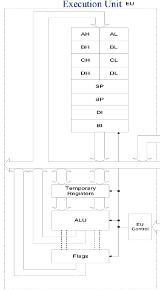
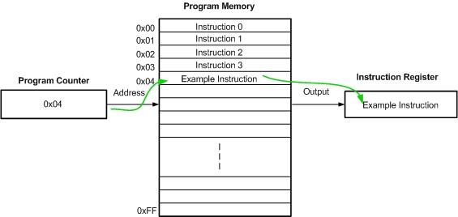
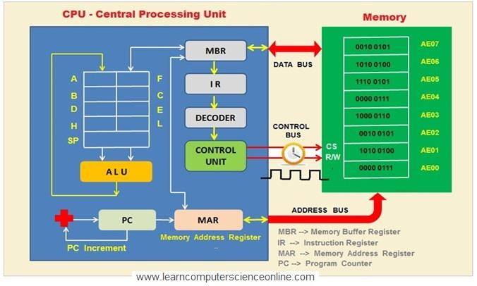
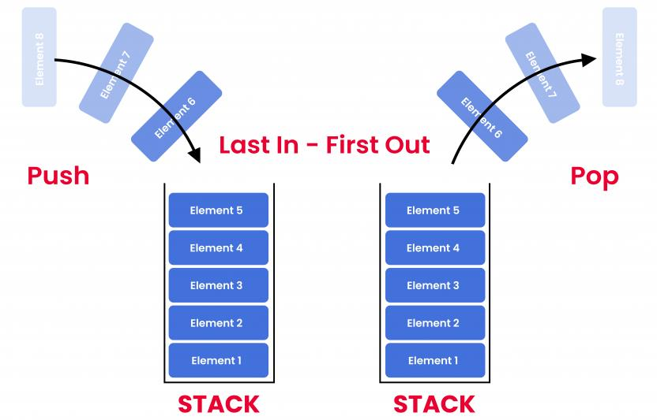
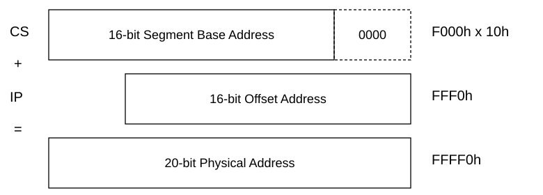
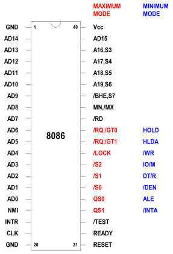
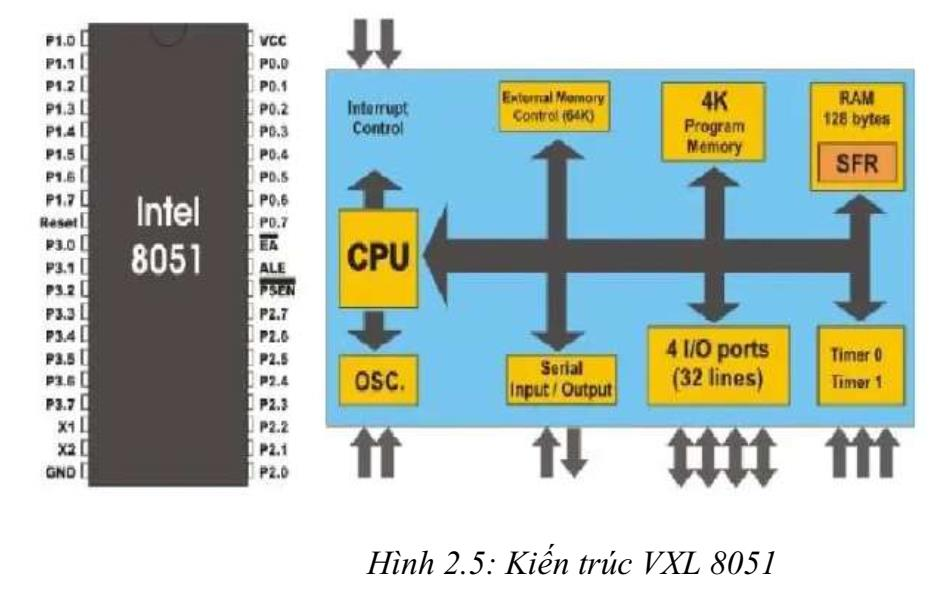

# Chương 2: Cấu trúc của bộ vi xử lý

Bài giảng môn Vi Xử Lý, biên soạn theo Giáo trình Kỹ thuật vi xử lý. Giảng viên: TS. Nguyễn Trọng Kiên, Khoa Kỹ thuật điện tử 2, Học viện Công nghệ Bưu chính Viễn thông (2020).

!!! abstract "Mục tiêu bài"
    - Nắm sơ đồ khối của 8086: hai khối **BIU** và **EU**.
    - Biết chức năng các thanh ghi và cách tính địa chỉ vật lý `segment:offset`.
    - Hiểu chu trình **fetch, decode, execute** qua lệnh `mov [bx], al`.
    - Biết đặc điểm 8086, 8051, AT89C51, ARM7TDMI.
    - Dùng đúng lệnh `MOV` và 7 chế độ địa chỉ.

## 1. Sơ đồ khối



*Hình: Sơ đồ khối 8086/8088 gồm EU (thanh ghi đa dụng, SP, BP, DI, SI, thanh ghi tạm, ALU, Flags, EU Control) và BIU (bộ cộng địa chỉ, thanh ghi đoạn CS, DS, SS, ES, hàng đợi lệnh 4 byte, bus địa chỉ 20 bit, bus dữ liệu).*

Sơ đồ khối của 8086 gồm hai khối chính:

- **BIU (Bus Interface Unit):** quản lý việc truyền dữ liệu giữa CPU với bộ nhớ và thiết bị ngoại vi. BIU đọc lệnh từ bộ nhớ và xếp vào hàng đợi lệnh.
- **EU (Execution Unit):** giải mã và thực hiện các lệnh lấy từ hàng đợi.

### 1.1 Đơn vị giao tiếp bus (BIU)

BIU tạo địa chỉ vật lý đưa ra bên ngoài bằng cách kết hợp giá trị thanh ghi đoạn (**CS, DS, SS, ES**) với giá trị offset (IP, SI, DI, BX, BP, SP).

| Thanh ghi đoạn | Ý nghĩa | Kết hợp với |
|---|---|---|
| `CS` (Code Segment) | Địa chỉ cơ sở của đoạn mã, chứa lệnh chương trình | `IP` |
| `DS` (Data Segment) | Địa chỉ cơ sở của đoạn dữ liệu, chứa biến và dữ liệu | `SI`, `BX`, địa chỉ trực tiếp |
| `SS` (Stack Segment) | Địa chỉ cơ sở của đoạn ngăn xếp | `SP`, `BP` |
| `ES` (Extra Segment) | Đoạn dữ liệu phụ, dùng trong thao tác chuỗi | `DI` (ví dụ `MOVSB`) |

**Hàng đợi lệnh** là chức năng quan trọng nhất của BIU. Lệnh được lấy từ bộ nhớ vào hàng đợi theo nguyên tắc **FIFO**, sẵn sàng cho EU giải mã. Nhờ đó việc nạp lệnh chạy song song với việc thực hiện lệnh.



*Hình: Hàng đợi lệnh, các lệnh vào theo thứ tự first fetch, second fetch, third fetch.*

### 1.2 Thanh ghi đoạn và bộ nhớ vật lý

Mỗi thanh ghi đoạn giữ 16 bit cao của địa chỉ bắt đầu một phân đoạn 64 KB trong không gian nhớ 1 MB (`00000H` đến `FFFFFH`).



| Thanh ghi | Giá trị | Phân đoạn tương ứng |
|---|---|---|
| `DS` | `2000H` | `20000H` đến `2FFFFH` |
| `CS` | `3000H` | `30000H` đến `3FFFFH` |
| `SS` | `5000H` | `50000H` đến `5FFFFH` |
| `ES` | `7000H` | `70000H` đến `7FFFFH` |

### 1.3 Khối thực hiện lệnh (EU)



*Hình: Khối EU gồm AH/AL, BH/BL, CH/CL, DH/DL, SP, BP, DI, SI, thanh ghi tạm, ALU, Flags và EU Control.*

**Bộ điều khiển (Control Unit)** nhận mã lệnh từ BIU, giải mã, rồi tạo tín hiệu điều khiển cho ALU, các thanh ghi và bộ nhớ.

**ALU** thực hiện các phép số học (cộng, trừ, nhân, chia), logic (AND, OR, NOT) và so sánh, đồng thời cập nhật các cờ. Toán hạng có thể nằm trong thanh ghi, trong bộ nhớ hoặc là hằng trong mã lệnh (ví dụ `MOV AX, 10`). ALU thường xử lý tối đa **hai toán hạng**.

#### Thanh ghi đa dụng

`AX`, `BX`, `CX`, `DX` là các thanh ghi 16 bit, mỗi thanh ghi tách được thành nửa cao (`H`) và nửa thấp (`L`) 8 bit: `AH/AL`, `BH/BL`, `CH/CL`, `DH/DL`.

| Thanh ghi | Vai trò | Ghi chú |
|---|---|---|
| `AX` (Accumulator) | Chứa kết quả phép toán số học, logic | Dùng nhiều trong nhân, chia |
| `BX` (Base) | Thanh ghi cơ sở khi tính địa chỉ bộ nhớ | `[BX]`, `[BX+3]` |
| `CX` (Count) | Bộ đếm vòng lặp, phép dịch | Lệnh `LOOP` |
| `DX` (Data) | Phép nhân, chia, địa chỉ cổng I/O | Cặp `DX:AX` cho số 32 bit |

```asm
MOV AX, 10      ; nạp 10 vào AX
ADD AX, 20      ; AX = AX + 20 = 30
```

```asm
MOV AL, [BX]    ; nội dung BX là địa chỉ ô nhớ
MOV AH, [BX+3]  ; chép ô nhớ DS:[BX+3] vào AH
```

```asm
MOV CX, 5       ; nạp 5 vào CX
nhan:
    ; ... thân vòng lặp ...
    LOOP nhan   ; CX = CX - 1, nhảy về nhan khi CX khác 0
```

Với phép chia 16 bit, số bị chia nằm trong cặp `DX:AX` (32 bit). Sau `DIV`, **thương nằm trong AX, dư nằm trong DX**.

```asm
MOV DX, 0       ; số bị chia = DX:AX = 0000:000A = 10
MOV AX, 10
MOV BX, 5       ; số chia
DIV BX          ; AX = 2 (thương), DX = 0 (dư)
```

!!! warning "Dễ nhầm"
    Nếu đặt `DX = 5` trước `DIV` thì số bị chia là `DX:AX = 0005000AH`, không phải 10. Kết quả khi đó vượt 16 bit và gây lỗi chia tràn. Phải xoá `DX` về 0 trước khi chia số 16 bit.

#### Thanh ghi chỉ số và con trỏ

Các thanh ghi này chứa địa chỉ offset khi truy cập bộ nhớ và quản lý ngăn xếp.

- **SP (Stack Pointer):** trỏ đỉnh ngăn xếp, tự cập nhật khi `PUSH`, `POP`, gọi và trả về hàm. `PUSH AX` làm SP giảm, `POP` làm SP tăng.
- **BP (Base Pointer):** truy cập biến và tham số trong khung ngăn xếp (stack frame) của hàm, thường giữ cố định trong suốt lời gọi hàm.
- **SI (Source Index):** địa chỉ nguồn trong thao tác chuỗi, đi với `DS`.
- **DI (Destination Index):** địa chỉ đích trong thao tác chuỗi, đi với `ES`.

```asm
MOV AL, [SI]    ; đọc byte từ nguồn vào AL
MOV [DI], AL    ; ghi AL vào đích
```

#### Thanh ghi tạm

CPU dùng nội bộ để giữ giá trị trung gian khi thực thi lệnh. Lập trình viên không truy cập trực tiếp.

#### Thanh ghi cờ (Flags)

Chứa các cờ phản ánh kết quả phép toán của ALU, dùng để quyết định các lệnh nhảy có điều kiện.

| Cờ | Tên | Được thiết lập khi |
|---|---|---|
| `ZF` | Zero | Kết quả bằng 0 |
| `CF` | Carry | Có nhớ (cộng) hoặc mượn (trừ) ở bit cao nhất |
| `SF` | Sign | Kết quả âm (bit cao nhất bằng 1) |
| `OF` | Overflow | Tràn số học với số có dấu |

## 2. Tổng quan về các thanh ghi trong CPU

Thanh ghi nằm bên trong CPU nên tốc độ truy xuất rất nhanh. Chúng đóng vai trò bộ nhớ nhỏ, nhanh để lưu biến tạm và kết quả từ ALU, giúp giảm số lần truy cập bộ nhớ ngoài.

| Loại thanh ghi | Chức năng |
|---|---|
| Program Counter (`PC`) | Giữ địa chỉ lệnh tiếp theo cần thực thi |
| Instruction Register (`IR`) | Lưu lệnh hiện đang giải mã, thực thi |
| Memory Address Register (`MAR`) | Giữ địa chỉ ô nhớ CPU cần truy xuất |
| Stack Pointer (`SP`) | Giữ địa chỉ đỉnh ngăn xếp |
| Index Register (`SI`, `DI`) | Chứa offset trong thao tác bộ nhớ |
| General Registers (`AX`, `BX`, `CX`, `DX`) | Thanh ghi đa dụng |
| Accumulator (`AX`) | Thanh ghi tích luỹ cho phép toán số học, logic |
| Flag Register | Chứa các cờ trạng thái |

Trong 8086, bộ đếm chương trình tương ứng với cặp `CS:IP`.

### 2.1 Program Counter và Instruction Register

1. CPU dùng giá trị `PC` để xác định địa chỉ lệnh kế tiếp. Ví dụ `PC = 0x04` trỏ tới lệnh "Example Instruction" trong bộ nhớ chương trình. Lệnh được đưa vào hàng đợi (FIFO), và `PC` cập nhật sang lệnh tiếp theo.
2. Lệnh đầu hàng đợi được chuyển vào `IR` để giải mã và chuẩn bị thực thi.



*Hình: PC = 0x04 trỏ ô nhớ 0x04 trong Program Memory (0x00 đến 0xFF), nội dung được xuất sang Instruction Register.*

### 2.2 Thanh ghi địa chỉ bộ nhớ (MAR)

- `MAR` giữ địa chỉ (logic) của ô nhớ cần truy xuất. Để có địa chỉ vật lý, CPU dùng **MMU (Memory Management Unit)** chuyển địa chỉ logic thành địa chỉ vật lý.
- Sau khi truy cập xong, `MAR` giữ nguyên giá trị cho đến khi có lệnh truy cập mới.
- `MAR` được cập nhật trong hai trường hợp: khi **nạp lệnh** (địa chỉ lấy từ `PC`) và khi **truy cập dữ liệu** (lệnh load, store).

```asm
MOV AX, [1000H] ; MAR = 1000H
MOV [2000H], AX ; MAR = 2000H
```



*Hình: CPU giao tiếp bộ nhớ qua data bus, control bus, address bus; PC truyền địa chỉ qua MAR, dữ liệu qua MBR, cùng IR, decoder, control unit, ALU.*

### 2.3 Con trỏ ngăn xếp (SP)

**Ngăn xếp (stack)** là một đoạn bộ nhớ (thường trong RAM) lưu biến cục bộ, tham số và địa chỉ trả về của hàm. Ngăn xếp hoạt động theo nguyên tắc **LIFO**: dữ liệu vào sau cùng được lấy ra đầu tiên.

- `PUSH`: `SP` giảm để trỏ vị trí mới, rồi dữ liệu được ghi vào đó.
- `POP`: dữ liệu được đọc tại vị trí `SP` đang trỏ, rồi `SP` tăng.



*Hình: Hai thao tác Push và Pop trên ngăn xếp theo nguyên tắc Last In, First Out.*

## 3. Địa chỉ vật lý và quá trình thực hiện lệnh

### 3.1 Địa chỉ vật lý

Địa chỉ logic viết dạng `segment:offset`. Địa chỉ vật lý 20 bit được tính:

$$\text{Địa chỉ vật lý} = \text{Thanh ghi đoạn} \times 10\text{H} + \text{Thanh ghi lệch}$$

Ví dụ `CS:IP = F000H:FFF0H`:

$$\text{F000H} \times 10\text{H} + \text{FFF0H} = \text{F0000H} + \text{FFF0H} = \text{FFFF0H}$$

Nhân với `10H` chính là dịch trái 4 bit (thêm một chữ số 0 ở hệ 16).



*Hình: Dịch trái CS = F000H thêm 4 bit 0, cộng IP = FFF0H được địa chỉ vật lý FFFF0H.*

### 3.2 Chu trình thực hiện lệnh

Để thực hiện một lệnh, bộ vi xử lý trải qua bốn bước:

1. **Fetch:** lấy lệnh từ bộ nhớ.
2. **Tăng PC:** tăng `CS:IP` lên 1 sau mỗi byte lấy được.
3. **Decode:** giải mã lệnh.
4. **Execute:** thực hiện lệnh nếu cần.

### 3.3 Ví dụ: lưu dữ liệu bằng `mov [bx], al`

Trạng thái ban đầu: `DS = 2000H`, `BX = 0023H`, `AX = 3F1C` (nên `AL = 1CH`), `CS = 1000H`, `IP = 0005H`. Ô nhớ `20023H` đang chứa `13H`.

```asm
mov [bx], al    ; mã máy 88 07
hlt             ; mã máy F4
```

Bảng sau tóm tắt các bước (các bus: địa chỉ `A19..A0`, dữ liệu `D7..D0`; tín hiệu đọc `MEMR`, ghi `MEMW` tích cực mức thấp):

| Bước | Hành động | Kết quả |
|---|---|---|
| 1. Fetch byte 1 | Đưa `CS:IP = 1000:0005` thành địa chỉ `10005H` lên bus; `MEMR = LOW`, `MEMW = HIGH` | Ô nhớ `10005H` trả mã `88` vào hàng đợi |
| 2. Tăng PC, decode | `IP = 0005 + 1 = 0006`; giải mã `88` | Nhận ra `mov [bx], ?`, chưa đủ mã lệnh |
| 3. Fetch byte 2 | Địa chỉ `10006H` lên bus; `MEMR = LOW` | Ô nhớ `10006H` trả mã `07`, hàng đợi = `8807` |
| 4. Tăng PC, decode | `IP = 0006 + 1 = 0007`; giải mã `8807` | Nhận đủ lệnh `mov [bx], al` |
| 5. Execute | Tính `DS:BX = 2000:0023` thành `20023H`; đặt `AL = 1CH` lên bus dữ liệu; `MEMR = HIGH`, `MEMW = LOW` | Ô nhớ `20023H` đổi từ `13H` thành `1CH` |
| 6. Lệnh `hlt` | Fetch `F4` tại `10007H`, `IP = 0008`, decode, execute | CPU dừng |

!!! note "Lưu ý"
    Slide gốc ghi `AX = 351C` ở phần đề và `3F1C` ở các hình minh hoạ. Cả hai đều cho `AL = 1CH` nên kết quả ghi vào bộ nhớ không đổi.

## 4. Giới thiệu cấu trúc một số bộ vi xử lý tiêu biểu

### 4.1 Vi xử lý 8086

8086 do Intel phát triển cuối thập niên 1970, là nền tảng của nhiều máy tính cá nhân đầu tiên.

1. **Kiến trúc 16 bit:** xử lý dữ liệu 16 bit trong một chu kỳ máy.
2. **Kiến trúc CISC:** tập lệnh phong phú, nhiều lệnh phức tạp và chế độ địa chỉ.
3. **Hỗ trợ chạy nhiều chương trình ở mức cơ bản:** thông qua ngắt phần cứng và chia sẻ bộ nhớ (không có bảo vệ bộ nhớ như các CPU đời sau).
4. **Không gian nhớ 1 MB:** bus địa chỉ 20 bit, dùng chung cho RAM, ROM và vùng I/O ánh xạ bộ nhớ.
5. **Kế thừa:** mở đường cho 8088, 80186, 80286, 80386.

#### Sơ đồ chân 8086

8086 có 40 chân DIP và hai chế độ: **Minimum** và **Maximum**, chọn bằng chân `MN/MX`. Một số chân điều khiển thay đổi theo chế độ.



| Nhóm chân | Chân | Ghi chú |
|---|---|---|
| Nguồn | `Vcc` (+5 V), `GND` (0 V) | |
| Địa chỉ và dữ liệu đa hợp | `AD0..AD15` (I/O) | Dùng chung bus theo thời gian |
| Địa chỉ cao, trạng thái | `A19/S6`, `A18/S5`, `A17/S4`, `A16/S3` (output) | |
| Chế độ Minimum | `HOLD`, `HLDA`, `WR`, `IO/M`, `DT/R`, `DEN`, `ALE`, `INTA` | |
| Chế độ Maximum | `RQ/GT0`, `RQ/GT1`, `LOCK`, `S2`, `S1`, `S0`, `QS0`, `QS1` | |

### 4.2 Vi điều khiển 8051

8051 thuộc họ MCS-51, Intel phát triển năm 1980, kiến trúc CISC, thiết kế cho ứng dụng điều khiển. Các thành phần chính: CPU, RAM, ROM, I/O và bộ đếm.

- Bản 8051 đầu tiên có **4 KB ROM** và **128 byte RAM**. Bản **8031** không có ROM trong.
- Nhiều hãng (Siemens, Fujitsu, Atmel...) phát triển biến thể, vẫn dùng rộng rãi trong hệ nhúng.



*Hình 2.5: Sơ đồ chân và sơ đồ khối 8051 gồm CPU, bộ dao động, điều khiển ngắt, điều khiển bộ nhớ ngoài (64 KB), 4 KB bộ nhớ chương trình, 128 byte RAM, SFR, cổng nối tiếp, 4 cổng I/O (32 đường), Timer 0 và Timer 1.*

### 4.3 AT89C51

AT89C51 do **Atmel** (nay thuộc Microchip) sản xuất theo công nghệ CMOS, phát triển dựa trên kiến trúc 8051. Đặc tính chính:

- 4 KB PEROM, ghi xoá khoảng 1000 lần.
- Tần số hoạt động từ 0 Hz đến 24 MHz.
- 128 byte RAM trong, mở rộng bộ nhớ chương trình ngoài và dữ liệu ngoài tối đa 64 KB.
- 4 cổng I/O 8 bit, 2 bộ Timer/Counter 16 bit.
- 6 nguồn ngắt.
- Chế độ tiết kiệm năng lượng: Idle và Power-down.

### 4.4 Kiến trúc ARM

ARM (Advanced RISC Machine) dựa trên kiến trúc **RISC**, do ARM Holdings phát triển. ARM nổi tiếng nhờ hiệu năng cao, tiêu thụ điện thấp và dùng từ điện thoại tới ô tô thông minh.

| Phiên bản | Năm | Đặc điểm |
|---|---|---|
| ARMv1 | 1985 | Phiên bản đầu tiên, dùng trong hệ nhúng |
| ARMv2 | 1986 | Bổ sung cải tiến, chưa tích hợp cache |
| ARMv3 | 1991 | Không gian địa chỉ 32 bit, hỗ trợ quản lý và bảo vệ bộ nhớ |

#### ARMv4T và ARM7TDMI

**ARMv4T** (T là Thumb) hỗ trợ tập lệnh **Thumb 16 bit**. Lệnh Thumb nén lệnh 32 bit thành 16 bit, giúp mã nhỏ hơn, tiết kiệm bộ nhớ. Khi CPU gặp lệnh 16 bit, nó giải nén về 32 bit để thực thi. Kiến trúc này dùng trong ARM7TDMI.

Ý nghĩa tên **ARM7TDMI**:

- **T:** hỗ trợ tập lệnh Thumb 16 bit.
- **D:** Debug.
- **M:** Long Multiply, phép nhân cho kết quả 64 bit.
- **I:** giao diện hỗ trợ gỡ lỗi (EmbeddedICE) theo slide gốc ghi là Interface.

ARM7TDMI có đường ống 3 tầng, kiến trúc Von Neumann, xử lý số học 32 bit.

#### Hai trạng thái hoạt động

Trạng thái chọn bằng **bit T** trong thanh ghi `CPSR` (Current Program Status Register).

| Trạng thái | Bit T | Độ dài lệnh | Dùng khi |
|---|---|---|---|
| ARM | `T = 0` | 32 bit | Cần hiệu năng cao, thao tác phức tạp |
| Thumb | `T = 1` | 16 bit | Tài nguyên hạn chế, cần tiết kiệm bộ nhớ |

#### Bảy chế độ hoạt động

Chế độ không do người dùng đặt trực tiếp mà thường tự động chuyển khi có ngắt, lỗi truy cập bộ nhớ hoặc yêu cầu đặc quyền, và được quản lý qua `CPSR`.

| Chế độ | Chức năng |
|---|---|
| User | Chế độ mặc định cho chương trình người dùng |
| FIQ (Fast Interrupt Request) | Xử lý ngắt nhanh, ưu tiên cao nhất |
| IRQ (Interrupt Request) | Xử lý ngắt thông thường |
| Supervisor | Quyền cao, dùng khi khởi động hệ thống, tác vụ đặc quyền |
| Abort | Xử lý lỗi truy cập bộ nhớ |
| Undefined | Xử lý lệnh không xác định |
| System | Như User nhưng có quyền truy cập cao hơn vào tài nguyên hệ thống |

#### Cờ điều kiện và thanh ghi

| Bit trong `CPSR` | Ý nghĩa |
|---|---|
| `N` (Negative) | Kết quả âm (bit cao nhất bằng 1) |
| `Z` (Zero) | Kết quả bằng 0 |
| `C` (Carry) | Có nhớ khi cộng hoặc mượn khi trừ |
| `V` (Overflow) | Tràn số học với số có dấu |
| `T` | `0` là lệnh ARM 32 bit, `1` là lệnh Thumb 16 bit |
| `I` | Interrupt Disable: khi `I = 1` thì vô hiệu hoá ngắt IRQ |

- `CPSR` giữ trạng thái chương trình hiện tại: các cờ `N`, `Z`, `C`, `V` và trạng thái CPU (ARM hoặc Thumb).
- **LR (Link Register)** lưu địa chỉ quay về sau lệnh nhảy (branch), phục vụ gọi hàm.
- ARM7TDMI có tổng cộng **37 thanh ghi**, trong đó 31 thanh ghi 32 bit đa dụng và 6 thanh ghi trạng thái.
- Hỗ trợ **2 tập lệnh**: ARM 32 bit và Thumb 16 bit.

## 5. Các lệnh truyền dữ liệu

Nhóm lệnh: `mov`, `lds`, `les`, `lea`, `xchg`, `xlat`, `in`, `out`, `push`, `pop`.

### 5.1 Lệnh MOV

Cú pháp: `MOV Dest, Source`, thực hiện `Dest ← Source`. Dữ liệu chép từ nguồn sang đích; toán hạng nguồn không đổi.

Các trường hợp **không** dùng được:

- Không chuyển trực tiếp giữa hai ô nhớ.
- Không nạp giá trị tức thời vào thanh ghi đoạn.
- Không chuyển dữ liệu giữa hai thanh ghi đoạn.
- Không dùng `CS` làm toán hạng đích.

## 6. Các chế độ địa chỉ

| STT | Chế độ địa chỉ | Tên tiếng Anh |
|---|---|---|
| 1 | Tức thì | Immediate addressing |
| 2 | Thanh ghi | Register addressing |
| 3 | Trực tiếp | Direct addressing |
| 4 | Gián tiếp qua thanh ghi | Register indirect addressing |
| 5 | Tương đối thanh ghi (cơ sở) | Register relative (based relative) addressing |
| 6 | Tương đối chỉ số | Indexed relative addressing |
| 7 | Tương đối chỉ số cơ sở | Based indexed relative addressing |

### 6.1 Địa chỉ tức thì

Toán hạng đích là thanh ghi hoặc ô nhớ, toán hạng nguồn là hằng số. Nạp được vào mọi thanh ghi (trừ thanh ghi đoạn và thanh cờ) hoặc ô nhớ trong đoạn `DS`.

```asm
MOV CL, 100      ; chuyển 100 vào CL
MOV AX, 0FF0H    ; chuyển 0FF0H vào AX
MOV DS, AX       ; rồi đưa vào DS (không nạp hằng trực tiếp vào thanh ghi đoạn)
MOV [BX], 10     ; nạp 10 vào ô nhớ DS:BX
```

### 6.2 Địa chỉ thanh ghi

Dùng các thanh ghi trong CPU làm toán hạng, nên tốc độ nhanh hơn lệnh có truy cập bộ nhớ.

```asm
MOV BX, DX       ; chuyển DX vào BX
MOV DS, AX       ; chuyển AX vào DS
ADD AL, DL       ; AL = AL + DL
```

- Thanh ghi 8 bit: `ah, al, bh, bl, ch, cl, dh, dl`.
- Thanh ghi 16 bit: `ax, bx, cx, dx, sp, bp, si, di, cs, ds, ss, es`.

```asm
MOV ES, DS       ; SAI: không chuyển giữa hai thanh ghi đoạn
MOV BL, DX       ; SAI: kích thước hai thanh ghi không tương thích
```

### 6.3 Địa chỉ trực tiếp

Một hằng là địa chỉ lệch của ô nhớ làm một toán hạng, toán hạng còn lại chỉ có thể là thanh ghi, không được là ô nhớ.

```asm
MOV AL, [1234H]  ; chuyển ô nhớ DS:1234H vào AL
MOV [4320H], CX  ; chuyển CX vào hai ô nhớ liên tiếp DS:4320H và DS:4321H
```

### 6.4 Địa chỉ gián tiếp qua thanh ghi

Địa chỉ nằm trong thanh ghi: `BX`, `SI`, `DI` (đoạn mặc định `DS`) và `BP` (đoạn mặc định `SS`).

```asm
MOV AL, [BX]     ; chuyển ô nhớ DS:BX vào AL
MOV [SI], CL     ; chuyển CL vào ô nhớ DS:SI
MOV [DI], AX     ; chuyển AX vào hai ô nhớ DS:DI và DS:DI+1
MOV [DI], [BX]   ; SAI: không chuyển trực tiếp giữa hai ô nhớ
```

??? example "Ví dụ: `MOV AX, [BX]`"
    Đề: `DS = 0100H`, `BX = 1000H`; `01000H = 11`, `01001H = 22`, `02000H = 32`, `02001H = 53`.

    - Địa chỉ vật lý: `0100H × 10H + 1000H = 01000H + 1000H = 02000H`.
    - Ô nhớ `02000H = 32H` (byte thấp), `02001H = 53H` (byte cao).

    **Kết quả:** `AX = 5332H` (`AL = 32H`, `AH = 53H`).

### 6.5 Địa chỉ tương đối thanh ghi

Địa chỉ bằng nội dung thanh ghi `BX`, `SI`, `DI` (đoạn `DS`), `BP` (đoạn `SS`) cộng độ dời 8 hoặc 16 bit.

```asm
MOV CX, [BX]+10  ; chuyển hai ô nhớ liên tiếp DS:[BX+10] và DS:[BX+11] vào CX
MOV CX, [BX+10]  ; cách viết khác của lệnh trên
MOV CX, 10[BX]   ; cách viết khác nữa
MOV AL, [BP]+5   ; chuyển ô nhớ SS:[BP+5] vào AL
```

??? example "Ví dụ: `MOV AX, [BX+1000H]`"
    Đề: `DS = 0200H`, `BX = 0100H`; `01100H = 10`, `01101H = 20`, `02100H = 32`, `02101H = 53`, `03100H = 45`, `03101H = 23`.

    - Offset: `0100H + 1000H = 1100H`.
    - Địa chỉ vật lý: `0200H × 10H + 1100H = 02000H + 1100H = 03100H`.
    - Ô nhớ `03100H = 45H`, `03101H = 23H`.

    **Kết quả:** `AX = 2345H`.

### 6.6 Địa chỉ tương đối chỉ số

Dùng các thanh ghi chỉ số `SI` (đoạn `DS`) và `DI` (đoạn `DS`, riêng lệnh chuỗi dùng `ES`) cộng độ dời.

```asm
MOV CX, [SI]+10  ; chuyển DS:[SI+10] và DS:[SI+11] vào CX
MOV CX, [SI+10]  ; cách viết khác
MOV CX, 10[SI]   ; cách viết khác nữa
MOV AL, [DI]+5   ; chuyển ô nhớ DS:[DI+5] vào AL
```

### 6.7 Địa chỉ tương đối chỉ số cơ sở

Địa chỉ gồm một thanh ghi cơ sở (`BX` hoặc `BP`), một thanh ghi chỉ số (`SI` hoặc `DI`) và độ dời.

```asm
MOV AX, [BX][SI]+8 ; chuyển DS:[BX+SI+8] và DS:[BX+SI+9] vào AX
MOV AX, [BX+SI+8]  ; cách viết khác
MOV CL, [BP+DI+5]  ; chuyển ô nhớ SS:[BP+DI+5] vào CL
```

??? example "Ví dụ: `MOV AX, [BX+DI+100H]`"
    Đề: `DS = 1000H`, `AX = A9H`, `BX = 0020H`, `DI = 0010H`; `00130H = 66`, `00131H = 12`, `01300H = 1FH`, `01310H = 00`, `10130H = FFH`, `10131H = 05`.

    - Offset: `0020H + 0010H + 100H = 0130H`.
    - Địa chỉ vật lý: `1000H × 10H + 0130H = 10000H + 0130H = 10130H`.
    - Ô nhớ `10130H = FFH`, `10131H = 05H`.

    **Kết quả:** `AX = 05FFH` (giá trị `A9H` cũ của `AX` bị ghi đè).

## 7. Bỏ ngầm định thanh ghi đoạn

Mỗi thanh ghi lệch có sẵn một thanh ghi đoạn ngầm định:

| Thanh ghi đoạn | CS | DS | ES | SS |
|---|---|---|---|---|
| **Thanh ghi lệch** | `IP` | `SI`, `DI`, `BX` | `DI` (lệnh chuỗi) | `SP`, `BP` |

Muốn lấy toán hạng ở đoạn khác, viết tiền tố đoạn (segment override). Ví dụ lấy toán hạng từ đoạn phụ `ES` thay vì `DS` mặc định:

```asm
MOV AL, ES:[BX]  ; dùng ES thay cho DS ngầm định
```

## 8. Câu hỏi ôn tập

??? question "Câu 1: BIU và EU khác nhau thế nào?"
    BIU nạp lệnh vào hàng đợi, tạo địa chỉ vật lý và giao tiếp bus. EU giải mã, thực hiện lệnh. Hai khối chạy song song nhờ hàng đợi lệnh FIFO.

??? question "Câu 2: Tính địa chỉ vật lý của `2A00H:0150H`."
    `2A00H × 10H + 0150H = 2A000H + 0150H = 2A150H`.

??? question "Câu 3: Lệnh nào sau đây sai và vì sao? `MOV DS, 1000H`, `MOV [BX], [SI]`, `MOV AL, BX`"
    Cả ba đều sai. Lệnh 1 nạp hằng trực tiếp vào thanh ghi đoạn. Lệnh 2 chuyển giữa hai ô nhớ. Lệnh 3 hai toán hạng khác kích thước (8 bit và 16 bit).

??? question "Câu 4: `PUSH AX` làm `SP` thay đổi thế nào?"
    `SP` giảm (trên 8086, giảm 2 vì ghi một từ 16 bit), rồi `AX` được ghi vào ô nhớ `SS:SP`.
